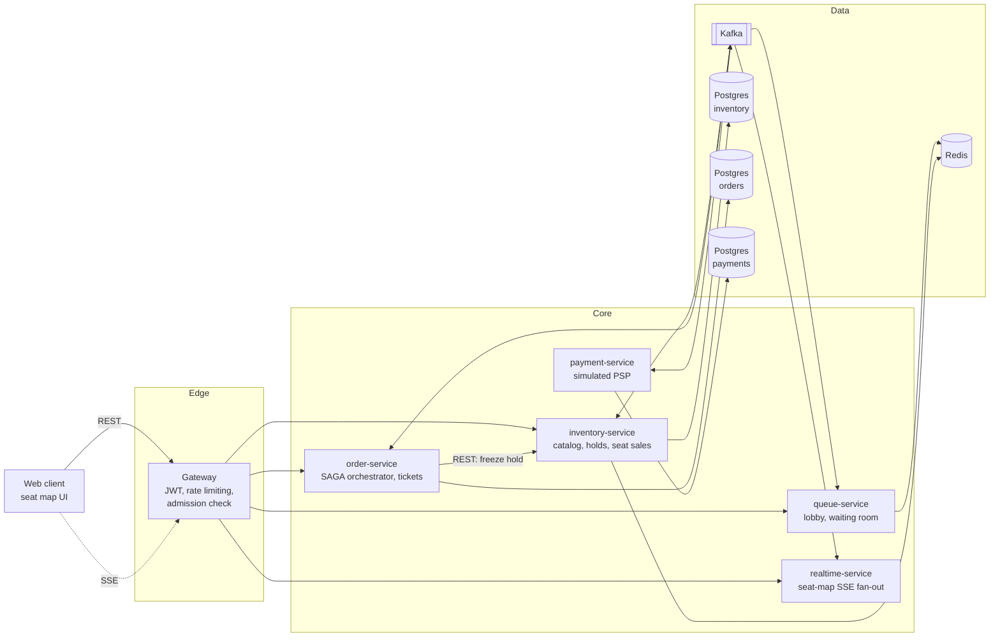
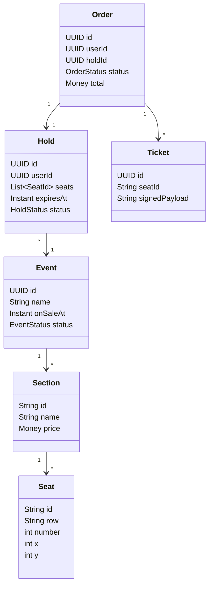
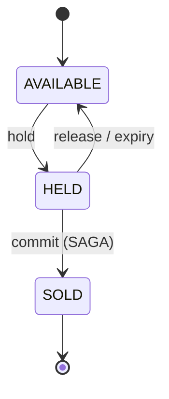
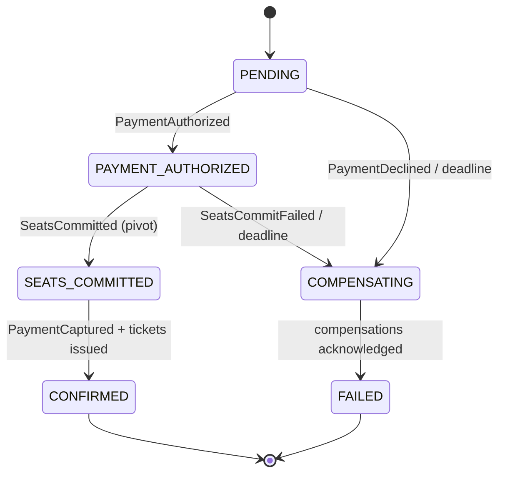
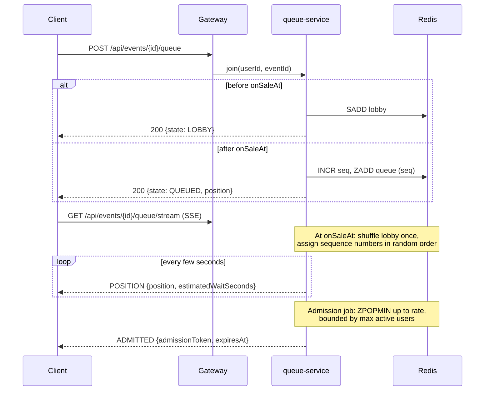
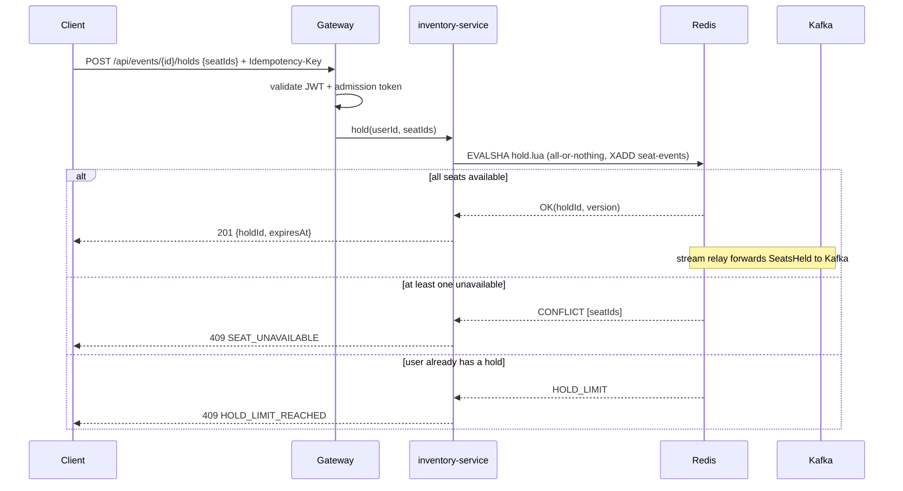
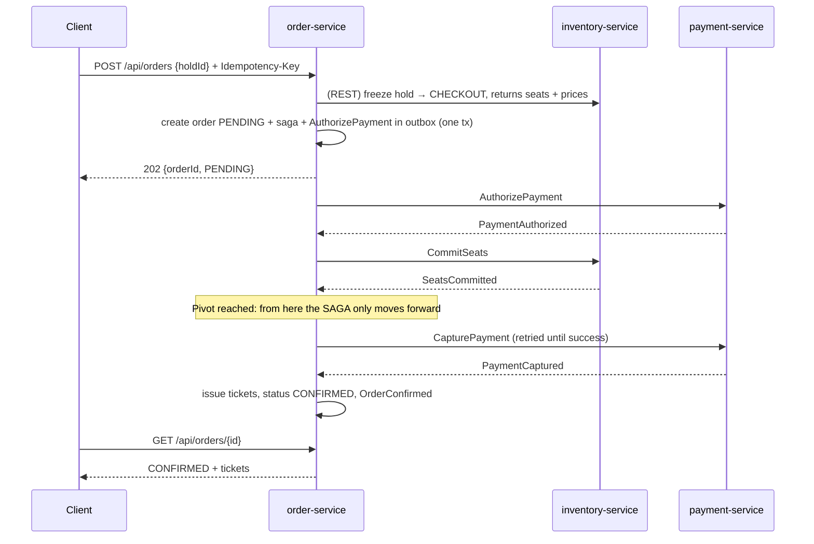

# SeatRush

**A distributed ticketing platform for high-demand "flash" on-sales: fair waiting room, zero overselling under extreme contention, and a real-time seat map.**

[](https://github.com/gianlucat97/seatrush/actions/workflows/ci.yml)

> Status: 🚧 under active development. This document is the technical specification of the system; values marked *Target* are goals that will be validated by the benchmark suite.

---

## Table of Contents

1. [The Problem](#1-the-problem)
2. [Goals and Non-Goals](#2-goals-and-non-goals)
3. [Glossary](#3-glossary)
4. [Core Invariants](#4-core-invariants)
5. [Architecture Overview](#5-architecture-overview)
6. [Services](#6-services)
7. [Domain Model](#7-domain-model)
8. [Key Flows](#8-key-flows)
9. [Consistency and Concurrency Strategy](#9-consistency-and-concurrency-strategy)
10. [Messaging (Kafka)](#10-messaging-kafka)
11. [Data Storage](#11-data-storage)
12. [Public API](#12-public-api)
13. [Security](#13-security)
14. [Observability](#14-observability)
15. [Non-Functional Requirements](#15-non-functional-requirements)
16. [Failure Modes](#16-failure-modes)
17. [Testing Strategy](#17-testing-strategy)
18. [Benchmark](#18-benchmark)
19. [Tech Stack](#19-tech-stack)
20. [Repository Structure](#20-repository-structure)
21. [Implementation Guidelines](#21-implementation-guidelines)
22. [Configuration](#22-configuration)
23. [Running Locally](#23-running-locally)
24. [Deployment on Kubernetes](#24-deployment-on-kubernetes)
25. [Architecture Decision Records](#25-architecture-decision-records)
26. [Roadmap](#26-roadmap)
27. [License](#27-license)

---

## 1. The Problem

When tickets for a high-demand event go on sale, hundreds of thousands of users arrive within seconds to compete for a few thousand seats. A naive system fails in predictable ways:

- **Overselling**: two buyers receive the same seat because of race conditions.
- **Collapse under load**: the database becomes the bottleneck and the whole site goes down.
- **Unfairness**: whoever refreshes fastest or runs a bot wins, not whoever arrived first.
- **Ghost inventory**: seats stay locked by users who abandoned checkout.
- **Hoarding**: a single user locks many seats in parallel and blocks everyone else.
- **Inconsistent payments**: a user is charged but receives no ticket, or receives a ticket without being charged.

SeatRush is a reference implementation of a system that solves these problems explicitly, with every design trade-off documented and every guarantee verified under load.

## 2. Goals and Non-Goals

### Goals

- Guarantee that **no seat is ever sold twice**, under any concurrency level and under partial failures.
- Protect the core system with a **fair virtual waiting room** that admits users at a controlled rate.
- Provide **temporary seat holds** with automatic expiry, so abandoned seats return to the pool.
- Implement checkout as an **orchestrated SAGA** across inventory, payment and ticketing, with compensations.
- Push **real-time updates** to clients: queue position, admission, sold-out notice and live seat-map changes.
- Scale horizontally on Kubernetes, with **observability built in** and a **reproducible load test** that proves the guarantees.

### Non-Goals

- Real payment processing: the payment provider is simulated (configurable latency and failure rate).
- Full user management: authentication is a minimal JWT-based stub.
- Secondary market, refunds after purchase, dynamic pricing.
- Advanced bot detection (only rate limiting and one-hold-per-user are in scope).
- Multi-region deployment (single region, documented as future work).

## 3. Glossary

| Term | Meaning |
|------|---------|
| **Event** | A show with a venue layout, sections, prices and an on-sale time. |
| **On-sale** | The moment tickets for an event become purchasable. |
| **Lobby** | Users who arrived *before* the on-sale opens. Their order is randomized at opening time. |
| **Waiting room / queue** | FIFO line of users waiting to be admitted to the purchase area. |
| **Admission** | Being let out of the queue; the user receives an admission token. |
| **Hold** | A temporary, exclusive reservation of 1..N seats with a TTL. |
| **Frozen hold** | A hold whose checkout has started; it no longer expires and is owned by the SAGA. |
| **Checkout SAGA** | The distributed transaction that turns a hold into a confirmed order. |
| **Pivot** | The SAGA step (`CommitSeats`) after which the SAGA can only move forward. |
| **Seat event** | A change of seat state (held, released, sold) broadcast to the live seat map. |

## 4. Core Invariants

These invariants are the contract of the system. Each one is enforced by a specific mechanism and verified automatically by the [invariant checker](#171-the-invariant-checker) after every load test. Five of them are checked there; the other three are properties of an instant rather than of an end state, and are proved by the tests of [section 17](#17-testing-strategy) instead.

| ID | Invariant | Enforced by |
|----|-----------|-------------|
| **I1** | A seat is sold at most once per event. | Postgres primary key on `seat_sale(event_id, seat_id)` (final guard), Redis atomic Lua scripts (fast path) |
| **I2** | A seat has at most one active hold at any time. | Atomic all-or-nothing hold Lua script |
| **I3** | A confirmed order always has its seats sold and its payment captured. | SAGA orchestrator with pivot-transaction design |
| **I4** | A failed order never leaves seats sold or a payment captured. | SAGA compensations (release hold, void payment), late-reply handling |
| **I5** | Repeating the same request or message never produces duplicate effects. | `Idempotency-Key` header on commands, `processed_message` table for consumers |
| **I6** | Users who joined after the on-sale opened are admitted in arrival order. | Monotonic sequence counter (`INCR`) as queue score |
| **I7** | No unfrozen hold lives beyond its TTL; no SAGA lives beyond its deadline without being resolved. | Hold expiry sweeper, SAGA timeout scheduler |
| **I8** | A user has at most one active hold per event. | `userhold` key checked inside the hold Lua script |

## 5. Architecture Overview



**Design principles**

- **Database per service.** Each service owns its data; cross-service communication happens through Kafka commands/events, plus one explicit synchronous REST call (freeze hold) where the user is waiting for an answer.
- **Fast path in memory, final guarantee in the database.** Redis absorbs the contention of the hold phase; Postgres constraints are the last line of defence for selling.
- **Synchronous where the user waits, asynchronous elsewhere.** Holds are synchronous (immediate yes/no); checkout is asynchronous (`202 Accepted` + status polling).
- **Every state change and its event are atomic.** Changes in Postgres use a transactional outbox table; changes in Redis append to a Redis Stream *inside the same Lua script*. A relay forwards both to Kafka.
- **Everything is observable and measurable.** Every invariant has a corresponding metric.

## 6. Services

### 6.1 Gateway (`services/gateway`)

Single entry point for clients. Built on Spring Cloud Gateway (reactive), so it can hold many long-lived SSE connections cheaply.

- Validates user JWTs on every request, except `POST /api/auth/demo-login` and the actuator endpoints a probe calls.
- Validates **admission tokens** on purchase commands only (`POST /holds`, `DELETE /holds/{id}`, `POST /orders`). Reads (`GET /orders/{id}`) need only the user JWT, so a user can follow an order even after the admission token has expired.
- Token-bucket **rate limiting per user and per IP**, backed by Redis.
- Removes any client-supplied `X-User-Id` header and sets it from the validated JWT. The removal happens on every request, including the ones that need no token, because that header is what every service behind the gateway trusts completely.
- Presented in `X-Admission-Token`, an admission is checked three ways before a purchase command is forwarded: that this deployment signed it and it has not lapsed, that its subject is the caller rather than somebody who passed it on, and, where the path names an event, that it is for that sale. `DELETE /holds/{id}` and `POST /orders` name a hold and an order instead, whose event is known to the services that own them, so ownership is checked there rather than read here to repeat a check somebody else makes. The header is dropped before the request is forwarded, since the only thing that validates an admission is the only thing that needs to see one.
- Refuses with the Problem Details of [§12.6](#126-error-codes): `401 UNAUTHENTICATED` for a missing or invalid token, `403 FORBIDDEN` for an admin endpoint without the role, `403 ADMISSION_REQUIRED` for a purchase command without a turn. Which check failed stays in the log, because only an attacker learns anything from being told.
- Routes requests to downstream services, propagates trace context and streams SSE responses without buffering.

### 6.2 Queue Service (`services/queue-service`)

Implements the lobby and the FIFO virtual waiting room.

- **Lobby**: users who join before `onSaleAt` are put in a lobby set. At opening time, the lobby is **shuffled once** and appended to the queue in that random order (arriving early gives no advantage over arriving a minute early; this prevents a "refresh at midnight" race). Users joining after opening are appended in arrival order.
- **What opens the doors** is inventory reporting the event as `ON_SALE`, not this service's clock (ADR-0015). Inventory warms the seat map into Redis as part of that transition, so a lobby drained a second early by a local clock would put buyers in front of a sale that still refuses them. queue-service polls the catalog (`seatrush.queue.catalog-refresh-interval`) and keeps serving the last answer it got if inventory is unreachable, because the users waiting are precisely the ones whose sale is about to open.
- **Shuffled in the service, not in Lua**: Redis makes `math.random` deterministic so that a replica replaying a script reaches the same state, which would turn the shuffle into a fixed permutation that merely looks fair. The order is produced with `SecureRandom` and passed in; `SREM` on the lobby set is the claim, so every pod may drain the same lobby at once without a leader and each user still gets exactly one sequence number.
- **Sequence numbers**: each queued user receives a strictly increasing sequence number from `INCR` (no timestamp ties). The queue is a sorted set scored by sequence.
- **Admission job**: runs every second, pops up to `rate-per-second` users (`ZPOPMIN`), but never lets more than `max-active-users` be inside the purchase area at the same time. It also stores the highest admitted sequence (`head`). Freeing the slots whose admission has expired happens in the same script as filling them, because the room to admit somebody is exactly what the freeing just made; there is therefore no interval during which the count of active buyers is known to be wrong. It runs on every pod with no leader: `ZPOPMIN` takes a user off the queue for exactly one caller, so pods share a batch rather than admitting a buyer twice, at the cost of the rate being per pod.
- **Position**: computed as `mySeq - head` (O(1), no `ZRANK` on 200k entries). It is an upper bound that never increases; users who leave make it slightly pessimistic, which is acceptable.
- **Estimated wait**: `position / observedAdmissionRate`, using a moving average of the actual admission rate. The rate is measured from how far `head` moved between two passes rather than from what one pod admitted, so it is the rate of the whole deployment; the configured `rate-per-second` is only the fallback before anything has been observed, which is the right guess precisely then, because a purchase area that is still empty really is admitting at its ceiling.
- **Admission token**: signed JWT with `userId`, `eventId`, short TTL, pushed over SSE and also retrievable with a polling endpoint (`GET .../queue/me`) for clients that lost the stream. It is **minted on read from the slot, never stored** (ADR-0016): the expiry it carries is the score of the slot in `active:{evt:<id>}`, so the two end at the same instant, and a client that missed a push, lost its stream or reloaded the page gets a working admission simply by asking again. A buyer whose admission has lapsed is still reported as `ADMITTED` and handed no token, which is what tells a client its time is up rather than leaving it to wonder why its token stopped working.
- **Slot release**: an active slot is freed when the admission token expires (sorted set scored by expiry) or when the user's order reaches a terminal state. `OrderConfirmed` and `OrderFailed` do the same thing here, because a confirmed checkout and a failed one are opposite news for the buyer and the same news for the waiting room; the expiry would have freed the slot anyway, so what consuming `order.events` buys is the minutes in between, and during an on-sale those are the next person's turn. Nothing guards against a redelivery and nothing has to: this service owns no database to claim a message in, and removing a member from a sorted set twice removes it once. The one thing it costs is stated plainly: the token that buyer already holds keeps working until it expires, because a bearer token cannot be recalled, so `max-active-users` is a cap on slots rather than on tokens. Overselling does not depend on it, being protected by the one hold per user per event and by the Postgres guard.
- **Stream**: `GET .../queue/stream` pushes the same place `GET .../queue/me` answers, every time it changes. One pass per `seatrush.queue.position-update-interval` reads one number per sale, the admission head, and places every listener of that sale by subtracting it from the sequence they already hold; ten thousand clients on a pod cost one read rather than ten thousand. Only changes are sent: a position that has not moved is not news, and a listener that has heard nothing for `seatrush.sse.heartbeat-interval` gets a comment instead, which is what keeps a proxy from dropping the connection. The registry of listeners is per pod and deliberately so, since a connection belongs to the pod holding it; nothing of it is state, because the queue lives in Redis and a client that reconnects elsewhere is told the same thing.
- **End of a stream**: an admission, an admission that has lapsed and a sold-out sale are all final. The stream sends the message and closes, so the connection goes back to the pool for the next sale rather than being held by somebody who is already shopping.
- **Sold-out**: when the catalog reports the event as `SOLD_OUT`, every waiting client receives a `SOLD_OUT` SSE message and the waiting room is closed: the lobby set and the queue sorted set are deleted, which is where a flash on-sale left two hundred thousand members each. The status and not the `EventSoldOut` message is what this service follows, for the reason of ADR-0015: a status is true for every pod at every moment, while a message consumed once is known only to the pod that was running when it arrived. The counters and the per-user keys are left alone, the second lot because they expire by themselves and both because a client that polls after the sale closed still gets a coherent answer out of them.
- Joining twice returns the existing position (idempotent join).

### 6.3 Inventory Service (`services/inventory-service`)

Owns events, venue layout, seat state, holds and the final record of sales.

- **Catalog**: events, sections, seats, plus a generator that creates a venue layout of configurable size for demos and benchmarks.
- **On-sale warm-up**: when an event is opened for sale, its seat map is loaded from Postgres into Redis (all seats `AVAILABLE`, except those already in `seat_sale`). Holds are refused for events that are not `ON_SALE`.
- **Opening the doors**: a `SCHEDULED` event whose `onSaleAt` has passed is moved to `ON_SALE` on a schedule, so a sale announced for a moment opens at that moment without anybody acting. The seat map is warmed up first and the status moves second, never the other way round, because a hold is only accepted for an event that is `ON_SALE` and there must be no instant in which buyers are let at a seat map that is not there. That order is also why the pass claims the rows it opens with `FOR UPDATE SKIP LOCKED` rather than running freely on every pod: two pods opening one sale would both warm up, and the loser's warm-up landing after the winner's status change would wipe holds buyers had already taken. The admin endpoint of [§12.2](#122-events-and-seat-map) still forces a sale open for demos and benchmarks, which is a different thing and deliberately so.
- **Holds**: atomic hold of 1..N seats (max configurable, default 6) via a Redis Lua script. All-or-nothing: if any seat is unavailable, nothing is held. A user can have only one active hold per event (I8).
- **Hold expiry**: a sweeper releases expired holds (see [§9.3](#93-hold-expiry)).
- **Freeze**: synchronous internal endpoint called by order-service; moves the hold from `ACTIVE` to `CHECKOUT` and returns the seats with their prices.
- **Seat commit**: on `CommitSeats` command, writes `seat_sale` rows in Postgres, then marks the seats sold in Redis (see [§9.6](#96-seat-commit-procedure)).
- **Seat map snapshot**: current state of all seats of an event with its `version`, used by clients for the initial render.
- **Seat events**: Lua scripts append `SeatsHeld`, `SeatsReleased`, `SeatsSold` to a per-event Redis Stream; a stream relay forwards them to Kafka.
- **Sold-out detection**: the sale that takes the last seat decides it, inside `markSold.lua` and in the same step that sells the seats, because that is the only instant at which the answer cannot be argued with and a sale is the only thing that can make it yes. The condition is the one of [§9.2](#92-redis-key-design) read with three O(1) commands: nothing available, no hold counting down and no hold in a checkout. A held seat is deliberately not counted as gone, since it may still be released. The script appends `EventSoldOut` to the seat event stream, so the announcement travels with the sale that caused it, and the commit then sets the event status to `SOLD_OUT`, which is what refuses further holds and closes the waiting room. The reconciler asks the same question of every event still on sale, because a pod dying between the two halves would otherwise leave a sold out event on sale for ever: there is no next sale to notice it.
- **Reconciler**: on startup and periodically, verifies that every `seat_sale` row is `SOLD` in Redis and fixes Redis if not (Postgres is the source of truth for sales).
- **Rebuild procedure**: on Redis data loss, seat state is rebuilt from Postgres and active holds are dropped (safe: holds are temporary by definition; frozen holds are recovered from the SAGA side, see [§16](#16-failure-modes)).

### 6.4 Order Service (`services/order-service`)

Orchestrates checkout and issues tickets.

- Accepts `POST /api/orders` with a `holdId` and an `Idempotency-Key`. It synchronously freezes the hold in inventory (fails fast with `410 HOLD_EXPIRED` or `409 HOLD_ALREADY_USED`), creates the order with the prices returned by inventory (inventory is the only source of prices), and responds `202 Accepted` with the order in `PENDING`.
- Runs the **checkout SAGA** as a persistent state machine stored in `saga_instance`, advanced by reply messages.
- Issues **tickets** with a signed payload (suitable for a QR code) once the order is confirmed.
- Enforces a **checkout deadline** on the steps before the pivot (see [§8.3](#83-checkout-saga-orchestrated)).
- Handles **late replies** for SAGAs already terminated (e.g. a `PaymentAuthorized` arriving after a timeout triggers a `VoidPayment`).
- Publishes `OrderConfirmed` / `OrderFailed` on `order.events`.

### 6.5 Payment Service (`services/payment-service`)

Simulates a payment service provider.

- Supports `Authorize`, `Capture` and `Void`, each idempotent by `(orderId, operation)`.
- `Void` on a non-authorized order is a successful no-op (makes compensation safe to repeat and safe to send blindly).
- Configurable **latency distribution** and **decline rate**, changeable at runtime through an internal endpoint, to exercise compensations under load.
- Persists every operation for audit and for the invariant checker.

### 6.6 Realtime Service (`services/realtime-service`)

Pushes live seat-map updates to clients.

- Consumes `inventory.seat-events` with a **unique consumer group per pod** (broadcast pattern): every pod receives every seat event and serves its own connected clients. Starts from the latest offset; clients catch up via snapshot. The group is named afresh at every start rather than after the pod, because what a starting pod wants is the changes from now on: a group that remembered an offset would replay minutes of seat events to clients holding a fresh snapshot, and every one of those deltas would be discarded by version on arrival.
- Keeps in-memory subscriber registries per event. Two connections of the same user are two live streams, unlike the waiting room where the second replaces the first: a place in a queue is one per person, a seat map is the same for everybody.
- **Batches deltas** (default every 200 ms) to protect clients and network during bursts. A window is a compression and not a buffer: a seat held and released inside one window is one line saying available, and a seat that moved four times is one line saying what it ended up being.
- Each delta carries `fromVersion`/`toVersion` so clients can detect gaps and re-fetch the snapshot. Those two numbers are the whole of the protocol state, so nothing per client is kept here and a client can reconnect to any pod. They also make a redelivered seat event free: the pod drops it by version before it reaches a batch, which is the idempotency of [§9.5](#95-transactional-outbox-postgres-and-redis) done without a `processed_message` table, since this service owns no database.
- `EventSoldOut` flushes the pending batch of that sale at once: the map will never move again, so the seats that took the last of it are not made to wait out a window nothing will arrive in.
- Sends a heartbeat comment every 15 s to keep connections alive through proxies.
- Holds no database, no Redis and no secret, and asks for no identity: the stream says the same thing to every client of a sale, and the gateway has already checked the JWT. A pod can be killed at any moment and the only consequence is that its clients reconnect, reload a snapshot and carry on.

### 6.7 Seat Map UI (`frontend/seat-map-ui`)

Minimal web client used for demos. TypeScript, React and Vite, with its own README in
`frontend/seat-map-ui`.

- Join the queue (lobby before opening), see position and estimated wait, get admitted or receive the sold-out notice. Six states and one panel, because an answer from [§12.3](#123-waiting-room) says which state somebody is in by which of its fields are present: `ADMITTED` with no token is a turn that came and went, and the answer to it is to join again rather than to wait or to retry. Joining is a button and never automatic, so a spectator takes no slot in anybody's purchase area.
- Counts down what nobody will push. The waiting room stream ends itself when a buyer is admitted, so the moment their slot expires is something only the clock knows: the page says so before the gateway says it by refusing a hold.
- Render the venue as an SVG seat map that updates live (available / held / sold, own hold highlighted). SVG and not a canvas, because a seat is a thing a person points at: a rectangle can already be clicked, focused and read out by a screen reader. The `viewBox` is measured from the seats themselves, so one component draws a club of two hundred seats and a stadium of fifty thousand.
- Select seats, hold them (with countdown), check out, see the order result and the signed ticket. The selection is pruned by the seat map itself: the map moves under a selection by design and a hold is all or nothing, so one seat taken by somebody else is a checkout that cannot start, and a buyer watches that seat leave their selection rather than finding out when they pay.
- Draws the pivot of [§8.3](#83-checkout-saga-orchestrated), which is the only thing the checkout panel has to get right. Before `CommitSeats` the page promises nothing, because the hold and the authorization can both still be given back. From `SEATS_COMMITTED` on it says the seats are the buyer's even though the order is not confirmed, because the SAGA cannot go back: an order sitting there because a payment provider is slow is a buyer who owns their seats and is waiting for paper. `COMPENSATING` is the mirror of that and reads as an outcome rather than as more waiting.
- Keeps an `Idempotency-Key` for exactly as long as an attempt is unresolved. A new key on a retry after a timeout is how a buyer ends up holding two sets of seats; a key kept after a definite answer is how a buyer who picks the same seats again, an expired hold later, is handed back the dead hold from the first attempt. A `503` is safe to retry with the same key ([§12.6](#126-error-codes)), and that is the case this exists for.
- Treats two refusals as recoveries rather than as errors. `HOLD_LIMIT_REACHED` carries the hold the buyer already has, which is the only way a page that lost its hold id gets it back, since no endpoint answers "my hold for this sale"; `SEAT_UNAVAILABLE` carries the seats that went, so losing one seat of six is one more click rather than starting again.
- Outlives the turn that started it. A hold lasts five minutes and an admission ten, so a hold taken late in a turn can still be live when the turn ends: the page says the seats are held and cannot be paid for rather than leaving a button that would be refused. An order is different again, because reading one takes no admission at all, so a buyer whose slot expired mid-SAGA keeps watching their order reach `CONFIRMED` and still collects their tickets.
- An order is followed by reading it rather than by a stream, because [§12.5](#125-orders) has none: the `Location` header is the API saying so. The interval starts short and backs off, since the common case settles inside a second and the pathological one is an order past the pivot waiting on capture retries that themselves back off to a minute.
- **Spectator mode**: live seat map only, to watch a load test fill the venue in real time. It is the same page with the venue given the whole window, reached at `#/events/{id}/spectator` so that watching from a second browser is a link somebody can paste. A spectator signs in too: the gateway validates a token on every read, so there is no anonymous view of a seat map.
- The three rules of [§8.4](#84-live-seat-map) live in one pure module over a map and a delta, with no fetch and no framework in it, because being wrong about them would show somebody a seat that is gone as one they can buy. What decides when to apply them, including the reconnect, is the hook beside it.
- Streams are read with `fetch` rather than with `EventSource`, which cannot set a header. The alternative was a credential in the query string, which every access log between the browser and the pod would keep.
- The dev server proxies `/api` to the gateway, so the page always talks to its own origin. That is why there is no CORS configuration anywhere in this repository: in the deployed stack the page and the API are served from one origin, and a dev server that fetched the gateway directly would exercise a path production does not have.

## 7. Domain Model



**Event states**: `DRAFT` → `SCHEDULED` (lobby open) → `ON_SALE` → `SOLD_OUT` | `CLOSED`.

**Seat state machine** (per seat, in Redis; `SOLD` is also persisted in Postgres):



**Hold states**: `ACTIVE` → `CHECKOUT` (frozen, not subject to expiry) → `CONSUMED` | `RELEASED`; or `ACTIVE` → `RELEASED` | `EXPIRED`.

**Order states**:



`FAILED` orders carry a `failureReason`: `PAYMENT_DECLINED`, `SEATS_UNAVAILABLE`, `TIMEOUT`. (Expired or already used holds are rejected synchronously at `POST /orders` and never create an order.)

## 8. Key Flows

### 8.1 Lobby, Waiting Room and Admission



### 8.2 Seat Hold



### 8.3 Checkout SAGA (orchestrated)



**Compensations**

| Trigger | Compensation | Final state |
|---------|--------------|-------------|
| `PaymentDeclined` | `ReleaseHold` | `FAILED (PAYMENT_DECLINED)` |
| `SeatsCommitFailed` (constraint violation, hold not in `CHECKOUT`) | `VoidPayment` + `ReleaseHold` | `FAILED (SEATS_UNAVAILABLE)` |
| Deadline reached in `PENDING` or `PAYMENT_AUTHORIZED` **before `CommitSeats` was sent** | `VoidPayment` (always, it is a safe no-op) + `ReleaseHold` | `FAILED (TIMEOUT)` |
| `CapturePayment` failure after pivot | No compensation: retry with exponential backoff; alert if retries are exhausted | stays `SEATS_COMMITTED` until captured |

**Deadline rules**

- The deadline applies only while the SAGA is waiting for `PaymentAuthorized`. Once `CommitSeats` has been sent, the SAGA waits for its reply indefinitely (inventory always replies, and the command is retried by Kafka redelivery). This avoids the race "timeout fires while the commit is succeeding".
- **Late replies** to a SAGA in `COMPENSATING` or `FAILED`: a late `PaymentAuthorized` triggers another `VoidPayment`; other late replies are logged and ignored.

`CommitSeats` is the **pivot transaction**: compensatable steps come before it, retriable steps after it. This guarantees I3 and I4.

### 8.4 Live Seat Map

1. Client calls `GET /api/events/{id}/seatmap` → snapshot with `version`.
2. Client opens `GET /api/events/{id}/seatmap/stream` (SSE).
3. realtime-service sends batched deltas `{fromVersion, toVersion, changes:[{seatId, status}]}`. No event id: one stream is one seat map and the client named it in the URL it opened.
4. Deltas with `toVersion` ≤ local version are ignored; if `fromVersion` > local version + 1 (gap), the client reloads the snapshot.
5. A sale realtime has never heard of is a quiet stream rather than a 404: that service holds no catalog, so an unknown event and one where nothing is happening are indistinguishable from it, and a spectator who opens a venue before its sale begins is not turned away. The client has already been told by the snapshot it could not load.

## 9. Consistency and Concurrency Strategy

### 9.1 Two layers of protection against overselling

1. **Fast path (Redis)**: the hold Lua script checks and changes the state of all requested seats atomically. Redis executes scripts serially, so there is no race between concurrent holds. This layer absorbs all of the contention.
2. **Final guard (Postgres)**: `CommitSeats` inserts one row per seat into `seat_sale` with primary key `(event_id, seat_id)`. Even if Redis lost data or a bug produced a double hold, the database rejects the second sale and the SAGA compensates.

The `seatrush_oversell_prevented_total` metric counts how many times layer 2 had to intervene. In a correct run it is 0; a non-zero value is a bug in layer 1, caught safely.

### 9.2 Redis key design

All keys of an event share the hash tag `{evt:<eventId>}`, so multi-key Lua scripts work on Redis Cluster (same slot).

| Key | Type | Content |
|-----|------|---------|
| `seats:{evt:<id>}` | HASH | `seatId → A` (available) \| `H:<holdId>` \| `S` (sold) |
| `seats:{evt:<id>}:version` | STRING | monotonic version of seat state |
| `seats:{evt:<id>}:available` | STRING | counter of available seats (sold-out detection) |
| `hold:{evt:<id>}:<holdId>` | HASH | `userId`, `seats`, `expiresAt`, `status`, `orderId` |
| `holds:{evt:<id>}:expiry` | ZSET | `ACTIVE` holdIds scored by `expiresAt` |
| `holds:{evt:<id>}:checkout` | ZSET | `CHECKOUT` holdIds scored by the instant they were frozen, read by the reconciler |
| `userhold:{evt:<id>}:<userId>` | STRING | holdId of the user's active hold (I8) |
| `idem:{evt:<id>}:<userId>:<key>` | STRING | stored response of a hold command, TTL 24h |
| `seat-events:{evt:<id>}` | STREAM | seat events waiting to be relayed to Kafka (capped with `MAXLEN ~`) |
| `lobby:{evt:<id>}` | SET | users waiting before on-sale |
| `queue:{evt:<id>}` | ZSET | `userId` scored by sequence number |
| `queue:{evt:<id>}:seq` | STRING | sequence counter |
| `queue:{evt:<id>}:head` | STRING | highest admitted sequence |
| `queue:{evt:<id>}:user:<userId>` | STRING | user's sequence (idempotent join, position), TTL 24h |
| `active:{evt:<id>}` | ZSET | admitted `userId` scored by admission expiry |
| `ratelimit:<scope>:<key>` | HASH | token bucket state (not event-scoped) |

**Trade-off (ADR-0002)**: one event lives on one Redis slot, therefore one shard. A single Redis shard comfortably handles the hold rate of one on-sale (bounded by the admission rate); if needed, the tag can be moved to `{evt:<id>:sec:<sectionId>}`, at the cost of limiting a hold to seats of one section.

**hold.lua (pseudocode)**

```
if GET idem:<user>:<key> exists: return stored response
if GET userhold:<user> exists: return HOLD_LIMIT
for each seatId in ARGV.seats:
    if HGET seats seatId != "A": return CONFLICT(seatId)
for each seatId: HSET seats seatId "H:" .. holdId
DECRBY available #seats
HSET hold:<holdId> userId, seats, expiresAt, status=ACTIVE
ZADD holds:expiry expiresAt holdId
SET userhold:<user> holdId
version = INCR seats:version
XADD seat-events MAXLEN ~ 100000 * type SeatsHeld seats ... version
SET idem:<user>:<key> response EX 86400
return OK(holdId, version)
```

Companion scripts:

| Script | Effect |
|--------|--------|
| `release.lua` | `ACTIVE`/`CHECKOUT` → `RELEASED`; seats back to `A`; clears `userhold`; `SeatsReleased` |
| `expire.lua` | Like release, but only if status is still `ACTIVE` and `expiresAt` ≤ now; otherwise no-op |
| `freeze.lua` | `ACTIVE` → `CHECKOUT`, stores `orderId`, moves the hold from the expiry set to the checkout set; idempotent for the same `orderId`; fails if expired or frozen by another order |
| `markSold.lua` | `CHECKOUT` → `CONSUMED`; seats → `S`; clears `userhold`; leaves the checkout set; `SeatsSold`, plus `EventSoldOut` if this sale took the last seat; idempotent for the same `orderId` |

Note: a released or sold seat increments/decrements `available` accordingly; when `available` reaches 0 *and* no seat is held, the event is sold out. `markSold.lua` checks exactly that on its way out, reading `available` and then the `ZCARD` of the two hold sets, which is why the held seats are countable without reading the seat map, and appends `EventSoldOut` to the stream when the sale it just made was the last one.

### 9.3 Hold expiry

Redis keyspace notifications are not reliable (fire-and-forget, lost on disconnect), so they are **not** used (ADR-0008). Instead:

- A sweeper in inventory-service runs every second, reads `ZRANGEBYSCORE holds:expiry -inf <now> LIMIT 0 500` and runs `expire.lua` for each result.
- `expire.lua` is a no-op if the hold is no longer `ACTIVE`, so the sweeper is safe to run on **multiple pods concurrently** without leader election.
- Frozen holds are never expired by the sweeper: the SAGA owns them and always ends with either `CommitSeats` or `ReleaseHold`.

### 9.4 Idempotency

- **HTTP commands** (`POST /holds`, `POST /orders`) require an `Idempotency-Key` header (UUID). The key and the response are stored (Redis for holds, the `customer_order` unique constraint for orders); a repeated request returns the original response. The same key with a different body returns `422 IDEMPOTENCY_KEY_REUSED`.
- **A repeated checkout whose freeze outlived it** is the one case the constraint above cannot answer on its own, and it is what the load test of [§18.1](#181-scenario) found. Starting a checkout is two steps: the hold is frozen for an order id, and then the order is written. The id is minted per attempt, the freeze is idempotent for the same id rather than for the same request, and the order row is where the key is recorded, so an attempt that died between the two leaves the hold frozen for an id nobody kept and no key recorded anywhere. The repeat the contract invites would then ask for a hold that is already frozen and be refused. It is not: inventory's `HOLD_ALREADY_USED` carries the order the hold is frozen for, and order-service asks whether such an order exists. If it does, this is a second checkout of one hold and the refusal stands. If it does not, the freeze outlived the attempt that made it, so the hold is frozen again for that id, which is the idempotent case, and the order is written under it. The orphan is adopted rather than left behind, which is also the state the invariant checker of [§17.1](#171-the-invariant-checker) reports when nobody retries.
- **Kafka consumers** record each processed `messageId` in a `processed_message` table **in the same transaction** as the business change. Duplicates are skipped.
- **Payment operations** are idempotent by `(orderId, operation)` with a unique constraint.
- **Lua scripts** for freeze, release and mark-sold are idempotent by design.

### 9.5 Transactional outbox (Postgres and Redis)

A service never changes state and publishes to Kafka as two independent operations.

- **Postgres outbox**: the business change and an `outbox` row are written in **one transaction**. A polling relay publishes pending rows using `SELECT ... FOR UPDATE SKIP LOCKED` (multiple pods can relay in parallel) and marks them as published.
- **Redis outbox**: Lua scripts append the seat event to the per-event stream `seat-events:{evt:<id>}` in the same atomic script. A stream relay reads it with a consumer group (`XREADGROUP`), publishes to Kafka and acknowledges with `XACK`; pending entries of a dead consumer are claimed with `XAUTOCLAIM`.
- Delivery guarantee: at-least-once in both cases; duplicates are handled by consumer idempotency (seat events carry the seat-state `version`, so realtime ignores duplicates by version).
- Ordering: per aggregate key (`orderId` for SAGA messages, `eventId` for seat events).

### 9.6 Seat commit procedure

On `CommitSeats(orderId, holdId)`:

1. Check in Redis that the hold is `CHECKOUT` for this `orderId`. If it is already `CONSUMED` for this order, reply `SeatsCommitted` (redelivery). Otherwise, if not valid, reply `SeatsCommitFailed`.
2. In **one Postgres transaction**: insert `seat_sale` rows, insert `processed_message`, insert the `SeatsCommitted` reply into the outbox.
3. If the transaction fails with a primary key violation: increment `seatrush_oversell_prevented_total`, then in a new transaction write `SeatsCommitFailed` to the outbox.
4. After commit, run `markSold.lua` (seats `S`, hold `CONSUMED`, `SeatsSold` stream event, plus `EventSoldOut` and the move to `SOLD_OUT` if this sale took the last seat of the event).
5. If the pod dies between steps 2 and 4, the seats are sold in Postgres but still held in Redis: nobody else can take them, and the **reconciler** applies `markSold.lua` on the next run. No overselling is possible in any interleaving.
6. If it dies between the script and the status change, the seat map says sold out and the catalog still says on sale. The reconciler closes that too, by asking every event still on sale whether anything is left to sell.

### 9.7 SAGA persistence

- `saga_instance` stores current step, status, deadline, retry count and an optimistic-locking `version`.
- Each reply advances the SAGA in one transaction: update state + write next command to the outbox + mark the message processed.
- A timeout scheduler (multi-pod safe via `SKIP LOCKED`) picks SAGAs past their deadline and starts compensation, following the deadline rules of [§8.3](#83-checkout-saga-orchestrated).
- Capture retries after the pivot are scheduled through `next_attempt_at`, picked by the same scheduler.

## 10. Messaging (Kafka)

The JSON Schema of every message below is published under [`docs/messages/`](docs/messages/index.md), generated from the records and checked against them by the build ([§17.3](#173-the-message-schemas)).

### 10.1 Topics

| Topic | Key | Partitions | Producers | Consumers | Messages |
|-------|-----|-----------|-----------|-----------|----------|
| `inventory.seat-events` | `eventId` | 12 | inventory (stream relay) | realtime, queue | `SeatsHeld`, `SeatsReleased`, `SeatsSold`, `EventSoldOut` |
| `inventory.commands` | `orderId` | 12 | order | inventory | `CommitSeats`, `ReleaseHold` |
| `inventory.replies` | `orderId` | 12 | inventory | order | `SeatsCommitted`, `SeatsCommitFailed`, `HoldReleased` |
| `payment.commands` | `orderId` | 12 | order | payment | `AuthorizePayment`, `CapturePayment`, `VoidPayment` |
| `payment.replies` | `orderId` | 12 | payment | order | `PaymentAuthorized`, `PaymentDeclined`, `PaymentCaptured`, `PaymentVoided` |
| `order.events` | `orderId` | 12 | order | queue (slot release) | `OrderConfirmed`, `OrderFailed` |
| `<topic>.dlq` | same | 3 | consumers | operators | poison messages after retries |

Keying by `orderId` guarantees ordering of all messages of the same SAGA; keying seat events by `eventId` guarantees ordered seat-map updates per event. Topics are created by an init job (local: Compose service; Kubernetes: Helm hook), never by auto-creation.

### 10.2 Message envelope

```json
{
  "messageId": "uuid",
  "type": "PaymentAuthorized",
  "schemaVersion": 1,
  "occurredAt": "2026-01-01T12:00:00Z",
  "correlationId": "orderId",
  "causationId": "messageId of the triggering message",
  "traceparent": "W3C trace context",
  "payload": { }
}
```

### 10.3 Message payloads

| Type | Payload |
|------|---------|
| `AuthorizePayment` | `orderId, userId, amountCents, currency` |
| `CapturePayment` / `VoidPayment` | `orderId` |
| `PaymentAuthorized` / `PaymentCaptured` / `PaymentVoided` | `orderId, paymentOperationId` |
| `PaymentDeclined` | `orderId, reason` |
| `CommitSeats` | `orderId, eventId, holdId, seatIds[]` |
| `ReleaseHold` | `orderId, eventId, holdId` |
| `SeatsCommitted` | `orderId, eventId, seatIds[]` |
| `SeatsCommitFailed` | `orderId, eventId, reason, conflictingSeatIds[]` |
| `HoldReleased` | `orderId, holdId` |
| `SeatsHeld` / `SeatsReleased` / `SeatsSold` | `eventId, seatIds[], version, holdId` |
| `EventSoldOut` | `eventId` |
| `OrderConfirmed` / `OrderFailed` | `orderId, userId, eventId, failureReason?` |

- Serialization: JSON with explicit `schemaVersion`; message classes live in `libs/messaging` and are shared by producers and consumers. JSON Schemas are generated into `docs/messages/` (Avro + Schema Registry is deferred, ADR-0007).
- Consumer error handling: bounded retries with backoff, then DLQ. Business rejections (e.g. payment declined) are **reply messages**, not errors.
- Producers: `acks=all`, idempotent producer enabled.

## 11. Data Storage

Locally a single Postgres instance hosts three databases (`inventory`, `orders`, `payments`); on Kubernetes they can be separate instances. Each service only has credentials for its own database. Schema migrations are managed with **Flyway**, one migration folder per service.

### 11.1 Inventory database

```sql
CREATE TABLE event (
    id           UUID PRIMARY KEY,
    name         TEXT NOT NULL,
    on_sale_at   TIMESTAMPTZ NOT NULL,
    status       TEXT NOT NULL,            -- DRAFT, SCHEDULED, ON_SALE, SOLD_OUT, CLOSED
    created_at   TIMESTAMPTZ NOT NULL DEFAULT now()
);

CREATE TABLE section (
    event_id     UUID NOT NULL REFERENCES event(id),
    id           TEXT NOT NULL,
    name         TEXT NOT NULL,
    price_cents  BIGINT NOT NULL CHECK (price_cents > 0),
    currency     CHAR(3) NOT NULL,
    PRIMARY KEY (event_id, id)
);

CREATE TABLE seat (
    event_id     UUID NOT NULL,
    id           TEXT NOT NULL,            -- e.g. "A-12-7" (section-row-number)
    section_id   TEXT NOT NULL,
    row_label    TEXT NOT NULL,
    number       INT  NOT NULL,
    x            INT  NOT NULL,            -- layout coordinates for the seat map
    y            INT  NOT NULL,
    PRIMARY KEY (event_id, id),
    FOREIGN KEY (event_id, section_id) REFERENCES section(event_id, id)
);

-- Final guard for invariant I1
CREATE TABLE seat_sale (
    event_id     UUID NOT NULL,
    seat_id      TEXT NOT NULL,
    order_id     UUID NOT NULL,
    sold_at      TIMESTAMPTZ NOT NULL DEFAULT now(),
    PRIMARY KEY (event_id, seat_id),
    FOREIGN KEY (event_id, seat_id) REFERENCES seat(event_id, id)
);
CREATE INDEX seat_sale_order ON seat_sale (order_id);

CREATE TABLE outbox (
    id            BIGSERIAL PRIMARY KEY,
    aggregate_key TEXT NOT NULL,
    topic         TEXT NOT NULL,
    message       JSONB NOT NULL,
    created_at    TIMESTAMPTZ NOT NULL DEFAULT now(),
    published_at  TIMESTAMPTZ
);
CREATE INDEX outbox_unpublished ON outbox (id) WHERE published_at IS NULL;

CREATE TABLE processed_message (
    message_id   UUID PRIMARY KEY,
    processed_at TIMESTAMPTZ NOT NULL DEFAULT now()
);
```

### 11.2 Order database

```sql
CREATE TABLE customer_order (
    id               UUID PRIMARY KEY,
    user_id          UUID NOT NULL,
    event_id         UUID NOT NULL,
    hold_id          UUID NOT NULL UNIQUE,
    status           TEXT NOT NULL,
    failure_reason   TEXT,
    total_cents      BIGINT NOT NULL,
    currency         CHAR(3) NOT NULL,
    idempotency_key  UUID NOT NULL,
    request_hash     TEXT NOT NULL,         -- detects key reuse with a different body
    created_at       TIMESTAMPTZ NOT NULL DEFAULT now(),
    updated_at       TIMESTAMPTZ NOT NULL DEFAULT now(),
    UNIQUE (user_id, idempotency_key)
);
CREATE INDEX customer_order_user ON customer_order (user_id, created_at DESC);

CREATE TABLE order_item (
    order_id     UUID NOT NULL REFERENCES customer_order(id),
    seat_id      TEXT NOT NULL,
    price_cents  BIGINT NOT NULL,
    PRIMARY KEY (order_id, seat_id)
);

CREATE TABLE saga_instance (
    order_id         UUID PRIMARY KEY REFERENCES customer_order(id),
    step             TEXT NOT NULL,
    status           TEXT NOT NULL,        -- RUNNING, COMPENSATING, COMPLETED, FAILED
    deadline_at      TIMESTAMPTZ,          -- NULL once CommitSeats has been sent
    next_attempt_at  TIMESTAMPTZ,          -- capture retries after the pivot
    retries          INT NOT NULL DEFAULT 0,
    -- The compensations still waiting for a reply, as a set: a late PaymentAuthorized sends a
    -- second VoidPayment (§8.3), and a counter would be decremented twice by its acknowledgement
    compensations_pending TEXT NOT NULL DEFAULT '',
    version          BIGINT NOT NULL DEFAULT 0
);
CREATE INDEX saga_deadline ON saga_instance (deadline_at) WHERE status = 'RUNNING';
CREATE INDEX saga_retry ON saga_instance (next_attempt_at) WHERE next_attempt_at IS NOT NULL;

CREATE TABLE ticket (
    id              UUID PRIMARY KEY,
    order_id        UUID NOT NULL REFERENCES customer_order(id),
    event_id        UUID NOT NULL,
    seat_id         TEXT NOT NULL,
    signed_payload  TEXT NOT NULL,
    issued_at       TIMESTAMPTZ NOT NULL DEFAULT now(),
    UNIQUE (event_id, seat_id)             -- second guard against duplicate tickets
);

-- plus outbox and processed_message, same structure as inventory
```

### 11.3 Payment database

```sql
CREATE TABLE payment_operation (
    id           UUID PRIMARY KEY,
    order_id     UUID NOT NULL,
    operation    TEXT NOT NULL,            -- AUTHORIZE, CAPTURE, VOID
    result       TEXT NOT NULL,            -- SUCCEEDED, DECLINED, NOOP
    amount_cents BIGINT,                   -- the amount of the authorization this belongs to
    currency     CHAR(3),                  -- always together with the amount, never without it
    created_at   TIMESTAMPTZ NOT NULL DEFAULT now(),
    UNIQUE (order_id, operation)
);

-- plus outbox and processed_message
```

## 12. Public API

All endpoints are served through the gateway under `/api`. Errors follow **RFC 9457 (Problem Details)** with a stable `code` field. An **OpenAPI 3.1 document is generated per service and published under [`docs/api/`](docs/api/)**, derived from the running service and compared against it by the build ([§17.4](#174-the-api-specifications)). Timestamps are ISO-8601 UTC; money is `{ "amountCents": 4500, "currency": "EUR" }`.

### 12.1 Auth (demo)

| Method | Path | Description |
|--------|------|-------------|
| `POST` | `/api/auth/demo-login` | Body `{ "username": "...", "admin": false }` → `{ accessToken, userId, username, expiresAt }`. The user id is derived from the name, so logging in twice is the same buyer and a benchmark run is repeatable. Enabled only in the `local` and `bench` profiles, by profile rather than by a flag. |

### 12.2 Events and seat map

| Method | Path | Auth | Description |
|--------|------|------|-------------|
| `GET` | `/api/events` | JWT | List events |
| `GET` | `/api/events/{eventId}` | JWT | Event details with sections and prices |
| `GET` | `/api/events/{eventId}/seatmap` | JWT | Snapshot `{ version, seats:[{id, sectionId, x, y, status}] }` |
| `GET` | `/api/events/{eventId}/seatmap/stream` | JWT | SSE: `DELTA {fromVersion, toVersion, changes}`. Served by realtime-service, which is why the gateway routes this one path away from inventory; no admission, since watching a map takes nothing from a sale |
| `POST` | `/api/admin/events` | admin | Create an event with a generated layout `{ name, onSaleAt, sections:[{id, name, priceCents, currency, rows, seatsPerRow}] }` |
| `POST` | `/api/admin/events/{eventId}/schedule` | admin | `DRAFT` → `SCHEDULED` (lobby opens) |
| `POST` | `/api/admin/events/{eventId}/open` | admin | Force on-sale opening now (demos and benchmarks) |

### 12.3 Waiting room

| Method | Path | Auth | Description |
|--------|------|------|-------------|
| `POST` | `/api/events/{eventId}/queue` | JWT | Join (idempotent) → `{ state: LOBBY \| QUEUED \| ADMITTED, position? }` |
| `GET` | `/api/events/{eventId}/queue/me` | JWT | Polling fallback: current state, position, admission token if admitted |
| `GET` | `/api/events/{eventId}/queue/stream` | JWT | SSE: `POSITION {eventId, position, estimatedWaitSeconds}`, `ADMITTED {eventId, admissionToken, admissionExpiresAt}`, `SOLD_OUT {eventId}`. The field names are the ones `queue/me` answers with, so one parser serves both. 404 if the caller is not waiting; the stream ends itself on `ADMITTED` and on `SOLD_OUT` |
| `DELETE` | `/api/events/{eventId}/queue` | JWT | Leave the queue |

### 12.4 Holds

| Method | Path | Auth | Description |
|--------|------|------|-------------|
| `POST` | `/api/events/{eventId}/holds` | JWT + admission | Body `{ seatIds:[...] }`, headers `Idempotency-Key` and `X-Admission-Token` → `201 { holdId, seatIds, expiresAt }` |
| `GET` | `/api/holds/{holdId}` | JWT | Hold details (owner only) |
| `DELETE` | `/api/holds/{holdId}` | JWT + admission | Release the hold (owner only, only if `ACTIVE`), header `X-Admission-Token` |

### 12.5 Orders

| Method | Path | Auth | Description |
|--------|------|------|-------------|
| `POST` | `/api/orders` | JWT + admission | Body `{ holdId }`, headers `Idempotency-Key` and `X-Admission-Token` → `202 { orderId, status: "PENDING" }` with `Location` header |
| `GET` | `/api/orders/{orderId}` | JWT | Order with status, items, total and, if confirmed, tickets (owner only) |
| `GET` | `/api/orders` | JWT | Current user's orders (cursor pagination) |

### 12.6 Error codes

| HTTP | `code` | Meaning |
|------|--------|---------|
| 400 | `VALIDATION_ERROR` | Malformed request, too many seats, seats from another event, missing `Idempotency-Key` |
| 401 | `UNAUTHENTICATED` | Missing or invalid JWT |
| 403 | `ADMISSION_REQUIRED` | No valid admission token for this event |
| 403 | `FORBIDDEN` | Resource belongs to another user, or admin role missing |
| 404 | `NOT_FOUND` | Unknown event, hold or order |
| 409 | `EVENT_NOT_ON_SALE` | Event is not on sale (or sold out) |
| 409 | `SEAT_UNAVAILABLE` | At least one seat is held or sold (`conflictingSeatIds` in the body) |
| 409 | `HOLD_LIMIT_REACHED` | User already has an active hold for this event |
| 409 | `HOLD_ALREADY_USED` | Hold already in checkout or consumed by another order |
| 410 | `HOLD_EXPIRED` | Hold expired or released |
| 422 | `IDEMPOTENCY_KEY_REUSED` | Same key used with a different body |
| 429 | `RATE_LIMITED` | Rate limit exceeded (`Retry-After` header) |
| 503 | `TEMPORARILY_UNAVAILABLE` | Dependency down; safe to retry with the same `Idempotency-Key` |

### 12.7 Internal endpoints (not exposed by the gateway)

| Service | Method | Path | Description |
|---------|--------|------|-------------|
| inventory | `POST` | `/internal/holds/{holdId}/freeze` | Body `{ orderId, userId }` → seats and prices; called by order-service |
| inventory | `POST` | `/internal/events/{eventId}/rebuild` | Rebuild Redis state from Postgres |
| payment | `PUT` | `/internal/config` | `{ declineRate, latencyMsP50, latencyMsP99 }` |

## 13. Security

- **User authentication**: JWT (HS256 locally, RS256 with a JWKS endpoint on Kubernetes), validated at the gateway. `userId` is propagated to services in `X-User-Id`, set only by the gateway; services are reachable only from inside the cluster.
- **Authorization**: users can only read and act on their own holds and orders; admin endpoints require the `ADMIN` role claim.
- **Admission tokens**: separate signing key, bound to `userId` + `eventId`, short TTL (default 10 minutes). Required for purchase commands only.
- **Token verification** (`libs/security`): both tokens are JWTs signed with HS256 by two different secrets, because the gateway mints the first and queue-service the second. On top of the separate secrets each carries an `aud` claim (`seatrush:user`, `seatrush:admission`) that is demanded back, so one secret configured in both places still cannot turn an admission into an identity. The signing algorithm is compared to a constant rather than read out of the token, and expiry is checked against the injected clock with no tolerance for skew: the admission TTL also scores the slot in `active:{evt:<id>}`, and a token outliving its slot would be a buyer nobody is counting.
- **Rate limiting**: token bucket per user and per IP on queue join, holds and orders.
- **Anti-hoarding**: one active hold per user per event, max seats per hold.
- **Signed tickets**: ticket payload (`ticketId, eventId, seatId, issuedAt`) signed with Ed25519 by order-service, verifiable offline at the venue entrance.
- **Internal endpoints** reachable only inside the cluster, as a rule the API server enforces and not only as a shape of the deployment ([§24.7](#247-networkpolicies)).
- **Secrets** via Kubernetes Secrets, never committed; `.env.example` for local development.
- **Input limits**: max seats per hold, max request body size, strict Bean Validation on every DTO.

## 14. Observability

### 14.1 Metrics

Micrometer to Prometheus, which scrapes `/actuator/prometheus` on every service over the stack network. In the cluster it discovers the pods instead and scrapes each one of them, which is the same decision one level down ([§24.4](#244-observability-in-the-cluster)): a scrape of a Service would land on whichever pod it load balanced to. Besides the standard JVM, HTTP, Kafka client and Hikari metrics, each service exposes the domain metrics below.

Every meter carries a **`service` label**, set from `spring.application.name` by `libs/observability`. Prometheus already labels a series with the job and the instance it came from, and that is exactly why the tag exists: those two say how a metric was collected, not what produced it, and the same metric arrives under a Compose service name here and a pod name in Kubernetes. A dashboard that selected on them would be a dashboard for one deployment.

| Metric | Type | Description |
|--------|------|-------------|
| `seatrush_queue_length{event,state}` | gauge | Users waiting for a sale, by part of the waiting room (`lobby`, `queued`) |
| `seatrush_queue_active_users{event}` | gauge | Buyers in the purchase area whose admission has not expired |
| `seatrush_admissions_total` | counter | Users let through the door |
| `seatrush_admission_slots_freed_total{reason}` | counter | Purchase area slots given back, by how (`released` by a finished checkout, `expired` by the clock) |
| `seatrush_holds_total{result}` | counter | Hold attempts by result (`ok`, `conflict`, `limit`, `invalid`) |
| `seatrush_hold_duration_seconds` | histogram | Latency of the hold operation |
| `seatrush_holds_released_total{by}` | counter | Holds given back on purpose (`user`, `saga`) |
| `seatrush_holds_expired_total` | counter | Holds released by the sweeper |
| `seatrush_holds_frozen_total{result}` | counter | Freeze attempts at the start of a checkout, by result |
| `seatrush_seats_sold_total` | counter | Seats sold |
| `seatrush_seats_available{event}` | gauge | Seats of a live sale that can still be taken, as the Redis counter has it |
| `seatrush_seats_capacity{event}` | gauge | Seats the venue of a live sale has, read once per event |
| `seatrush_oversell_prevented_total` | counter | Sales rejected by the Postgres guard (must be 0) |
| `seatrush_redis_reconciliations_total` | counter | Seats fixed in Redis by the reconciler |
| `seatrush_sales_opened_total` | counter | Sales whose doors this pod opened when their moment came |
| `seatrush_seat_events_relayed_total` | counter | Seat events moved from the Redis stream to Kafka |
| `seatrush_checkout_started_total{result}` | counter | Checkout attempts, including the ones refused before a SAGA existed |
| `seatrush_saga_duration_seconds{outcome}` | histogram | End-to-end checkout duration |
| `seatrush_saga_compensations_total{reason}` | counter | Compensations by reason |
| `seatrush_saga_late_replies_total{type}` | counter | Replies received for terminated SAGAs |
| `seatrush_saga_stuck{reason}` | gauge | Checkouts the scheduler cannot move on its own: past their deadline (`overdue`) or out of capture retries (`capture_abandoned`) |
| `seatrush_payment_operations_total{operation,result}` | counter | Authorizations, captures and voids as the provider answered them |
| `seatrush_payment_replays_total{operation}` | counter | Payment commands answered from the stored result of a previous one |
| `seatrush_outbox_lag_seconds{store}` | gauge | Age of the oldest unpublished outbox entry (`postgres`, `redis`) |
| `seatrush_outbox_relayed_total` | counter | Outbox entries published |
| `seatrush_messages_duplicates_total{type}` | counter | Redelivered messages skipped by `processed_message` |
| `seatrush_sse_connections{stream}` | gauge | Open SSE connections per pod (`queue`, `seatmap`) |
| `seatrush_realtime_propagation_seconds` | histogram | Time from seat change (`occurredAt`) to delta sent |

**Six of the seven gauges describe shared state and have to be aggregated with a `max`, never a `sum`**: `seatrush_queue_length`, `seatrush_queue_active_users`, `seatrush_saga_stuck`, `seatrush_outbox_lag_seconds`, `seatrush_seats_available` and `seatrush_seats_capacity`. The state lives in Redis or in Postgres, not in the pod, so every replica publishes its own reading of the same number and a sum would multiply it by the replica count. `seatrush_sse_connections` is the one exception and the only metric here that must be summed: it counts the connections a single pod is holding, and the figure anybody wants is the total across them. That property is also what makes it the one metric in this table an autoscaler reads ([§24.3](#243-autoscaling)).

**A gauge is sampled by the job that already knows the answer, never by the scrape.** The waiting room sizes are read by a scheduled sample in queue-service, the seats left by one in inventory-service, the outbox lag by the relay pass that just claimed the rows, the stuck checkouts by the scheduler pass that just tried to move them. The alternative is for the gauge function itself to call Redis or Postgres, which would put a blocking round trip inside the response to a scrape: a store that stalled would then take the metrics endpoint down with it, at the one moment anybody is reading it. It also means a failed sample keeps the previous reading, which is the right answer for all three, since a waiting room that could not be measured has not emptied.

**The timers publish histogram buckets, and that is a server-side decision.** A Micrometer timer exports a count, a sum and a maximum by default, and none of those is a percentile; the p99 targets of [§15](#15-non-functional-requirements) are `histogram_quantile` over bucket counters, so the buckets have to be in the exported metric. `libs/observability` configures them for `seatrush_hold_duration_seconds`, `seatrush_saga_duration_seconds`, `seatrush_realtime_propagation_seconds` and Boot's own `http_server_requests_seconds`, each with a bounded range and with an exact bucket edge on its target from §15. The range is what keeps a histogram to around sixty buckets rather than the hundred-odd an unbounded timer generates, most of them for durations the operation cannot have.

The per-endpoint targets of §15 are read on the service that serves the endpoint and not on the gateway, because Spring Cloud Gateway tags its own server timer with `uri="UNKNOWN"` for a proxied route: the path it forwarded is not a route pattern it knows. So a join is `queue-service` with `uri="/api/events/{eventId}/queue"` and a hold is `inventory-service` with `uri="/api/events/{eventId}/holds"`, which is also the more useful of the two readings, since it is the one that excludes the proxy hop.

**Nothing measures the monitoring.** Prometheus scrapes `/actuator/prometheus` every ten seconds and the container probe asks `/actuator/health/readiness` every five, and observed like any other request those add a row of `http_server_requests_seconds` per service that measures nothing but the monitoring itself. On the gateway it is worse than noise: it is the one service that starts traces, so every scrape would be a trace of its own, thousands a day of Prometheus reading a page. `libs/observability` leaves actuator paths out with an `ObservationPredicate`, which is the same argument sampling makes one level up ([§14.2](#142-tracing)): a trace is worth having when somebody is waiting for the request, and the only thing waiting for a scrape is the scrape.

This system also pushes no metrics anywhere. `spring-boot-starter-opentelemetry` brings a Micrometer OTLP **metrics** registry along with the tracing it is there for, and that registry exports on its own as soon as it is on the classpath: before it was excluded in the parent POM it pushed to a `localhost` receiver that does not exist, once a minute, in six services, and warned every time. Traces are pushed and metrics are scraped, and the artifact that disagreed is gone rather than switched off by a property somebody has to remember.

Kafka consumer lag is collected with a **Kafka exporter**, because it is the one number no service can report about itself: a consumer knows the offset it has reached and not the offset the log is at, and the gap between them is the question. It is also where the dead letter alert of [§14.4](#144-dashboards-and-alerts) reads from, since nothing consumes a `.dlq` topic and its depth is a fact about the broker.

### 14.2 Tracing

OpenTelemetry (Micrometer Tracing bridge) with OTLP export to **Tempo**, which the local stack runs and Grafana queries as a provisioned datasource. Trace context travels over HTTP in the usual header and between services in the message envelope's `traceparent`, so a full checkout SAGA appears as **one trace across all services**: the gateway, order-service, the synchronous freeze into inventory, payment-service authorizing, inventory committing at the pivot, the capture, and the queue slot released at the end of it.

**The envelope carries the trace, not the broker.** A message is written to the outbox inside the transaction that caused it and published by a relay later, on another thread and possibly from another pod ([§9.5](#95-transactional-outbox-postgres-and-redis)). The Kafka hop therefore belongs to the relay's scheduled tick and not to the request that made the message, so a trace stitched from broker headers would attach every consumer to whichever tick happened to carry its record. Instead the context is captured where the envelope is built, which is inside the span of the request a buyer is waiting on, and the consumer continues from it: `MessageFactory` captures, `MessageRouter` continues, and `MessageTracing` in `libs/messaging` is the port between the two. That is also why the Kafka client instrumentation is left off: it would describe the relay's tick, which is not the journey anybody is following.

**A trace is born at the door and nowhere else**, and not even there for a request the monitoring made ([§14.1](#141-metrics)). The gateway samples roots at `SEATRUSH_TRACING_SAMPLE_RATE`; every other service samples none and only continues a context that arrives, over HTTP or in an envelope. The sampler is parent based, so this loses nothing a client asked for: every request reaches the system through the gateway ([§6.1](#61-gateway-servicesgateway)), and everything behind it is either an HTTP hop carrying a header or a message carrying an envelope. What it does lose is a trace per background tick, and that is the point: the two relays run ten times a second and the schedulers once, in five services, almost always finding nothing to do, and each tick would otherwise be a trace of its own with every Redis command it made hanging underneath it. Silencing the instrumentation name by name is the same fix played as whack-a-mole, because the noise simply reappears one level down as orphaned client spans. Background work is measured instead ([§14.1](#141-metrics)), and `SEATRUSH_TRACING_BACKGROUND_SAMPLE_RATE` raises the root rate of one service when its schedulers are the thing being looked at.

Sampling head-on is a knob rather than a constant, because a flash on-sale is exactly the workload that cannot keep every trace, and the traces worth keeping in one are the slow and the failed ones.

### 14.3 Logging

Structured JSON logs with `traceId`, `spanId`, `orderId`, `eventId`, `userId` in MDC. No personal data or tokens are logged.

### 14.4 Dashboards and alerts

Three Grafana dashboards are **provisioned as code** in `deploy/grafana/dashboards`, under a `SeatRush` folder a `make up` creates without a click. They are read from the repository and not editable in the UI: a change made in Grafana is not saved back, and one made here lands in a running Grafana within half a minute.

| Dashboard | What it answers | Panels |
|-----------|-----------------|--------|
| **On-sale overview** | How the sale is going, right now | Seats left and sold-out progress, the lobby and the queue apart, admissions and freed slots per second, hold attempts by result, holds given back by how, seats sold per second, hold latency against its 50 ms target, and the two invariant counters that are specified to stay at zero |
| **Checkout SAGA** | What happens to a purchase after Pay | Throughput and confirmed share, duration percentiles against the 2 s target, stuck checkouts, compensations by reason, late replies by type, duplicate messages, freeze results, payment operations and replays |
| **Platform health** | Why the other two look wrong | Request rate, 5xx share and p99 per service, error logs, the two outbox lags, Kafka consumer lag and dead letters retained, SSE connections, seat-map propagation against its 500 ms target, scheduled work, the Hikari pool, Lettuce command time and rate, heap, GC share and CPU |

Three conventions run through all of them, and each is a decision the metrics make rather than the panels:

- **A gauge over shared state is maxed, never summed** ([§14.1](#141-metrics)). Every replica publishes its own reading of the same Redis key or Postgres table, so a sum would multiply the figure by the replica count. `seatrush_sse_connections` is the single exception and is stacked and summed, because it counts what one pod is holding.
- **A percentile comes from buckets the service publishes**, not from an average, which is why `libs/observability` configures them. The four panels with a dashed line on them read a target of [§15](#15-non-functional-requirements) off an exact bucket edge.
- **A 4xx is not an error rate.** A seat conflict, a refused hold and a missing admission token are the ordinary answers of a busy on-sale, so the error panel counts 5xx only. An error rate that included the rest would be highest exactly when the system was working.

The dashboards are validated in CI by `scripts/check-dashboards.py`: the JSON parses, the uids are unique, no two panels overlap on the grid, every query names the provisioned datasource, and every expression is handed to `promtool` as a rule so the PromQL is parsed rather than trusted. A dashboard fails quietly otherwise, because Grafana logs the provisioning error and serves the folder without it.

Prometheus alert rules live in `deploy/prometheus/alerts.yml`. There are five, and what they have in common is that each one fires on something that should not be possible rather than on something that is merely bad: this system already answers slow, failed and duplicated work by itself ([§16](#16-failure-modes)), so a threshold on latency or on error rate would mostly fire while nothing was wrong. What is left is the cases where the automatic answer has already been tried and did not work.

| Alert | Expression | Why it is an alert |
|-------|-----------|--------------------|
| `OversellPrevented` | `increase(seatrush_oversell_prevented_total[5m]) > 0` | Two orders reached the commit for the same seat, so the Redis state they were validated against was wrong. Nothing was oversold, and the hold path has a bug. |
| `OutboxLagHigh` | `seatrush_outbox_lag_seconds > 5` for 1 min | Messages are written and not reaching Kafka, which stalls every consumer behind them. One rule for both outboxes, which is why the Postgres table and the Redis stream publish under one metric name. |
| `DeadLetterTopicNotEmpty` | `current - oldest offset` of any `*.dlq` `> 0` for 1 min | A record this system gave up on, and nothing reads a dead letter topic. The difference of the two offsets and not the current one alone, because offsets never go back: the absolute figure would hold the alert open for ever after one poison message. |
| `CheckoutPastItsDeadline` | `max(seatrush_saga_stuck{reason="overdue"}) > 0` for 1 min | A deadline is compensated within one scheduler pass, so this is zero even while payments are slow. Above zero for a minute means the scheduler is not running, is failing every pass, or is not getting through its batch. |
| `CaptureRetriesExhausted` | `max(seatrush_saga_stuck{reason="capture_abandoned"}) > 0` | The one failure of [§16](#16-failure-modes) with no automatic answer left: the seats are sold, the money is not taken, and no retry remains. It needs a person. |

There is no Alertmanager in the local stack. A firing rule is visible under **Alerts** in the Prometheus UI, which is what a demo of the rules needs; the receiver belongs to the Kubernetes deployment of [§24](#24-deployment-on-kubernetes).

## 15. Non-Functional Requirements

*Target* values, measured by the benchmark in [§18](#18-benchmark):

| Requirement | Target |
|-------------|--------|
| Oversold seats | **0** (hard requirement) |
| Queue join latency | p99 < 100 ms |
| Hold latency | p99 < 50 ms |
| Checkout end-to-end (simulated payment p50 = 300 ms) | p99 < 2 s |
| Seat-map change → client propagation | p99 < 500 ms |
| Concurrent users in waiting room | 200,000 |
| Concurrent SSE connections | 200,000 queue + 50,000 seat-map across pods |
| Loss of one pod of any service during the on-sale | no order left inconsistent; no checkout failed beyond client retries |

## 16. Failure Modes

| Failure | Expected behaviour |
|---------|-------------------|
| inventory pod dies during a hold | Lua script is atomic: the hold exists or it does not. Client retries with the same `Idempotency-Key` and gets the original result. |
| inventory pod dies between `seat_sale` commit and `markSold.lua` | Seats stay held (not available to others); reconciler marks them sold; reply already in outbox. |
| inventory pod dies after `markSold.lua` sold the last seat | `EventSoldOut` is already on the stream, because the script appended it in the same step; the reconciler moves the event to `SOLD_OUT` on its next pass. |
| order pod dies mid-SAGA | SAGA state is in Postgres; any pod continues when the next reply arrives or when the scheduler fires. |
| Duplicate Kafka delivery | Ignored via `processed_message`; Lua scripts and payment operations are idempotent. |
| Kafka temporarily unavailable | Outbox rows and stream entries accumulate; relays publish them when Kafka is back. No data loss. |
| Redis restart with data loss | Active holds lost (users re-hold); seat state rebuilt from `seat_sale`; frozen holds of running SAGAs fail `CommitSeats` validation → SAGA compensates; Postgres guard prevents overselling throughout. The rebuild is `POST /internal/events/{id}/rebuild` ([§12.7](#127-internal-endpoints-not-exposed-by-the-gateway)) and it is an operator action, not a timer: a sale that lost its state and was never rebuilt is what the checker of [§17.1](#171-the-invariant-checker) reports as a sale nothing can be bought in, which is the one failure here that looks like nothing at all from the outside. `restart-redis` of [§17.2](#172-the-chaos-experiments) performs both halves. |
| Payment provider slow | Checkout latency grows; deadline bounds the wait before the pivot and compensates. |
| Late `PaymentAuthorized` after timeout | `VoidPayment` sent again; no captured payment for a failed order. |
| Capture fails after seats committed | Retried with backoff; order stays `SEATS_COMMITTED`; alert fires if retries are exhausted. |
| realtime pod dies | Clients reconnect (SSE `retry`), reload the snapshot, continue with deltas. |
| A pod is removed on purpose (rollout, scale-down, drain) | It keeps serving through the pre-stop pause while its callers' endpoint caches catch up, hands every SSE stream back with a jittered retry hint, finishes the record and the relay pass in hand, and then exits ([§24.6](#246-graceful-shutdown)). |
| A pod's relay stops passing, or a listener container stops running | Its readiness probe fails, so it leaves its Service and the rollout stops; the other pods carry the work and nothing kills it, because a restart would replace it with a pod in the same state ([§24.6](#246-graceful-shutdown)). |
| queue pod dies | Queue state is in Redis; clients reconnect and are told the same thing by any pod; the admission job runs on every pod with no leader and no lock, because `ZPOPMIN` claims a buyer for exactly one caller ([§6.2](#62-queue-service-servicesqueue-service)). |
| Poison message | Retries, then DLQ; alert fires. |

## 17. Testing Strategy

| Level | Tooling | Scope |
|-------|---------|-------|
| Unit | JUnit Jupiter, AssertJ, Mockito | Domain logic, SAGA state machine transitions (every transition and every late reply) |
| Lua scripts | Testcontainers (Redis) | Every script: success, conflict, limit, idempotency, expiry edge cases |
| Concurrency | JUnit + virtual threads + Testcontainers | e.g. 10,000 concurrent hold attempts on 100 seats → exactly 100 seats held, never more; one hold per user |
| Integration | Testcontainers (Postgres, Redis, Kafka), Spring Boot tests | Both outbox relays, idempotent consumers, full SAGA happy path and every compensation, seat commit crash window |
| Message contracts | JSON Schema validation ([§17.3](#173-the-message-schemas)) | Every message type of `libs/messaging`: the schema matches the record, a producer's bytes satisfy it, and a consumer reads them back |
| API contracts | OpenAPI 3.1 published per service ([§17.4](#174-the-api-specifications)) | The document each service serves, compared against the one committed under `docs/api/` |
| API | MockMvc and WebTestClient, over a real context | Contracts, error codes, idempotency behaviour, ownership checks |
| Architecture | ArchUnit | Layering rules (domain has no framework dependency), no cross-service module dependency |
| End-to-end | Docker Compose, driven by the load test and the checker | Lobby → queue → admission → hold → checkout → ticket; sold-out notice |
| Load | Gatling (Java DSL), `make load-small` | The scenario of [§18.1](#181-scenario), followed by the checker below ([§18.1.1](#1811-how-it-is-run)) |
| Chaos | `make chaos` ([§17.2](#172-the-chaos-experiments)), during a load run | Six of the [§16](#16-failure-modes) rows, each with the recovery that row promises |
| Invariants | The checker of [§17.1](#171-the-invariant-checker), over the stores of a deployment | Every invariant of [§4](#4-core-invariants) that a finished run can still be asked about |

Time-dependent logic (TTLs, deadlines, sweepers) uses an injected `java.time.Clock` so tests are deterministic.

### 17.1 The invariant checker

`load-tests/invariant-checker` is a standalone CLI, run by `make check`, that reads the three databases and the Redis of a running deployment and verifies the invariants of [§4](#4-core-invariants) that a finished run can still be asked about. It is what a load test ends with, and it is the difference between a benchmark that produced a throughput figure and a benchmark that produced a throughput figure nothing was broken for.

| Check | What it verifies |
|-------|------------------|
| **I1** | No `(event_id, seat_id)` has two `seat_sale` rows, no seat is on two `CONFIRMED` orders, and no seat has two tickets. Three sources, because the primary key only makes the answer impossible in one of them: two confirmed orders over one seat is overselling that the final guard did not catch, and two tickets is two people at one turnstile |
| **I3** | Every `CONFIRMED` order has each of its seats in `seat_sale` under its own order id, a ticket per seat and no more, a `CAPTURE` that succeeded for the amount the order totals, no successful `VOID`, items that add up to that total, a `COMPLETED` SAGA, and a hold that is `CONSUMED` |
| **I4** | Every `FAILED` order owns no sold seat, has no ticket, has no successful `CAPTURE`, has a `VOID` if it ever had a successful `AUTHORIZE`, says why it failed, has a `FAILED` SAGA with no compensation outstanding, and leaves no hold still `ACTIVE` or `CHECKOUT` |
| seat map | Every `S` in the seat map has a `seat_sale` row and every `seat_sale` row says `S`; every `H:<holdId>` names a hold that exists, is live and lists the seat; the available counter equals the number of `A` seats; the seat map has as many seats as the venue |
| **I7** | No hold is still `ACTIVE` past its expiry, neither sorted set names a hold that has finished or vanished, and no SAGA is `RUNNING` past its deadline |
| **I8** | No buyer has two live holds for one event, and no `userhold` key points at a hold that is finished, missing, or somebody else's |
| totals | The tickets of each event equal its seats sold on confirmed orders, the captured amounts equal the confirmed order totals per currency, and no `seat_sale` row belongs to an order the order database has never heard of |

**Three invariants of [§4](#4-core-invariants) are deliberately not here**, because a snapshot taken afterwards cannot speak to them. I2, one active hold per seat, is a property of every instant rather than of the end: the seat map holds one value per seat, so a double hold leaves nothing behind to find, and the concurrency tests above are what prove it. I5, no duplicate effect from a repeated request, has the same shape, and its evidence is a request that was repeated. I6, admission in arrival order, is a sequence of events the queue does not keep.

**Two of the checks need a system in which nothing is in flight**, and they are the two that compare the halves of a checkout against each other. Step 4 of the commit procedure ([§9.6](#96-seat-commit-procedure)) updates the seat map after the transaction that made the sale, and the tickets are written one step later again, so a checkout caught in between is a sale whose seat still says held, or a sale with no ticket yet. Both are the correct state to be in, and both are indistinguishable from the bug being looked for. So the checker waits: `--settle-timeout` is how long it gives every order to reach a terminal state, polling and saying what it is waiting for. A run that never settles is a finding of its own, and the usual reason is the one the counts name, a checkout whose capture has used up its retries and stays `SEATS_COMMITTED` by design ([§9.7](#97-saga-persistence)).

**The exit code is the contract**, because what reads it is a shell. `0` when every check ran and held, `1` when an invariant is broken, and `2` when the check could not be made at all: a store it could not reach, a flag that does not parse, or a system that never stopped working. An answer nobody has is not a guarantee, and a checker that exited `0` on one would turn a gate into decoration. `--settle-timeout 0` is the other mode, a deliberate look at a sale that is still running, where those two checks are skipped and the skip is expected rather than a failure.

**It never writes, and it calls no service.** Read-only connections, no API client and no state of its own: a run can be checked twice, a failed run can be picked over by hand afterwards, and what the report describes is what is in the stores rather than what a service says about it. It also has no idea which load test produced the state it is reading, so the same command checks a benchmark, a demo, and a cluster somebody has been clicking around in.

**It spells the Redis keys and the SQL itself** rather than taking them from the services (ADR-0021). The cost is a second copy of the key names of [§9.2](#92-redis-key-design) and of the columns of [§11](#11-data-storage); what it buys is a checker that is able to disagree. One built out of the service's own key builders and row mappers would agree with the service by construction, and a service that had quietly started writing a hold under a different tag would look perfectly consistent. The integration test is the other half of that argument: it creates its three databases from the migration files of the three services, so the SQL is checked against the schema that is really deployed, and a renamed column fails the build rather than the next benchmark.

Every address has a default that fits the local stack, can be overridden by the environment variable that stack is itself configured with, and can be overridden again by a flag, which is the order `scripts/check.sh` applies them in. `./scripts/check.sh --help` is the whole list.

```bash
make check                                  # the running stack, waiting for checkouts to finish
make check CHECK_FLAGS="--settle-timeout 0" # a look at a sale that is still running
make check CHECK_FLAGS="--event <uuid>"     # one event of a catalog with several
```

A cluster publishes no store ports, so there it is two port-forwards and the flags that match:

```bash
kubectl --namespace seatrush port-forward svc/seatrush-postgres 15432:5432 &
kubectl --namespace seatrush port-forward svc/seatrush-redis 16379:6379 &
make check CHECK_FLAGS="--postgres-port 15432 --redis-port 16379"
```

### 17.2 The chaos experiments

`scripts/chaos.sh`, run by `make chaos`, breaks six of the things [§16](#16-failure-modes) makes a promise about, waits for the system to do what that row says, and reports whether it did. It ends by running the invariant checker, because the point of killing a service mid-checkout is not that it restarts.

| Experiment | The [§16](#16-failure-modes) row | What is measured |
|---|---|---|
| `kill-inventory` | inventory dies during a hold, and between the `seat_sale` commit and `markSold.lua` | It is serving again, and the invariants hold over what was being bought at the time |
| `kill-order` | order dies mid-SAGA | The same, for the service whose state is a `saga_instance` row |
| `kill-queue` | queue dies | The same, for the service whose state is entirely in Redis |
| `kill-realtime` | realtime dies | The same, for the one service that holds nothing |
| `stop-kafka` | Kafka temporarily unavailable | The unpublished `outbox` rows of all three databases while the broker is away, and that the backlog returns to nothing when it is back |
| `restart-redis` | Redis restart with data loss | The hot state before and after, then the rebuild of [§12.7](#127-internal-endpoints-not-exposed-by-the-gateway), then that the seat map and `seat_sale` agree again |

**Run it beside a load test, in a second terminal.** `make load-small` in one and `make chaos` in the other is the arrangement [§17](#17-testing-strategy) means by "during load", and the difference is not small: a service killed on an idle stack proves that it restarts, which is Docker's achievement rather than this system's. A service killed while four hundred buyers are holding seats and a hundred checkouts are mid-SAGA proves what that row of [§16](#16-failure-modes) actually claims, which is that nothing was lost by it.

**Four outcomes, three exit codes.** `PASS` and `0` is the system doing what [§16](#16-failure-modes) says. `FAIL` and `1` is the system not doing it. `GAP` and `2` is a promise whose recovery step is not in the code, which is a finding rather than a regression and worth telling apart in a gate. `SKIP` is the fourth and changes no exit code: the experiment ran and had nothing to measure because nothing was in flight. It is deliberately not a pass, since an experiment that reports success over an idle stack is how a chaos suite turns into decoration. `stop-kafka` and `restart-redis` are the two that skip, and both skip only when there is no sale to lose anything from.

**It works against either stack and detects which.** The experiments are written over five operations: crash a component, stop and start one, wait until it serves again, read a scalar out of a service's database, and run a Redis command. Each has a Compose implementation and a Kubernetes one, so the suite is the same six experiments on a laptop and on `make k8s-up`.

One difference between the two is worth stating rather than hiding. In the cluster, deleting a pod is the whole experiment and the Deployment is what brings it back, which is the real behaviour. The Compose stack has no controller: `restart: unless-stopped` does not fire for a container killed through the API, which Docker counts as an explicit stop, so there the script starts the service again itself and says so on the line where it does it. What is being tested either way is the claim, which is about what the crash cost and not about who noticed.

### 17.3 The message schemas

`docs/messages/` holds one JSON Schema per message type of [§10.3](#103-message-types), describing the whole envelope as it appears on a topic rather than the payload alone: what a consumer reads off `inventory.replies` is an envelope, and a schema of the payload would describe a document nobody receives. `docs/messages/index.md` lists them by topic and is generated with them.

They are generated from the records and committed, which only stays true if something checks it. `MessageSchemaTest` is the generator and the check in one class: without a flag it regenerates every schema and compares, so a file that has drifted fails the build and says `make message-docs`; with `-Dseatrush.messages.write=true`, which is what that target passes, it writes them instead.

**The generator is written here rather than taken from a library**, for a reason that is not taste. This repository serializes with Jackson 3 (`tools.jackson`), and the schema generators read Jackson 2 annotations and build their output with Jackson 2 databind. A schema produced by a different Jackson than the one that produces the bytes describes a document that may not be the document, which is the one failure a schema must not have. Eighteen records over nine component types is the whole of what a library would do for them, and the generator **refuses a component type it does not know**: a message field of a new type fails the build rather than being described as something it is not.

**Validation is the half that makes them a contract.** Every type has a sample, the catalog test already asserts that set is complete, and each sample is encoded by the codec that publishes to Kafka, validated against its schema, and decoded by the codec that consumes from it. That is the row of [§17](#17-testing-strategy) in both directions. The validator is told to assert `format`, which JSON Schema 2020-12 leaves off by default: these documents say `format: uuid` and mean it, and a consumer validating with them has the same switch to throw.

**An unknown property is accepted, deliberately.** [ADR-0007](docs/adr/0007-json-messages-with-schema-version.md) is the compatibility policy: fields are added and consumers ignore what they do not know. A schema that refused one would describe a rule the services do not follow and would fail on the first additive change. There is a test for that too, so the permissiveness is a decision on the record rather than a gap.

### 17.4 The API specifications

[`docs/api/`](docs/api/) holds one OpenAPI 3.1 document per service, named after it, describing the endpoints of [§12](#12-public-api) as that service describes them. Six files, no index: a directory whose file names are the six services of [§6](#6-service-topology) needs no second list of itself, which is the opposite of the case the message schemas make for having one.

**Each document is asked of its own service while that service is running**, by an `OpenApiIT` with the stores that service holds behind it. That is the whole design, and it is the same argument the message schemas make in reverse. The document is built from the handler mappings, the argument resolvers, the validation annotations and the Jackson configuration that are actually in effect, so a slice test with its own mapper and a subset of the beans could publish a contract no deployed pod serves. The cost is that regenerating needs Docker, which is why `make api-docs` is a `verify` and not a `test`.

Write or compare, as in [§17.3](#173-the-message-schemas): without a flag each test asks its service for the document and compares it to the committed file, so an endpoint added, renamed or retyped without regenerating fails the build and says `make api-docs`; with `-Dseatrush.api.write=true`, which is what that target passes, it writes instead. The shared half of those six tests is one class in `libs/test-support`, so the write flag, the line endings and the version check cannot disagree between services.

**The version is checked rather than trusted.** Each service declares its own `info.version` in the `@OpenAPIDefinition` of its application class, and the test compares it against the version Maven is building, which Failsafe passes in. Six hand-written version strings would otherwise go stale one release at a time, each of them inside a published contract.

**The sections of the documents are the subsections of [§12](#12-public-api)**: `Events and seat map`, `Waiting room`, `Holds`, `Orders`, `Auth`, `Internal`. Left alone, springdoc tags each operation with the class name of its controller, which groups the API by the way it happens to be split into files. The same endpoints are described twice, in prose there and as a schema here, and they are at least filed under the same headings.

**The server is `/` and that is deliberate.** Unset, springdoc fills the server in from the request that asked for the document, which is a different address in Compose, in the cluster and in the test that publishes the file. A published contract should not name whichever host generated it.

**Three things these documents say less about than the rest, each for a reason:**

**The gateway's is the shortest, and it is not a gap.** What it proxies are Spring Cloud Gateway routes, which are predicates and filters rather than handler methods, so nothing in the process can be asked what they look like. Each of those paths is described by the service that answers it, which is what the other five documents are. The gateway's own document is the one endpoint it answers itself, the demo login.

**The two SSE endpoints are described as the text they carry.** Left alone, springdoc publishes the shape of `SseEmitter`, a Spring class with a timeout field and nothing a client ever receives, which is worse than saying little: it is a schema a client could parse against and be wrong. The response is declared as `text/event-stream` carrying a string, with the event names and their payloads in the description, because the grammar of an event stream belongs to the SSE specification rather than to JSON Schema.

**The error responses are not in the documents.** Every service answers failures with the Problem Details of [§12.6](#126-error-codes), and what is published here is the success side of each operation only. The reason is the one this whole directory exists for: the error body is Spring's `ProblemDetail` plus the extra members each failure carries, built in an `ApiExceptionHandler` rather than returned as a record, so there is no type to derive a schema from. Writing one by hand would be exactly the hand-maintained description that drifts, and it would drift inside the document whose purpose is not to. [§12.6](#126-error-codes) is the contract for the error shape and the stable `code` vocabulary, and it is tested where the errors are produced.

`springdoc.writer-with-order-by-keys` and `springdoc.writer-with-default-pretty-printer` are set in all six services. Both are about the bytes rather than the content: these files are compared byte for byte, so the writer has to produce the same document twice. One consequence worth having is that the live `/v3/api-docs` of a pod is the committed file, character for character.

**Where the endpoint is reachable is the same answer as [§12.7](#127-internal-endpoints-not-exposed-by-the-gateway).** The gateway routes `/api`, so `/v3/api-docs` of the five services behind it is reachable inside the cluster and from nowhere else. The gateway's own is behind the same bearer token every other path of it needs, which is why its test sends one: widening what the single internet-facing process serves without a token is not a change a documentation feature gets to make.

## 18. Benchmark

### 18.1 Scenario

- Venue: 20,000 seats in 10 sections with different prices.
- 50,000 users wait in the lobby before opening; 150,000 more join within 60 seconds after opening.
- Admission rate: 500 users/s, max 5,000 active users.
- Each admitted user tries to hold 1-4 adjacent seats; 70% target the two "best" sections to create real contention; on conflict they retry with other seats up to 3 times.
- 10% of users abandon after holding (exercises hold expiry).
- Payment simulator: p50 300 ms, p99 1.5 s, 5% decline rate.
- 2,000 spectator clients on the live seat-map stream.
- Run ends when the event is sold out and every SAGA is terminal; then the invariant checker of [§17.1](#171-the-invariant-checker) runs, and the run is published only if it exits zero.

### 18.1.1 How it is run

`load-tests/gatling` holds one simulation in the Java DSL, and `scripts/load.sh` is the two halves of a run in one command: Gatling, then the invariant checker of [§17.1](#171-the-invariant-checker) pointed at the sale that was just made. Neither half is a verdict on its own. Gatling sees responses, so it can say how fast the system answered and how often it refused; it cannot see a seat sold twice or a confirmed order with no ticket, because neither of those is a response.

```bash
make load-small                                        # the small profile, against make up
make load-full                                         # the scenario above, against a cluster
make load-small LOAD_FLAGS="-Dseatrush.load.lobbyUsers=150 -Dseatrush.load.arrivingUsers=350 \
  -Dseatrush.load.rows=5 -Dseatrush.load.seatsPerRow=4 -Dseatrush.load.spectators=20 \
  -Dseatrush.load.watchers=20"                         # a tenth of small, for a laptop
```

**Two profiles and nothing in between.** `full` is the scenario above at the size it states. `small` is the same shape at a hundredth of it, 5,000 buyers against 2,000 seats in the same ten sections, which keeps the one property that matters: demand outruns the venue by an order of magnitude, so the sale sells out and most buyers lose. A run that left seats unsold would never exercise the contention the system exists to survive. Every knob is a `-Dseatrush.load.<name>` of its own, listed in `LoadProfile`, so a run between the two needs no third preset.

**The sale is created by the run and opened by it.** The venue comes from the admin endpoint of [§12.2](#122-events-and-seat-map) like any other event, because that is what generates the layout and what the Redis warm-up hangs off; a benchmark that inserted rows would be measuring a sale that never opened. The layout is therefore known to the simulation without a request, which is how a buyer picks adjacent seats. The doors are then opened by one request at the instant the lobby has finished filling, rather than by waiting on `onSaleAt`: the whole shape of the scenario is measured from that moment, and a run that waited on a clock would start measuring whenever something happened to notice.

**Four populations, each with one job.** Buyers do the journey: join, wait, reach for a block of adjacent seats, retry on a conflict, and either pay or walk away. Spectators hold the seat-map stream open and buy nothing, which is the fan-out of [§15](#15-non-functional-requirements). Watchers hold the waiting-room stream open, which is the other half of the same target. One opener opens the sale.

**The buyer reads its place instead of being told it**, and that is a deliberate departure from what a real client does. [§12.3](#123-waiting-room) publishes both: the pushed stream and `GET .../queue/me` with the same field names, "so one parser serves both". The injector uses the second, because it could not read the first reliably: Gatling's SSE message checks did not extract the admission out of a frame here, and a message that says a buyer is in the lobby is byte for byte the message that says the sale is over, so a buyer waiting on the stream could not tell its turn from the end of the sale. Polling costs request rate that a real client does not, which is why the interval is seconds rather than milliseconds and why it is a knob. The streams themselves are still under load, from the two populations whose job is exactly that, and no figure [§15](#15-non-functional-requirements) asks for is measured on the wait.

**Watchers wait in a second sale that never opens during the run.** The waiting-room stream ends itself the moment its user is admitted, which is right and which makes it impossible to hold one open on a sale that is admitting: such a connection lasted until its turn came, not under load. So the clients whose job is to be a concurrent queue connection wait in the lobby of a sale scheduled hours out. Same service, same fan-out job, same sockets; a different event, and that is the price of measuring it at all.

**Most requests are supposed to be refused, so a refusal is not a failure.** A conflict on a hold is an answer, and in a sale with ten buyers per seat it is the common answer; the same goes for joining a sale that has already sold out. Each request therefore declares the statuses the scenario expects, and the one assertion that gates every run is that nothing outside them happened: no timeout, no 5xx, no status nobody designed for.

**Two of the five targets of [§15](#15-non-functional-requirements) gate a run, and only on `full`.** Queue join and hold are one request each, with no poll and no pause inside them, so their p99 means what the table says. The checkout figure is a group around a command and however many polls followed, so it is quantised by the poll interval and is reported rather than gated. Seat-map propagation is not measured by this injector at all: it is the time between a seat moving and a watcher being told, which needs both ends of one change, and reading the pushed end is the thing that did not work. The targets are also switched off on `small`, because they are figures about the environment of [§18.2](#182-environment): a laptop injecting thousands of buyers at the stack it is itself running has no business being held to them, and a gate that fails for that reason is a gate people learn to ignore. `-Dseatrush.load.assertTargets=true` turns them on anywhere.

**A `503` is retried with the same key.** [§12.6](#126-error-codes) defines `503 TEMPORARILY_UNAVAILABLE` as a dependency briefly away and says the request is safe to repeat with the same `Idempotency-Key`, and [§15](#15-non-functional-requirements) asks for no checkout to fail beyond client retries, so the simulation repeats it. The retries are a request of their own in the report, because how often a run had to retry is the saturation signal a benchmark is read for. This is also what found the one case where that promise was not kept, which [§9.4](#94-idempotency) now describes and the code now honours: the repeat used to be answered `409`.

**The payment simulator is left alone.** Its defaults are already the figures above, and `PUT /internal/config` is not published by the gateway ([§12.7](#127-internal-endpoints-not-exposed-by-the-gateway)), so a run that wanted different ones would have to reach inside the deployment. A run against a stack whose simulator has been retuned is not comparable, and this is the only part of the scenario nothing enforces.

### 18.2 Environment

Documented precisely for reproducibility: Kubernetes cluster type and node sizes, replicas per service, Redis/Kafka/Postgres sizing, Gatling injector hardware, exact commit hash.

### 18.3 Results

| Metric | Result |
|--------|--------|
| Seats sold | TBD |
| Oversold seats | TBD |
| Time to sell out | TBD |
| Hold p50 / p99 | TBD |
| Checkout p50 / p99 | TBD |
| Seat-map propagation p99 | TBD |
| Compensations (declined / timeout / unavailable) | TBD |
| Invariant checker | TBD |

Grafana screenshots, the Gatling report and the report of the invariant checker are stored for each published run in `docs/benchmarks/<date>/`.

## 19. Tech Stack

| Area | Technology |
|------|-----------|
| Language | Java 25 (LTS), virtual threads enabled |
| Framework | Spring Boot 4.0.x; Spring Cloud Gateway (release train compatible with Boot 4); Spring Kafka; Spring Data JDBC; Spring Data Redis (Lettuce) |
| Build | Maven multi-module with Maven Wrapper |
| Messaging | Apache Kafka (KRaft mode) |
| Hot state | Redis 7.4+ (Lua scripting, Streams) |
| Database | PostgreSQL 17+, Flyway |
| Real-time | Server-Sent Events |
| Observability | Micrometer, Prometheus, Grafana, OpenTelemetry, Tempo |
| Testing | JUnit Jupiter, AssertJ, Mockito, Testcontainers, REST Assured, ArchUnit, Gatling; Vitest and Testing Library for the frontend |
| Code quality | Spotless (google-java-format), Error Prone, JaCoCo; Prettier and the TypeScript compiler for the frontend |
| Frontend | TypeScript, React, Vite, SVG seat map |
| Containers | Docker, Jib for image builds |
| Orchestration | Kubernetes, Helm (umbrella chart, library subchart), kind for the local cluster, HPA, KEDA (scaling on Kafka lag) |
| CI | GitHub Actions |

## 20. Repository Structure

```
seatrush/
├── pom.xml                         # parent POM, dependency and plugin management
├── mvnw, .mvn/
├── libs/
│   ├── common/                     # Money, ids (UUIDv7), Problem Details helpers, Clock config
│   ├── messaging/                  # envelope, message types, Postgres outbox relay,
│   │                               # Redis stream relay, idempotent consumer support
│   ├── observability/              # common metrics, tracing and logging config
│   ├── security/                   # JWT, admission token and ticket signing utilities
│   └── test-support/               # shared Testcontainers setup and fixtures
├── services/
│   ├── gateway/
│   ├── queue-service/
│   │   └── src/main/resources/redis/   # Lua scripts (join, leave, openLobby, admit, place)
│   ├── inventory-service/
│   │   └── src/main/resources/redis/   # Lua scripts (hold, release, expire, freeze, markSold)
│   ├── order-service/
│   ├── payment-service/
│   └── realtime-service/
├── frontend/
│   └── seat-map-ui/
├── load-tests/
│   ├── gatling/                    # the simulation of section 18.1, run by make load-small
│   └── invariant-checker/          # the standalone CLI of section 17.1, run by make check
├── deploy/
│   ├── docker-compose/             # local stack: services + infra + observability
│   │   ├── Dockerfile              # one image per service, built from the repository root
│   │   ├── ui.Dockerfile           # the bundle behind nginx
│   │   └── nginx.conf              # the one origin the client and the API share
│   ├── helm/seatrush/              # umbrella chart: one release, the whole system
│   │   ├── charts/seatrush-lib/    # the templates every service subchart is made of
│   │   ├── charts/<service>/       # one per service of section 6, plus the client
│   │   └── charts/infra/           # Postgres, Redis and the broker, for a cluster with none
│   ├── k8s/                        # kind cluster config, and the add-ons of section 24.4
│   │   └── observability/          # Prometheus, Grafana, Tempo, the exporter, the adapter
│   ├── grafana/dashboards/         # read by the Compose stack and by the cluster alike
│   └── prometheus/                 # scrape config of the local stack, and the alert rules
├── docs/
│   ├── adr/                        # one file per row of section 25, validated in CI
│   ├── api/                        # one OpenAPI 3.1 document per service, generated from
│   │                               # the running service and compared against it by the build
│   ├── messages/                   # JSON Schemas of the Kafka messages, generated and
│   │                               # compared against the records by the build
│   ├── benchmarks/
│   └── diagrams/
├── scripts/                        # seed.sh, check.sh, load.sh, chaos.sh, the two
│                                   # k8s scripts, the three CI validators
├── .github/workflows/
│   ├── ci.yml                      # format check, build, unit + integration tests, ArchUnit
│   └── images.yml                  # build and push container images on tag
├── .env.example
├── Makefile
├── LICENSE
└── README.md
```

**Package layout inside each service** (hexagonal style, enforced by ArchUnit):

```
com.seatrush.<service>
├── domain/          # entities, value objects, domain services, ports (no framework code)
├── application/     # use cases, SAGA orchestration, transaction boundaries
├── adapters/
│   ├── in/web/      # REST controllers, SSE endpoints, DTOs
│   ├── in/messaging/
│   ├── out/persistence/
│   ├── out/redis/
│   └── out/messaging/
└── config/
```

Module dependency rules: services depend only on `libs/*`, never on another service's module. `libs/*` never depend on services.

The `load-tests/*` modules sit in a profile of the parent POM that is on unless `-DskipLoadTests` turns it off, which is what the image build passes. They are modules of the build and their tests run in CI like any others; what they are not is part of a deployable image, and the build context of `deploy/docker-compose/Dockerfile` deliberately does not contain them. It has to be the reactor that is shaped and not the list of projects, because Maven reads every module of the tree before `-pl` is considered and stops on one whose directory is absent.

## 21. Implementation Guidelines

Conventions every module follows, so the code base stays consistent.

**Java**

- Immutable value objects and DTOs as `record`s; no Lombok.
- Constructor injection only; no field injection.
- Configuration through `@ConfigurationProperties` records with validation, prefix `seatrush.*`.
- IDs are UUIDv7 (time-ordered), generated in the application, never by the database.
- Money is `long` cents + ISO currency, wrapped in the `Money` record; never `double`.
- `java.time.Clock` injected wherever time matters.
- Errors: domain exceptions mapped to Problem Details in one `@RestControllerAdvice` per service, using the codes of [§12.6](#126-error-codes).
- Blocking code on virtual threads in all services except the gateway (reactive).
- Lua scripts loaded once at startup (`SCRIPT LOAD`) and invoked with `EVALSHA`.

**Testing**

- Test class per production class for domain logic; integration tests suffixed `IT` and run by Failsafe.
- Every bug fix comes with a test that fails before the fix.
- Concurrency-sensitive code has at least one test with real Redis/Postgres and many concurrent virtual threads.

**Workflow**

- Code formatted with Spotless; the `format` job of [`ci.yml`](.github/workflows/ci.yml) fails on
  unformatted code, and `make format` rewrites it.
- Commit messages are `Feature - <module> - <summary>` followed by a bullet list of what changed;
  the body of a pull request is that bullet list.
- Features branch off `develop`, land through a pull request into `develop`, and reach `master` at a release.
- Branch names are `feature/*`, `bugfix/*`, `test/*`, `master` or `develop`. A repository ruleset
  refuses the creation of anything else, so the name is decided before the first push rather than
  renamed afterwards.
- The head branch of a merged pull request is deleted on `origin` by
  [`delete-merged-branch.yml`](.github/workflows/delete-merged-branch.yml), and only for those
  three short-lived prefixes. Local branches are never touched, and `master` and `develop` are
  protected from deletion by the same ruleset that keeps them from being force pushed.
- Every architectural decision that changes this specification gets an ADR and an update to this README.

**Definition of done for a feature**

1. Code and tests (unit + integration) pass in CI.
2. Metrics and log fields added where the feature changes state.
3. `make api-docs` and `make message-docs` run if contracts changed, which the build will otherwise ask for.
4. Invariant checker updated if a new invariant is introduced.

## 22. Configuration

Main properties (all overridable via environment variables):

| Property | Service | Default | Description |
|----------|---------|---------|-------------|
| `seatrush.hold.ttl` | inventory | `5m` | Hold lifetime |
| `seatrush.hold.max-seats` | inventory | `6` | Max seats per hold |
| `seatrush.hold.sweeper-interval` | inventory | `1s` | Expiry sweeper period |
| `seatrush.hold.sweeper-batch-size` | inventory | `500` | Holds expired per sweep |
| `seatrush.sale-opener.interval` | inventory | `1s` | How often the catalog is asked whether a scheduled sale is due, which with the queue's catalog refresh below is how late a sale can open |
| `seatrush.sale-opener.batch-size` | inventory | `20` | Due sales opened per pass, which bounds the transaction that claims them |
| `seatrush.reconciler.interval` | inventory | `30s` | Redis/Postgres reconciliation period |
| `seatrush.reconciler.batch-size` | inventory | `500` | Frozen holds examined per event per pass |
| `seatrush.admission.rate-per-second` | queue | `500` | Users admitted per second per event |
| `seatrush.admission.max-active-users` | queue | `5000` | Max users concurrently admitted, per pod |
| `seatrush.admission.interval` | queue | `1s` | How often the door is opened and expired slots are freed |
| `seatrush.admission.token-ttl` | queue, gateway | `10m` | Admission token lifetime, which is also how long the slot in `active:{evt:<id>}` is held |
| `seatrush.admission.secret` | queue, gateway | none | Base64 HS256 secret (>= 32 bytes) admission tokens are signed with; a throwaway one is generated when unset |
| `seatrush.queue.position-update-interval` | queue | `3s` | SSE position update period |
| `seatrush.gateway.inventory` | gateway | `http://localhost:8081` | Where inventory answers: events, the seat map and holds |
| `seatrush.gateway.order` | gateway | `http://localhost:8082` | Where order-service answers |
| `seatrush.gateway.queue` | gateway | `http://localhost:8084` | Where queue-service answers |
| `seatrush.gateway.realtime` | gateway | `http://localhost:8085` | Where realtime-service answers: the seat map stream, and nothing else |
| `seatrush.auth.secret` | gateway | none | Base64 HS256 secret (>= 32 bytes) user JWTs are signed with; a throwaway one is generated when unset |
| `seatrush.auth.token-ttl` | gateway | `1h` | User JWT lifetime |
| `seatrush.checkout.timeout` | order | `2m` | SAGA deadline before the pivot |
| `seatrush.checkout.capture-max-retries` | order | `10` | Capture retries after the pivot |
| `seatrush.checkout.capture-backoff` | order | `1s` | Pause before the first capture retry |
| `seatrush.checkout.capture-max-backoff` | order | `60s` | Ceiling the capture backoff doubles up to |
| `seatrush.checkout.scheduler-interval` | order | `1s` | How often overdue SAGAs and due capture retries are picked up |
| `seatrush.checkout.scheduler-batch-size` | order | `500` | SAGAs taken per scheduler pass |
| `seatrush.queue.catalog-refresh-interval` | queue | `1s` | How often inventory's event list is read, which is also how late a sale can open |
| `seatrush.queue.lobby-open-interval` | queue | `1s` | How often an open sale is checked for a lobby still to drain |
| `seatrush.queue.lobby-open-chunk-size` | queue | `1000` | Users appended to the queue per Lua call; the whole lobby is still shuffled as one |
| `seatrush.inventory.base-url` | order, queue | `http://localhost:8081` | Inventory API: the synchronous freeze for order, the event list for queue |
| `seatrush.inventory.connect-timeout` | order | `1s` | Connect timeout of the freeze call |
| `seatrush.inventory.read-timeout` | order | `3s` | Read timeout of the freeze call, kept below the checkout deadline |
| `seatrush.outbox.poll-interval` | all | `100ms` | Postgres outbox relay period |
| `seatrush.outbox.batch-size` | all | `500` | Rows per relay batch |
| `seatrush.outbox.stale-after` | all | `30s` | How long without a completed relay pass fails this pod's readiness probe ([§24.6](#246-graceful-shutdown)). Two orders of magnitude above the poll interval, because it catches a scheduler that died and never a broker that is briefly away |
| `seatrush.consumer.retries` | all | `3` | Redeliveries of a record before the DLQ |
| `seatrush.consumer.retry-backoff` | all | `500ms` | Pause before the first redelivery |
| `seatrush.consumer.retry-max-backoff` | all | `5s` | Ceiling the redelivery pause doubles up to |
| `seatrush.tickets.private-key` | order | none | Base64 PKCS#8 Ed25519 key tickets are signed with; a throwaway pair is generated when unset |
| `seatrush.tickets.public-key` | order | none | Base64 X.509 public half, which is what verifies a ticket |
| `seatrush.sale-metrics.interval` | inventory | `5s` | How often the seats left of every live sale are read, for the sold-out progress of [§14.4](#144-dashboards-and-alerts) |
| `seatrush.stream-relay.poll-interval` | inventory | `100ms` | Seat event relay period |
| `seatrush.stream-relay.batch-size` | inventory | `500` | Stream entries per relay pass |
| `seatrush.stream-relay.claim-idle-after` | inventory | `30s` | Pending entries are claimed from a dead consumer after this |
| `seatrush.stream-relay.stale-after` | inventory | `30s` | The same readiness bound as the outbox relay's, for the other relay this service runs ([§24.6](#246-graceful-shutdown)) |
| `seatrush.realtime.batch-window` | realtime | `200ms` | Delta batching window |
| `seatrush.sse.heartbeat-interval` | queue, realtime | `15s` | SSE keep-alive comment |
| `management.tracing.sampling.probability` | gateway | `1.0` | Share of requests that start a trace, which is every trace in the system ([§14.2](#142-tracing)); `SEATRUSH_TRACING_SAMPLE_RATE` |
| `management.tracing.sampling.probability` | the other five | `0.0` | Roots only, so a background tick starts no trace of its own; `SEATRUSH_TRACING_BACKGROUND_SAMPLE_RATE` |
| `management.opentelemetry.tracing.export.otlp.endpoint` | all | `http://localhost:4318/v1/traces` | Where spans are exported; `SEATRUSH_OTLP_ENDPOINT` |
| `management.tracing.export.enabled` | all | `true` | The switch that turns the export off. It is this and not an empty endpoint: the autoconfiguration is conditional on that property being present, and the default above makes it always present, so a deployment with nothing collecting spans would export at its own loopback and log it every thirty seconds. Set `false` by the chart of [§24](#24-deployment-on-kubernetes) when no endpoint is given |
| `seatrush.sse.timeout` | queue, realtime | `30m` | How long one SSE stream may stay open before the client is asked to reconnect |
| `seatrush.sse.shutdown-reconnect-delay` | queue, realtime | `2s` | The shortest a client waits before reconnecting after this pod closed its stream on purpose. Jittered per client over twice it, so a pod's clients do not all return in the same instant ([§24.6](#246-graceful-shutdown)) |
| `spring.lifecycle.timeout-per-shutdown-phase` | all | `10s` | How long one shutdown phase may take. It bounds the gateway in particular, where a proxied SSE exchange never completes on its own ([§24.6](#246-graceful-shutdown)) |
| `spring.task.scheduling.shutdown.await-termination` | the five with schedulers | `true` | Whether a relay pass that is running may finish before the process exits. Boot defaults it to `false`, which cuts a pass off mid-publish |
| `seatrush.payment.decline-rate` | payment | `0.05` | Simulated decline rate |
| `seatrush.payment.latency-p50` | payment | `300ms` | Simulated latency median |
| `seatrush.payment.latency-p99` | payment | `1500ms` | Simulated latency tail |
| `seatrush.ratelimit.*` | gateway | see config | Token bucket per scope |
| `SEATRUSH_VERSION` | compose | `dev` | The tag the local images are built and run as |

Spring profiles: `local` (Compose, demo login enabled), `bench` (demo login enabled, verbose metrics), `k8s` (RS256 JWKS, demo login disabled). The cluster of [§24](#24-deployment-on-kubernetes) runs `local` by default, because the demo login of [§12.1](#121-auth-demo) is how a browser gets a token and a cluster nobody can log in to is not a demo; `k8s` is what a deployment facing anything but a laptop sets, and it brings its own identity provider.

On Kubernetes every one of these is a value of the Helm chart rather than a line of `.env`: the shared ones are in `deploy/helm/seatrush/values.yaml` and a service's own are in its subchart's, next to the service they configure. What a subchart does not set keeps the default of the service's `application.yml`, so a value is in one place and not two.

Two of the defaults above are deliberately not what the chart sets, and both are the two admission figures: they are per pod, so `charts/queue-service/values.yaml` divides them by the replica count the autoscaler may reach, which keeps the rate of the sale fixed as the fleet changes ([§24.3](#243-autoscaling)).

The load test of [§18.1.1](#1811-how-it-is-run) is not in the table either, for the same reason, and its knobs are the `-Dseatrush.load.*` properties `LoadProfile` lists: the two presets are the scenario and a hundredth of it, and any one figure can be moved without a third preset.

The invariant checker of [§17.1](#171-the-invariant-checker) is not in the table and has no `application.yml`, because it is not a Spring application. It is configured by flags, each one defaulting to an environment variable: the addresses are the `POSTGRES_*` and `REDIS_*` of `.env`, so the same file that tells the stack where to listen tells the checker where to look, and its own three are `SEATRUSH_CHECK_SETTLE_TIMEOUT` (`60s`), `SEATRUSH_CHECK_GRACE` (`5s`, how late a sweeper or a scheduler may be before being late is a violation) and `SEATRUSH_CHECK_EXAMPLES` (`10`). `./scripts/check.sh --help` prints the list.

## 23. Running Locally

**Prerequisites**: Docker, and for working on the code JDK 25 and Node.js (LTS). Maven is provided by the wrapper. Nothing else: the images build the code themselves, so a clone and `make up` is enough to see the system run.

```bash
make up           # the whole stack: infra, observability, the six services, the client
make seed         # demo event with 2,000 seats, on-sale in 2 minutes
make down         # stop everything and remove volumes

make build        # format check, compile, unit tests
make test-it      # integration tests (Testcontainers)
make images       # build the container images without starting anything
make ui           # the frontend dev server, against the stack's gateway
make ui-build     # format check, unit tests and bundle of the frontend
make load-small   # 5,000-user load test followed by the invariant checker
make load-full    # the benchmark of section 18.1, for a cluster and an injector
make chaos        # break what section 16 promises about, then check the invariants
make check        # verify the invariants of section 4 against the running stack
```

The same system on a local Kubernetes cluster is `make k8s-up`, which is [§24](#24-deployment-on-kubernetes). It builds the same images this stack does, so the two never run different code, and it publishes on a port of its own so both can be up at once.

The first `make up` builds seven images and takes a few minutes, most of it the Maven reactor and the npm install. After that it is seconds: the build stage is shared by the six service images, so the reactor is compiled once and the other five are an unpack and a copy, and an unchanged tree rebuilds nothing at all. `make up` passes `--build` on purpose, so the stack that starts is the code in the working tree rather than whatever was built last.

Then `make seed` creates an event through the public API and prints the two links to open it with. The sale opens two minutes later, which is time enough to open a second window and watch the venue fill from it.

`make load-small` is the load test of [§18.1](#1811-how-it-is-run) against this stack, followed by the invariant checker on the sale it just made. It creates its own venue, opens the sale, and runs 5,000 buyers at 2,000 seats, which is a real flash on-sale: most buyers lose, and the question is whether losing is as fast and as correct as winning. On a machine that is also running the stack it is measuring, that size saturates the whole thing: 5,000 buyers against this Compose stack on one laptop produced 630 requests a second, a p99 of 17 seconds and 1% failures, almost all of them sockets the injector could not open and `503`s from a stack with nothing left to give. `LOAD_FLAGS` is how a run is scaled to the machine at hand, and a tenth of `small` fits comfortably:

```bash
make load-small LOAD_FLAGS="-Dseatrush.load.lobbyUsers=150 -Dseatrush.load.arrivingUsers=350   -Dseatrush.load.spectators=20 -Dseatrush.load.watchers=20   -Dseatrush.load.rows=5 -Dseatrush.load.seatsPerRow=10"
```

`make chaos` is the experiments of [§17.2](#172-the-chaos-experiments) against this stack. It is worth most in a second terminal while `make load-small` runs in the first: a service killed on an idle stack proves it restarts, and one killed mid-checkout proves the SAGA survived it.

`make check` is the invariant checker of [§17.1](#171-the-invariant-checker) pointed at whatever is running: it reads the three databases and Redis, waits for any checkout still in flight, and prints a verdict on every invariant of [§4](#4-core-invariants) along with the figures of the run, exiting non-zero if any of them is broken. Buy a few seats in the browser and run it. Nothing has to be running under load for it to say something useful, and it writes nothing, so there is no state to clean up afterwards.

**What is published and what is not.** Only the gateway, the client and the observability tools answer on the host. The five services behind the gateway are reachable from inside the stack network alone, which is the same shape the NetworkPolicies of [§24](#24-deployment-on-kubernetes) give the cluster and the one [§13](#13-security) depends on: a service trusts the `X-User-Id` it is handed because nothing outside can reach it to set one.

| Component | URL |
|-----------|-----|
| Seat map UI | http://localhost:5173 |
| Gateway | http://localhost:8080 |
| Grafana (the three dashboards of [§14.4](#144-dashboards-and-alerts), in the `SeatRush` folder) | http://localhost:3000 |
| Prometheus | http://localhost:9090 |
| Tempo (traces, through Grafana Explore or its own API) | http://localhost:3200 |

**Grafana opens without a login and with the dashboards already there.** Anonymous access is read-only and the three dashboards of [§14.4](#144-dashboards-and-alerts) are provisioned from the repository, so there is nothing to import: `make seed`, then **On-sale overview**, and the venue fills in front of you. The admin credentials in `.env` are only needed to change something by hand, and a change made that way is not saved back.

**What Prometheus is scraping.** The six services, by the names the stack network resolves, plus a Kafka exporter that publishes nothing to the host. The target list is in `deploy/prometheus/prometheus.yml` and its state is at http://localhost:9090/targets, which is the first page to open if a panel is empty: six `seatrush` targets and one `kafka` target should be up. The rules of [§14.4](#144-dashboards-and-alerts) are at http://localhost:9090/alerts, where a firing one is visible without an Alertmanager.

**The client is served by nginx, not by Vite.** The bundle is static files and `/api` is proxied to the gateway, so the page and the API share an origin and the browser never makes a cross-origin request. That is why there is no CORS configuration anywhere in this repository, and `deploy/docker-compose/nginx.conf` is where that claim is kept true. `make ui` runs the dev server on the same port for working on the client, with the same proxy, so only one of the two is up at a time.

**Working on one service.** Stop its container, run it from the IDE against the rest of the stack: `docker compose stop order-service`, then start the application with the defaults of its `application.yml`, which point at the published ports of the infrastructure. The gateway's downstream URLs in `.env` are there for exactly this, and the stack overrides them with the names its own network resolves.

**The two secrets are set in `.env.example` and are deliberately fake.** Read the base64 and it says so. A service with nothing set generates its own and warns about it, which is fine for a single process and wrong the moment there are two: queue-service mints an admission token and the gateway checks it, so two generated secrets would be two services refusing each other's tokens and every purchase answering `403`. `make up` starts both, so a value that works has to be in the file rather than in a step somebody is told to perform.

## 24. Deployment on Kubernetes

The whole system on a local cluster, from a clone, is two commands:

```bash
make k8s-up     # create the kind cluster, build the images, deploy the release
make k8s-seed   # a demo event with 2,000 seats, on sale in two minutes
```

Then **http://localhost:8088** is the client and `http://localhost:8088/api` is the API, from
the same origin, which is the property [§6.7](#67-seat-map-ui-frontendseat-map-ui) depends on.

**Prerequisites**: Docker, and `kind`, `kubectl` and `helm` on the `PATH`. Four, and not a
fifth: the images are built from this tree by the same Compose file [§23](#23-running-locally)
uses, so nothing has to be pushed anywhere and there is no registry to log in to.

The first `make k8s-up` takes a few minutes, most of it creating the three nodes and handing
them the seven images. After that it is also the command to run after changing a line of a
service: the cluster is left alone if it is there, the images are rebuilt only where the tree
changed, and the release is upgraded rather than reinstalled.

| Command | What it does |
|---------|--------------|
| `make k8s-up` | The cluster, the ingress controller, the add-ons, the images and the release |
| `make k8s-seed` | The demo event of [§23](#23-running-locally), through the Ingress |
| `make k8s-status` | The pods, services and Ingress of the release |
| `make k8s-hpa` | What every autoscaler of the release currently reads ([§24.3](#243-autoscaling)) |
| `make k8s-grafana` | The three dashboards of [§14.4](#144-dashboards-and-alerts), on port 3001 |
| `make k8s-observability` | The metrics and autoscaling add-ons alone ([§24.4](#244-observability-in-the-cluster)) |
| `make k8s-template` | Render the chart with no cluster, which is what CI validates |
| `make k8s-down` | Delete the cluster and everything in it |

### 24.1 The chart

One **Helm umbrella chart** at `deploy/helm/seatrush` with a subchart per service, which makes
the whole system one release and one revision. Every subchart is a directory of this
repository and none has a repository to be fetched from, so a checkout installs with no
`helm dependency build`, no `Chart.lock` and no network.

- **`charts/seatrush-lib`** is a library chart and holds the Deployment, the Service, the
  ServiceAccount, the probes and the environment every service is made of. The six services
  differ in their port, their environment and what they have to wait for, and in nothing else:
  six Deployments would be six places to forget a probe or a security context, and the service
  whose manifest was written differently from its neighbours would be a difference nobody
  chose, found during an incident.
- **The umbrella's `values.yaml`** holds what every subchart shares and what none may decide
  on its own: the images, the infrastructure endpoints, the four secrets of
  [§13](#13-security), and the values two services have to agree on. The admission lifetime is
  one of those, because queue-service mints the token and the gateway checks it.
- **A service's own knobs live in its subchart's `values.yaml`**, next to the service they
  configure, so `charts/queue-service/values.yaml` is where the door of a sale is set rather
  than a block of a long file forty lines from the next one. Everything there is a variable of
  [§22](#22-configuration); what a subchart does not set keeps the default of the service's own
  `application.yml`, so a value lives in one place and not two.
- **`charts/infra`** is Postgres, Redis and the broker, for a cluster that has none of them:
  the Compose stack of [§23](#23-running-locally) expressed as Kubernetes objects, pinned to
  the same three images. `infra.enabled=false` with the three hosts of the global block set is
  how the same release runs against managed ones, and nothing else about it changes. That is
  what cloud-agnostic means here, and it is a code path CI renders rather than a claim.

**Probes.** Liveness and readiness come from the actuator groups of [§22](#22-configuration),
and there is a startup probe as well, because the three answer different questions: a Spring
Boot service takes tens of seconds to answer either of the first two, and without a startup
probe the liveness threshold would have to be long enough to cover a cold start, which is
exactly the patience you do not want once the service is running and wedged.

**Not root, and nothing written.** Every pod of ours runs as uid 10001 on a read-only root
filesystem with every capability dropped, which is the image of [§23](#23-running-locally) and
the cluster insisting on it rather than trusting it. One `emptyDir` on `/tmp` covers the two
things a JVM writes outside its own heap. The exception is the client, and it is the one
container not built from our Dockerfile: the upstream nginx binds port 80 and rewrites its own
configuration before starting.

**Secrets.** One Secret per release and not one per service, because two of the four are
shared: a Secret per service would be the same value written in three places, and what follows
from them drifting is every purchase command answering `403` with nothing in any log to say
why. A service still reads only the keys it is given, so the gateway is the one thing that sees
the key user tokens are signed with and order-service the one thing that sees the key tickets
are signed with. The values in the chart are the fake ones of [§23](#23-running-locally);
`global.secrets.existingSecret` is what a real deployment points at a Secret it manages itself.

**The two things that have to exist before a service runs**, handled differently on purpose:

- **The databases** of [§11](#11-data-storage) are created by the Postgres server's own
  initialisation, from a script the chart mounts, exactly as in the Compose stack. Not a Helm
  hook: a `pre-install` hook runs before the chart has created the Postgres it would have to
  connect to, and a `post-install` one runs after Helm has waited for every service to be
  ready, which is after Flyway has already failed. The entrypoint runs that script while
  listening on its socket alone, which is also what makes the init container of a service
  correct, since a server reachable over TCP is a server whose databases are there. The schema
  inside each database stays with Flyway in the service that owns it.
- **The topics** of [§10.1](#101-topics) are a Job, as a `post-install` and `pre-upgrade` hook.
  `post-install` for the same reason, that on a first install there is no broker yet;
  `pre-upgrade` because by then there is one, and a topic a new release produces to has to
  exist before the release does. What that costs on a first install is the seconds between the
  services starting and the topics appearing, during which a consumer logs that its topic is
  unknown and asks for fresh metadata. Nothing produces in that window: the relays of
  [§9.5](#95-transactional-outbox-postgres-and-redis) poll and find nothing until there is a
  sale, and `make k8s-up` seeds one after the hook has run.

**Init containers** are what keep a cold start from becoming a backoff. Flyway is the reason: a
service whose database is not accepting connections fails to start rather than waiting, and
Kubernetes answers that with a `CrashLoopBackOff` whose pause doubles up to five minutes. A pod
held at `Init` for the seconds Postgres takes is the same wait without the backoff, and it is a
TCP connect rather than a query, from one small image, for all three stores.

**The one way in** is the Ingress, with two paths on one host: `/api` to the gateway and
everything else to the client. Nothing else is exposed, which is the arrangement
[§13](#13-security) depends on, a service trusting the `X-User-Id` it is handed because nothing
outside can reach it to set one. The two streams of this system are silent for minutes at a
time by design ([§12.2](#122-seat-map), [§12.3](#123-waiting-room)), so the rule carries the
same three decisions `deploy/docker-compose/nginx.conf` makes: no response buffering, and read
and send timeouts of an hour. Without the first, a seat map update sits in a proxy buffer until
the next one arrives; without the other two, a waiting client is disconnected every minute.

### 24.2 The local cluster

`deploy/k8s/kind-cluster.yaml` is three nodes: a control plane that keeps its taint and runs
none of the workload, and two workers. Three and not one, because two of the things the chart
will say about a pod are only true with somewhere else to put it, since a PodDisruptionBudget
and a topology spread constraint over a single node are statements nothing can satisfy or
violate ([§24.5](#245-what-the-chart-does-not-do-yet)). It is also what gives the autoscaling
of [§24.3](#243-autoscaling) somewhere to put the pods it adds.

The ingress controller is pinned to the one worker that has a port mapped from the host,
because it binds port 80 of its node directly and the host reaches it through that mapping.
The port is **8088**: 80 on a Windows host is usually already held by http.sys, and 8080 and
5173 belong to the Compose stack, so a cluster and `make up` can be up at the same time.

The images are the ones `make images` builds, loaded into the two workers and never into the
control plane. They are named in one `kind load` and not seven: the six service images share
every layer but the last two ([§23](#23-running-locally)), and named together those layers
cross to each node once instead of six times, which is the difference between a minute and ten.

### 24.3 Autoscaling

Six services and three signals, and the reason there is more than one is that CPU describes
two of them and lies about the other four.

| Service | Scales on | Range | Threshold |
|---------|-----------|-------|-----------|
| gateway | CPU utilisation | 1 - 4 | 70% of its request |
| inventory-service | CPU utilisation | 1 - 4 | 70% of its request |
| queue-service | `seatrush_sse_connections` | 1 - 4 | 2,000 connections per pod |
| realtime-service | `seatrush_sse_connections` | 1 - 4 | 1,000 connections per pod |
| order-service | consumer lag of its group | 1 - 4 | 50 records per pod |
| payment-service | consumer lag of its group | 1 - 4 | 25 records per pod |

**CPU is honest about the first two.** Every request through the gateway costs token
validation and stream copying, every hold costs inventory one Lua call, and in both cases a
pod that is twice as busy is doing twice as much work. The target is 70% of the request the
container declares, which leaves headroom for the burst that arrives while the new pod is
starting: a JVM takes tens of seconds to be ready, so a target of 90 would be a fleet already
saturated by the time the decision was made.

What that does is turn a CPU request into a **capacity statement**, where everywhere else in
this chart it is a scheduling floor, and inventory-service had to be given a bigger one for
it. That pod is never idle: the sweeper runs every second, the two relays ten times a second,
the reconciler every thirty and the sale metrics sample every five, which on a kind cluster
with no sale running at all measures 80 millicores. Against the 200 it used to ask for, that
is 40% of the way to the target before a single buyer has arrived, and the first rollout of
this section had inventory-service at its ceiling of four pods while the system was doing
nothing. Its request is 500 millicores now. The gateway's 300 needed no change, because an
idle gateway costs 10.

**An SSE pod is busy in a way CPU cannot see.** A pod of queue-service holding tens of
thousands of waiting clients is nearly idle: what it spends is a socket and a buffer each,
plus a position update every three seconds. CPU would therefore stay low right up
to the point the pod ran out of memory or of file descriptors. So those two scale on
`seatrush_sse_connections`, which is the one gauge of [§14.1](#141-metrics) that is summed
rather than maxed, because it counts what a single pod is holding, and that is exactly what
makes it an autoscaling signal. An HPA on a `Pods` metric divides the sum by the number of
pods, so the thresholds above are connections per pod. Half as many for the seat map, because
a client watching it is sent every change within the 200 ms batch window while a waiting
client is sent its position every three seconds.

Reading that gauge is what the Prometheus of [§24.4](#244-observability-in-the-cluster) is
for. Kubernetes has no idea what `seatrush_sse_connections` is: an HPA asks the API server
for a named metric about the pods of a Deployment, and the API server answers only if
something is registered as the provider of `custom.metrics.k8s.io`. **prometheus-adapter** is
that provider, and `deploy/k8s/observability/prometheus-adapter-values.yaml` is the one rule
that turns the question into a PromQL query.

**A consumer is behind in a way neither can see.** order-service and payment-service can have
their pods idle with a hundred records waiting, because what bounds them is the partitions the
group has been assigned and the time one record takes. The number that says so lives in the
broker and not in the pod, which is the same reason [§14.1](#141-metrics) collects lag with an
exporter. So those two get a **KEDA `ScaledObject`**, which is not a second kind of
autoscaler: KEDA turns it into an HPA of its own with the lag as an external metric, and what
it brings is the part that knows how to ask the broker. It asks directly rather than reading
the exporter, so a pod is added without waiting for a scrape.

`lagThreshold` is lag per replica, since KEDA divides the group's lag by it to get the replica
count it wants. 50 for order-service is a figure about the deadline rather than throughput: a
SAGA has `seatrush.checkout.timeout` to reach its pivot and a reply waiting in a partition is
time out of it. 25 for payment-service, because the work behind one of its records is a call
to a provider that answers in 300 ms. Twelve is the real ceiling for both and the broker is
what enforces it, not the chart: a group with more consumers than the partitions of
[§10.1](#101-topics) leaves the extra ones assigned nothing.

An idle group does not read zero either, which is worth knowing before reading `make k8s-hpa`
on a quiet cluster. KEDA answers a lag of 1 for every partition the group has never committed
an offset to, instead of 0, so that a consumer which has not started yet is never scaled away;
a group holding the twelve partitions of [§10.1](#101-topics) with two of them consumed
reports 10 while the broker reports 0 on all twelve. Both thresholds clear that floor with
room, and one lowered below it for a demo would be scaling on nothing.

Neither one may scale to zero, which KEDA would happily do. Both services also run a
scheduler, so a deployment with no pod is a checkout whose deadline passes with nothing to
compensate it ([§8.3](#83-checkout-saga-orchestrated)), and the first record of a burst would
wait for a cold JVM.

An autoscaler that cannot read its trigger fails the install rather than being installed
broken, and that is worth knowing because it is not obvious: `helm upgrade --wait` waits for
a ScaledObject's own `Ready` condition, so a KEDA scaler that cannot reach the broker is a
`make k8s-up` that ends in a timeout and a message naming the dial that failed. The first run
of this section ended exactly that way, and what it had found was a real bug: the broker
advertised itself under a bare Service name, which resolves from the release's namespace and
not from KEDA's.

**Scaling up is urgent and scaling down is not**, so the behaviour is deliberately not
symmetric. The lobby of [§8.1](#81-lobby-waiting-room-and-admission) fills in seconds, so
there is no stabilisation window at all on the way up and the fleet may double in fifteen of
them. Removing a pod is never urgent and is never free: a pod of either SSE service takes its
clients' connections with it, and every one of them reconnects and asks for a snapshot again
([§12.2](#122-events-and-seat-map)). So the way down waits five minutes for the reading to
hold and then moves one pod a minute.

**A Deployment under an autoscaler states no replica count**, and that is not tidiness. Both
objects are valid together, the cluster accepts them, and the next `helm upgrade` writes the
chart's number over whatever the autoscaler had decided, which during an on-sale is a fleet
of twelve handed back to one. Kubernetes has no merge rule that saves this; the only way for an
autoscaler to own the field is for nothing else to set it. `scripts/check-chart.py` fails the
build on it, because it is the mistake in this area that looks like nothing at all.

**What this does to the waiting room is the one wart.** The admission job of
[§6.2](#62-queue-service-servicesqueue-service) runs on every pod with no leader, so its rate
and its active-user ceiling are per pod. They are therefore divided by `maxReplicas` in
`charts/queue-service/values.yaml`: four pods admit the 500 a second and hold the 5,000 active
users [§22](#22-configuration) documents, which are figures about a sale rather than about a
fleet: the purchase area is bounded by seats and by the checkouts inventory can absorb. Fewer
pods open the door more slowly rather than more quickly, which is the safe half of being wrong
about it: a door that is too slow leaves buyers in the queue a moment longer, and one that is
too fast puts more buyers in the purchase area than there are seats for. The honest fix is a
rate shared in Redis the way the queue itself is, and that is a change to the service.

**Everything else about this system was already written to run on more than one pod**, which
is why the rest of the table needs no caveat: the hold sweeper and the seat reconciler are
safe on every pod at once because the Lua scripts they call are atomic
([§9.3](#93-hold-expiry)), both outbox relays and the SAGA scheduler take their rows with
`FOR UPDATE SKIP LOCKED` ([§9.5](#95-transactional-outbox-postgres-and-redis)), and the gauges
over shared state are maxed and not summed for exactly this reason
([§14.1](#141-metrics)).

**What does not scale.** The client is static files behind the Ingress and costs 10 millicores,
so a second pod of it would be a second pod of nothing. More interesting is what a replica
count cannot raise: Redis is one instance and the serialization point of every hold
([§9.1](#91-two-layers-of-protection-against-overselling)), so the ceiling of inventory-service
is that server's rather than a number in this chart. That is a property of the design, and the
per-section sharding of [§26](#26-roadmap) is what moves it.

**Seeing it move on a laptop.** The thresholds above are the ones the capacity targets of
[§15](#15-non-functional-requirements) imply, since 200,000 queue connections is a hundred
pods at 2,000 each, so nothing in a demo of a few hundred users will cross one. Lowering it is a
flag rather than an edit:

```bash
helm upgrade seatrush deploy/helm/seatrush --namespace seatrush --reuse-values \
  --set queue-service.autoscaling.podMetrics.seatrush_sse_connections=5
make k8s-hpa
```

### 24.4 Observability in the cluster

`make k8s-up` installs five things that are not part of the release, and each one answers a
question the one above it raises:

| Add-on | Why it is there |
|--------|-----------------|
| **metrics-server** | Where an HPA's CPU reading comes from. A managed cluster has it, kind does not, and without it an HPA on CPU reports `<unknown>` for ever. It is also what makes `kubectl top` answer. |
| **Prometheus** | Where `seatrush_sse_connections` is collected from the pods publishing it, and where the five alert rules of [§14.4](#144-dashboards-and-alerts) fire. |
| **kafka-exporter** | Consumer lag and dead letter depth, which no service can report about itself ([§14.1](#141-metrics)). |
| **prometheus-adapter** | How an HPA gets to read that gauge: it serves `custom.metrics.k8s.io` and turns the question into a query. |
| **KEDA** | What a `ScaledObject` is. It reads the broker directly and never Prometheus. |

**Grafana and Tempo** come with them, because they cost one Deployment each and close the rest
of [§14](#14-observability): the three dashboards of [§14.4](#144-dashboards-and-alerts) with
nothing to import, and a collector that makes `global.otlpEndpoint` worth setting. That
endpoint is named in one place, `deploy/k8s/release-observability-values.yaml`, which
`scripts/k8s-up.sh` passes to the release when the add-ons are installed. The chart's own
default stays empty on purpose: a service told where to export spans exports them, so an
endpoint with nothing behind it is a stack trace every thirty seconds in six services.

**None of it is in the chart, and that is the decision this part is built around.** A release
that installed its own Prometheus would be a second Prometheus on every cluster that already
has one, scraping the same pods into a store nobody queries, and the same goes for Grafana and
for a metrics adapter. These are facilities of a cluster, the way the ingress controller is.
The `infra` subchart of [§24.1](#241-the-chart) is not a counter-example but the comparison
that makes the line clear: the services cannot run at all without Postgres, Redis and a
broker, and they run perfectly well with nothing watching them. What does belong to the
release is the HorizontalPodAutoscalers and the ScaledObjects, because those are statements
about a workload.

It also means `helm uninstall` takes SeatRush away and leaves what was watching it, and that a
second release in a second namespace is scraped by the same Prometheus with nothing installed
twice.

**One copy of every configuration file.** `scripts/k8s-observability.sh` builds its ConfigMaps
from `deploy/prometheus/alerts.yml`, `deploy/tempo/tempo.yml`, `deploy/grafana/provisioning`
and `deploy/grafana/dashboards`, which are the same paths the Compose stack of
[§23](#23-running-locally) mounts directly. The three dashboards are a hundred kilobytes of
JSON, and a manifest holding a copy of them would be in step with the originals until the
first time somebody edited one. What makes it work is one choice in the manifests: the
Services are named `prometheus` and `tempo`, which are the hostnames those provisioned
datasource files already carry for the Compose network.

The one file this repository does have twice is the scrape config, and it is the one that
genuinely differs. `deploy/k8s/observability/prometheus-scrape.yml` **discovers pods** rather than
naming containers, and keeps the ones the chart annotated for scraping. That is the
arrangement that survives autoscaling: a target list naming the six Services would scrape
whichever pod each Service load balanced the request to, so a gauge that is per pod by
definition would read as a sawtooth over the fleet. The scrape is also where `namespace` and
`pod` are put on the series, because those are the two labels the custom metrics API is
addressed by.

**Where to look.**

| What | How |
|------|-----|
| The three dashboards | `make k8s-grafana`, then http://localhost:3001 |
| What each autoscaler reads | `make k8s-hpa` |
| Prometheus targets and alerts | `kubectl --namespace seatrush-observability port-forward service/prometheus 9091:9090` |

Grafana gets no Ingress. [§24.1](#241-the-chart) has exactly one way into the cluster and it is
the client and the API; an operations console on the same host would be a second one, open to
whoever can reach the port. A port-forward is the honest way to look at a cluster's own
tooling. Port 3001 and 9091 on the host, because 3000 and 9090 belong to the Compose stack and
both can be up at once.

**What it costs and how to turn it off.** Nine pods asking for 750 millicores between them,
on a cluster whose release asks for 1.6 cores. `SEATRUSH_OBSERVABILITY=0 make k8s-up` skips
all of it, and the same switch turns the autoscaling off with it, because they are one
decision: with nothing serving metrics, a release that kept its autoscalers would have four
reporting an unknown target and two naming a CRD that is not installed.

### 24.5 Disruption and placement

Two objects with one subject, and neither could say anything true before
[§24.3](#243-autoscaling): a budget over a single replica is a statement nothing can satisfy,
and a spread constraint over a single pod is one that is always met.

**A PodDisruptionBudget per service, written as `maxUnavailable: 1`.** It governs voluntary
disruption and nothing else, which is the half worth protecting: a node drained for an upgrade,
a cluster autoscaler consolidating, somebody running `kubectl drain` during an on-sale. A node
that dies takes its pods either way, and so does the autoscaler scaling down, because neither is
an eviction.

`minAvailable` is the trap and the reason the budget is written the other way round. Every
service here scales from one, and `minAvailable: 1` against a single replica is a pod the API
server refuses to evict for ever: the drain hangs, the node never cordons, and the reason is
three levels inside `kubectl describe pdb`. `maxUnavailable: 1` says the useful half of the same
thing, which is that a fleet of four loses one pod at a time, and it still lets a single-replica
service be moved off a node. One and never a percentage, because 25% of four pods is one and 25%
of two is zero, so a percentage would quietly become the undrainable case at the replica count
the fleet sits at most of the time. `unhealthyPodEvictionPolicy: AlwaysAllow`, because a pod
whose readiness has failed for the reasons of [§24.6](#246-graceful-shutdown) is one nobody wants
protected from being moved.

The stores get no budget at all. Postgres, Redis and the broker are single instances, so a budget
over one of them either refuses every drain or permits it, and the restart-with-data-loss path of
[§16](#16-failure-modes) is a behaviour this system is built to survive rather than one to stand
in the way of.

**A topology spread constraint per service, `maxSkew: 1` over hostnames.** Four pods of the
gateway on one node are four pods one kubelet restart takes away, and that is the case a
disruption budget cannot help with, because a node that goes is not a node that drains.

`ScheduleAnyway` and deliberately not `DoNotSchedule`, which is the arithmetic of the cluster this
runs on: [§24.2](#242-the-local-cluster) has two workers and the autoscaling goes to four pods, so
a requirement would leave the third and fourth `Pending` for ever. An autoscaler whose pods cannot
be placed does nothing at the moment it is needed, and a preference gets the spread whenever the
cluster can give it. `matchLabelKeys` with the pod template hash, so the skew is measured within
one revision rather than against the pods of the previous one that are still terminating.

### 24.6 Graceful shutdown

A pod of this system now goes away on purpose, which it did not before
[§24.3](#243-autoscaling): a rollout was the only thing that removed one, and a scale-down removes
one whenever the fleet is larger than the load needs. So what a pod does on its way out stopped
being a detail.

**The pre-stop pause, which is the part that has nothing to do with the process.** A pod's
removal from its Service endpoints and the signal to its container happen at once, in two
controllers that do not wait for each other. A pod that stopped listening the moment it was
signalled would still be receiving requests from the ingress controller and from its neighbours
for as long as their endpoint caches took to catch up: a handful of `502`s per rollout that
nobody can reproduce afterwards. The chart therefore sleeps 5 seconds in a `preStop` hook, during
which the process keeps serving normally while the removal propagates. Nothing waits for that
sleep which was not already waiting.

**What each process then does with the time it has.** `server.shutdown` is not set anywhere,
because graceful is already the default in Spring Boot 4; what the services add is the work that
default cannot do on its own.

| Service | On the way out |
|---------|----------------|
| queue-service, realtime-service | Every SSE stream is completed with a jittered retry hint, before the web server begins to drain |
| order-service, payment-service, inventory-service | The Kafka listener containers finish the record in hand and commit where they got to; the relays finish the pass they are in |
| gateway | The reactive server stops accepting and drains what it is proxying, bounded by the phase timeout |

**The streams are closed first, and the ordering is the point.** An SSE exchange does not finish
by itself, so a graceful shutdown that simply waited for in-flight requests would wait out its
whole grace period on connections that have no reason to end, and then cut them anyway. Both
streaming services close theirs on `ContextClosedEvent`, which Spring publishes before the web
server's own shutdown phase begins, so the streams end while the container can still write to
them. What goes out last on each one is a `retry:` hint and a comment saying why.

That hint is **jittered per client over [2s, 4s)**, and the jitter is the whole reason it exists.
An `EventSource` reconnects by itself; what it must not do is reconnect at the browser's default
all at once, because a pod holding ten thousand clients would hand the pods that remain ten
thousand reconnections in the same instant, each one a snapshot to build, exactly when one of
their neighbours has just gone. Nobody loses anything by the close itself: a waiting client is
told the same position by any pod, because the queue is in Redis, and a watching client reloads a
seat map that lives in inventory.

The gateway is where that costs the most and can be helped the least: it proxies both streams, and
a proxied stream is an exchange that never completes. `spring.lifecycle.timeout-per-shutdown-phase`
is what stops it waiting, and the arithmetic behind that number is deliberate: 45 seconds of
termination grace, 5 of them spent in the pre-stop hook, 10 per shutdown phase and 10 for a relay
pass to finish, which leaves the last 10 as margin before the kubelet stops asking.

**Readiness says what this pod has in place, and never what the cluster is doing.** This is the
half of the probes [§24.1](#241-the-chart) left open, and the rule it is built on is the one
sentence worth taking away from this section. Each service's readiness group names the
contributors it actually has:

| Contributor | Down when | Service |
|-------------|-----------|---------|
| `kafkaListeners` | A listener container is not running | all five consumers |
| `outboxRelay` | No pass of the Postgres outbox relay has completed for 30s | inventory, order, payment |
| `streamRelay` | No pass of the Redis stream relay has completed for 30s | inventory |

Each one is a failure that otherwise shows up as nothing at all. A pod whose listener container is
not running answers HTTP perfectly and consumes no records, and because another pod of the group
takes them, the queue drains and the dashboards look ordinary: the only symptom is a fleet doing
the work of one pod fewer. During a rolling update it is worse, because that pod would be declared
ready and the rollout would carry on replacing the pods that were working.

**And what is deliberately not in those groups**: the database, Redis and the broker, every one of
which Boot would contribute a health indicator for. A readiness probe on a shared store is a fleet
that removes itself: one slow Postgres and all four pods of three services leave their Services in
the same instant, which turns a store having a bad minute into a `503` for every buyer holding a
seat. A store that is down belongs on the dashboards and in the alert rules of
[§14.4](#144-dashboards-and-alerts), where a person decides what to do about it. The same argument
decides the two Kafka cases: a container that is running but has been assigned no partition is a
correct member of an over-provisioned group and not a broken pod, and a container whose broker has
gone keeps running and retrying, which is exactly what this probe wants it to do.

None of this is in liveness either. Readiness takes a pod out of its Service and stops a rollout;
liveness kills it, and a pod killed during an on-sale costs whatever it was holding. A relay that
has stopped passing is not transient, so a probe that killed on it would replace a pod that
publishes nothing with a pod that publishes nothing, five times over, and then back off for five
minutes.

### 24.7 NetworkPolicies

Every service behind the gateway already answers only to callers inside the cluster, because
nothing outside has a route to one: the Ingress of [§24.1](#241-the-chart) names two paths and
neither is a service. What that is not is a rule. It is a shape, and [§13](#13-security) rests on
it, since a service trusts the `X-User-Id` it is handed because only the gateway can set one. That
holds exactly as long as nobody adds a second Ingress, a second LoadBalancer, or a port-forward in
a script. These policies are the same arrangement written where the API server reads it.

**A deny-all that selects every pod in the namespace**, and every other policy is a named
permission on top of it. A NetworkPolicy is additive: a pod with none is open to the cluster and a
pod with one accepts what its policies allow and nothing else, so the per-service policies alone
would secure the six services and leave the seventh open by accident.

| Target | May be reached by |
|--------|-------------------|
| gateway, seat-map-ui | the ingress controller's namespace |
| inventory-service | gateway, order-service (the freeze of [§12.7](#127-internal-endpoints-not-exposed-by-the-gateway)), queue-service (the catalog, ADR-0015) |
| order-service, queue-service, realtime-service | gateway |
| payment-service | nothing at all |
| every service | the `seatrush-observability` namespace, for the scrape of [§24.4](#244-observability-in-the-cluster) |
| Postgres | the three services that own a database ([§11](#11-data-storage)) |
| Redis | inventory-service, queue-service |
| the broker | all five services, the topics Job, itself, and two namespaces |

Four of those rows are worth a sentence. **payment-service is reachable by nothing**, which is a
sharper statement than any list: it is driven entirely by `payment.commands` and answers on
`payment.replies`, so it has no caller to allow. **The broker is in its own list**, because a
single node in KRaft mode is its own controller quorum and connects to itself through the headless
Service, which under a deny-all is ingress from a pod that happens to be itself. **Two namespaces
reach the broker** and neither is part of the release: the Kafka exporter of
[§24.4](#244-observability-in-the-cluster) and the KEDA operator of [§24.3](#243-autoscaling),
which asks it for consumer group lag. And the **scrape** is the one permission every pod needs
from outside, because a pod no Prometheus can reach is a pod whose SSE connections no autoscaler
can read.

Namespaces are matched on `kubernetes.io/metadata.name`, which the API server sets on every
namespace, so none of this needs a label of anybody else's chart.

**Ingress only, and that is a decision rather than a half-finished job.** Egress rules answer a
different question: not who may call a service, but where a compromised pod may call out to.
Answering it needs a peer for DNS, for each of the three stores, for the collector in another
namespace and for whatever a JVM resolves at startup, and a list that long gets a hole punched in
it the first time something breaks at three in the morning. [§13](#13-security) is about the first
question, so that is the one these policies answer.

**A policy is only worth what the CNI enforces.** The kindnet of
[§24.2](#242-the-local-cluster) does implement NetworkPolicy, which is what makes
`make k8s-up` a cluster these rules are actually tested on rather than one that accepts and
ignores them. That is not true of every CNI, and a cluster whose network plugin ignores policies
is one where these objects read as protection and provide none, so
`global.networkPolicy.enabled=false` is the honest setting for it.

`scripts/check-chart.py` compares the policies against the calls the chart configures, which is
the one failure here that is silent in both directions: the gateway is told where queue-service
answers in one values file, queue-service says who may call it in another, and a release where
those two disagree renders cleanly, installs cleanly, and times out the first time anybody joins a
queue.

## 25. Architecture Decision Records

ADRs live in `docs/adr/` using the format *Context → Decision → Consequences → Alternatives considered*, one file per row of the table below. Each one also carries the status of the decision and the milestone it was taken in, and links back to the sections of this document it is about.

The table is the index and nothing keeps an index honest by itself, so `scripts/check-adrs.py` is part of CI: every row has a file and every file has a row, the titles agree exactly, each link points at the file it names, and every ADR has the four sections and is not an empty heading. A decision recorded nowhere and a record of no decision are both quiet failures, and they are the two this section is prone to.

| ADR | Title |
|-----|-------|
| 0001 | [Orchestrated SAGA instead of choreography for checkout](docs/adr/0001-orchestrated-saga-for-checkout.md) |
| 0002 | [Redis Lua scripts as hold fast path, Postgres primary key as final overselling guard](docs/adr/0002-lua-fast-path-postgres-final-guard.md) |
| 0003 | [Transactional outbox with polling relay (instead of CDC)](docs/adr/0003-transactional-outbox-with-polling-relay.md) |
| 0004 | [Waiting room: randomized lobby + FIFO queue with sequence counter and rate-based admission](docs/adr/0004-randomized-lobby-and-fifo-queue.md) |
| 0005 | [Server-Sent Events instead of WebSocket for server push](docs/adr/0005-sse-instead-of-websocket.md) |
| 0006 | [Database per service](docs/adr/0006-database-per-service.md) |
| 0007 | [JSON messages with explicit schema version; Avro deferred](docs/adr/0007-json-messages-with-schema-version.md) |
| 0008 | [Hold expiry via sorted-set sweeper instead of keyspace notifications](docs/adr/0008-hold-expiry-via-sweeper.md) |
| 0009 | [`CommitSeats` as pivot transaction; no deadline after the pivot command is sent](docs/adr/0009-commitseats-as-pivot-transaction.md) |
| 0010 | [Hexagonal package structure enforced with ArchUnit](docs/adr/0010-hexagonal-structure-enforced-with-archunit.md) |
| 0011 | [Redis Streams as outbox for events originating in Lua scripts](docs/adr/0011-redis-streams-as-outbox-for-lua-events.md) |
| 0012 | [One active hold per user per event](docs/adr/0012-one-active-hold-per-user-per-event.md) |
| 0013 | [Synchronous hold freeze at order creation](docs/adr/0013-synchronous-hold-freeze-at-order-creation.md) |
| 0014 | [Admission as a signed bearer token instead of a lookup against queue-service](docs/adr/0014-admission-as-a-signed-bearer-token.md) |
| 0015 | [The lobby opens on inventory's sale status, never on queue-service's own clock](docs/adr/0015-the-lobby-opens-on-inventorys-sale-status.md) |
| 0016 | [Admission tokens minted on read from the slot that backs them, never stored](docs/adr/0016-admission-tokens-minted-on-read.md) |
| 0017 | [Infrastructure as templates of the chart instead of community charts or operators](docs/adr/0017-infrastructure-as-templates-of-the-chart.md) |
| 0018 | [Three autoscaling signals: CPU, SSE connections per pod, Kafka consumer lag](docs/adr/0018-three-autoscaling-signals.md) |
| 0019 | [The observability stack as an add-on of the cluster, not a subchart of the release](docs/adr/0019-observability-as-a-cluster-add-on.md) |
| 0020 | [Readiness on this pod's own machinery, never on a shared store](docs/adr/0020-readiness-on-this-pods-own-machinery.md) |
| 0021 | [The invariant checker reads the stores directly and spells their keys and columns itself](docs/adr/0021-invariant-checker-reads-the-stores-directly.md) |

## 26. Roadmap

| Milestone | Scope | Done when |
|-----------|-------|-----------|
| **M1 - Foundations** | Monorepo, parent POM, `libs/common`, CI, Docker Compose infra; inventory catalog, event generator, on-sale warm-up, hold/release/expiry Lua scripts, Redis stream relay | Concurrency test: N threads, M seats → exactly M held; one hold per user |
| **M2 - Checkout SAGA** | order-service, payment-service, Postgres outbox, idempotent consumers, freeze, seat commit with Postgres guard and reconciler, tickets, late replies | Integration tests for happy path, every compensation and the commit crash window pass |
| **M3 - Waiting room and edge** | queue-service (lobby, queue, admission, sold-out), gateway, JWT, admission tokens, rate limiting | E2E test: lobby → queue → admission → hold → checkout |
| **M4 - Real-time** | realtime-service, snapshot/delta protocol, frontend with live map and spectator mode | Two browsers see each other's holds within 500 ms |
| **M5 - Observability** | Domain metrics, tracing across Kafka, dashboards as code, alert rules | One checkout visible as a single trace; dashboards provisioned automatically |
| **M6 - Kubernetes** | Helm charts, HPA, KEDA, probes, PDBs, NetworkPolicies, hooks, kind setup | `make k8s-up` deploys the full system |
| | *Arrived in three parts: the chart, the cluster and the hooks, which is what `make k8s-up` is ([§24.1](#241-the-chart), [§24.2](#242-the-local-cluster)); then the autoscaling of HPA and KEDA with the in-cluster Prometheus it reads ([§24.3](#243-autoscaling), [§24.4](#244-observability-in-the-cluster)); then the disruption, placement, graceful shutdown and NetworkPolicies ([§24.5](#245-disruption-and-placement), [§24.6](#246-graceful-shutdown), [§24.7](#247-networkpolicies)).* | |
| **M7 - Benchmark and chaos** | Gatling scenarios, invariant checker, chaos scripts, published results | Results table filled, invariant checker green, chaos run documented |
| | *Arriving in parts. The invariant checker of [§17.1](#171-the-invariant-checker) came first, because it is what every other part of this milestone is judged by: a load test with nothing to check it against produces a throughput figure and no verdict. Then the Gatling simulation of [§18.1.1](#1811-how-it-is-run), which is `make load-small` and `make load-full`. Then the chaos experiments of [§17.2](#172-the-chaos-experiments), which is `make chaos`. The published results of [§18.2](#182-environment) and [§18.3](#183-results) follow.* | |
| **M8 - Polish** | ADRs complete, OpenAPI and message docs, demo GIF, final README review | - |

**Future work**: Avro + Schema Registry, multi-region active-passive, waitlist for sold-out events, bot-detection signals, CDC-based outbox relay (Debezium) as an alternative implementation, per-section Redis sharding.

## 27. License

Released under the [MIT License](LICENSE).
