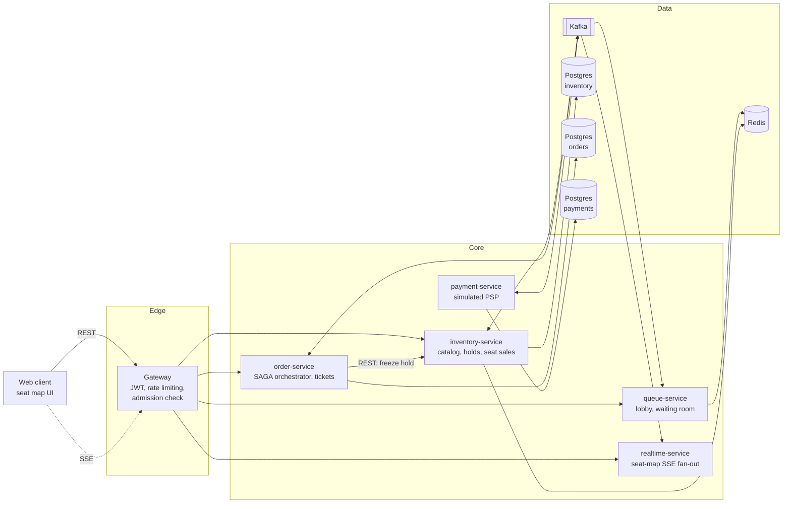
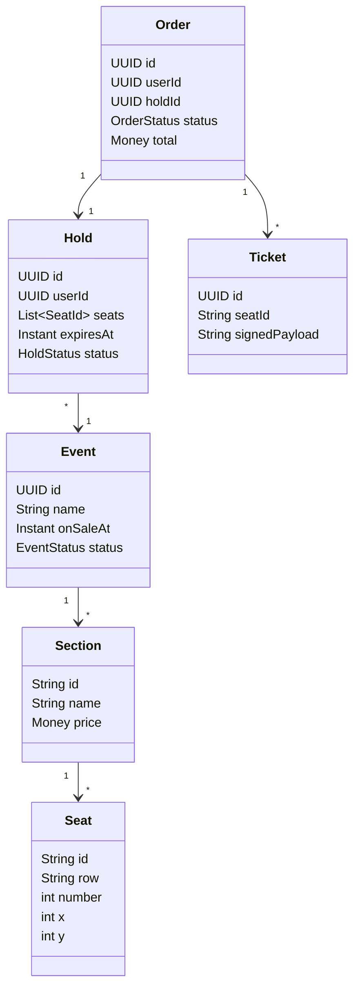
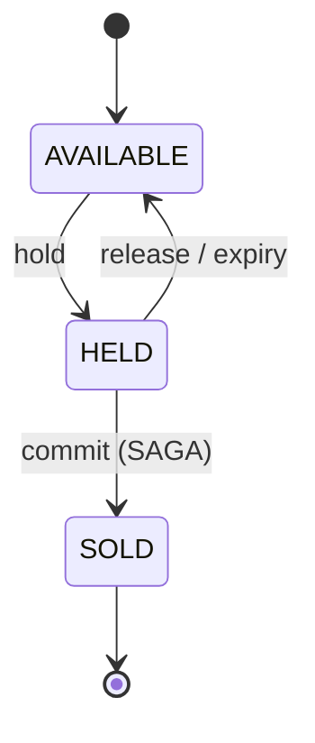
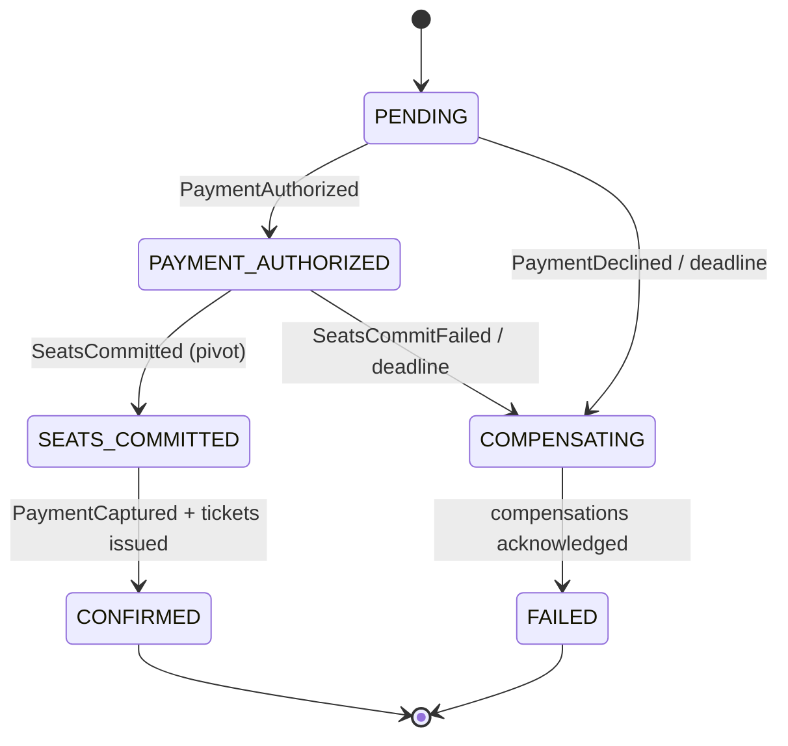
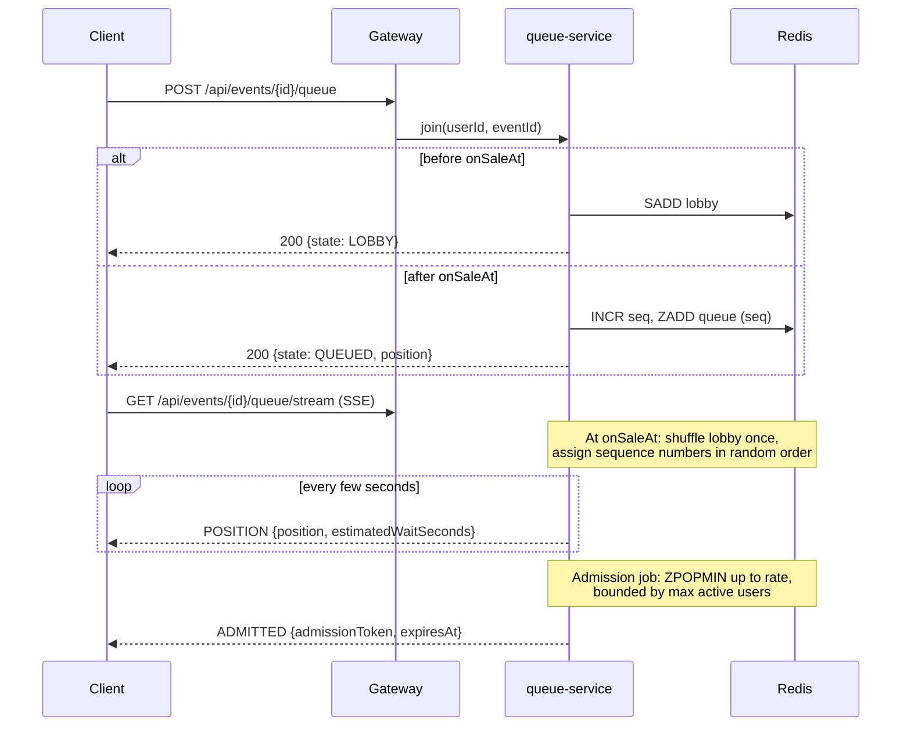
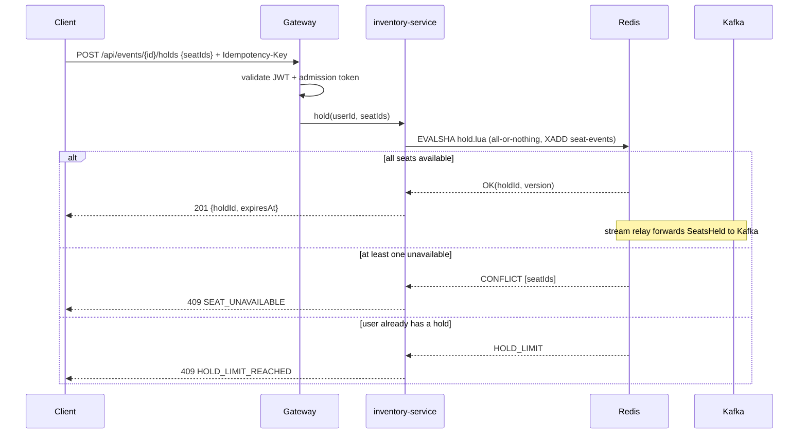
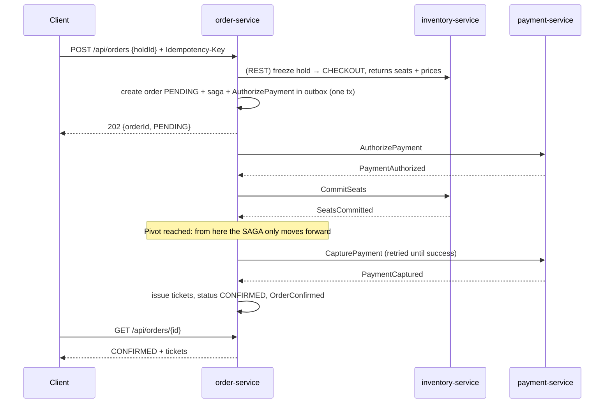

# SeatRush

**A distributed ticketing platform for high-demand "flash" on-sales: fair waiting room, zero overselling under extreme contention, and a real-time seat map.**

[](https://github.com/gianlucat97/seatrush/actions/workflows/ci.yml)

> Status: 🚧 under active development. This document is the technical specification of the system; values marked *Target* are goals that will be validated by the benchmark suite.

---

## Table of Contents

1. [The Problem](#1-the-problem)
2. [Goals and Non-Goals](#2-goals-and-non-goals)
3. [Glossary](#3-glossary)
4. [Core Invariants](#4-core-invariants)
5. [Architecture Overview](#5-architecture-overview)
6. [Services](#6-services)
7. [Domain Model](#7-domain-model)
8. [Key Flows](#8-key-flows)
9. [Consistency and Concurrency Strategy](#9-consistency-and-concurrency-strategy)
10. [Messaging (Kafka)](#10-messaging-kafka)
11. [Data Storage](#11-data-storage)
12. [Public API](#12-public-api)
13. [Security](#13-security)
14. [Observability](#14-observability)
15. [Non-Functional Requirements](#15-non-functional-requirements)
16. [Failure Modes](#16-failure-modes)
17. [Testing Strategy](#17-testing-strategy)
18. [Benchmark](#18-benchmark)
19. [Tech Stack](#19-tech-stack)
20. [Repository Structure](#20-repository-structure)
21. [Implementation Guidelines](#21-implementation-guidelines)
22. [Configuration](#22-configuration)
23. [Running Locally](#23-running-locally)
24. [Deployment on Kubernetes](#24-deployment-on-kubernetes)
25. [Architecture Decision Records](#25-architecture-decision-records)
26. [Roadmap](#26-roadmap)
27. [License](#27-license)

---

## 1. The Problem

When tickets for a high-demand event go on sale, hundreds of thousands of users arrive within seconds to compete for a few thousand seats. A naive system fails in predictable ways:

- **Overselling**: two buyers receive the same seat because of race conditions.
- **Collapse under load**: the database becomes the bottleneck and the whole site goes down.
- **Unfairness**: whoever refreshes fastest or runs a bot wins, not whoever arrived first.
- **Ghost inventory**: seats stay locked by users who abandoned checkout.
- **Hoarding**: a single user locks many seats in parallel and blocks everyone else.
- **Inconsistent payments**: a user is charged but receives no ticket, or receives a ticket without being charged.

SeatRush is a reference implementation of a system that solves these problems explicitly, with every design trade-off documented and every guarantee verified under load.

## 2. Goals and Non-Goals

### Goals

- Guarantee that **no seat is ever sold twice**, under any concurrency level and under partial failures.
- Protect the core system with a **fair virtual waiting room** that admits users at a controlled rate.
- Provide **temporary seat holds** with automatic expiry, so abandoned seats return to the pool.
- Implement checkout as an **orchestrated SAGA** across inventory, payment and ticketing, with compensations.
- Push **real-time updates** to clients: queue position, admission, sold-out notice and live seat-map changes.
- Scale horizontally on Kubernetes, with **observability built in** and a **reproducible load test** that proves the guarantees.

### Non-Goals

- Real payment processing: the payment provider is simulated (configurable latency and failure rate).
- Full user management: authentication is a minimal JWT-based stub.
- Secondary market, refunds after purchase, dynamic pricing.
- Advanced bot detection (only rate limiting and one-hold-per-user are in scope).
- Multi-region deployment (single region, documented as future work).

## 3. Glossary

| Term | Meaning |
|------|---------|
| **Event** | A show with a venue layout, sections, prices and an on-sale time. |
| **On-sale** | The moment tickets for an event become purchasable. |
| **Lobby** | Users who arrived *before* the on-sale opens. Their order is randomized at opening time. |
| **Waiting room / queue** | FIFO line of users waiting to be admitted to the purchase area. |
| **Admission** | Being let out of the queue; the user receives an admission token. |
| **Hold** | A temporary, exclusive reservation of 1..N seats with a TTL. |
| **Frozen hold** | A hold whose checkout has started; it no longer expires and is owned by the SAGA. |
| **Checkout SAGA** | The distributed transaction that turns a hold into a confirmed order. |
| **Pivot** | The SAGA step (`CommitSeats`) after which the SAGA can only move forward. |
| **Seat event** | A change of seat state (held, released, sold) broadcast to the live seat map. |

## 4. Core Invariants

These invariants are the contract of the system. Each one is enforced by a specific mechanism and verified automatically by the [invariant checker](#17-testing-strategy) after every load test.

| ID | Invariant | Enforced by |
|----|-----------|-------------|
| **I1** | A seat is sold at most once per event. | Postgres primary key on `seat_sale(event_id, seat_id)` (final guard), Redis atomic Lua scripts (fast path) |
| **I2** | A seat has at most one active hold at any time. | Atomic all-or-nothing hold Lua script |
| **I3** | A confirmed order always has its seats sold and its payment captured. | SAGA orchestrator with pivot-transaction design |
| **I4** | A failed order never leaves seats sold or a payment captured. | SAGA compensations (release hold, void payment), late-reply handling |
| **I5** | Repeating the same request or message never produces duplicate effects. | `Idempotency-Key` header on commands, `processed_message` table for consumers |
| **I6** | Users who joined after the on-sale opened are admitted in arrival order. | Monotonic sequence counter (`INCR`) as queue score |
| **I7** | No unfrozen hold lives beyond its TTL; no SAGA lives beyond its deadline without being resolved. | Hold expiry sweeper, SAGA timeout scheduler |
| **I8** | A user has at most one active hold per event. | `userhold` key checked inside the hold Lua script |

## 5. Architecture Overview



**Design principles**

- **Database per service.** Each service owns its data; cross-service communication happens through Kafka commands/events, plus one explicit synchronous REST call (freeze hold) where the user is waiting for an answer.
- **Fast path in memory, final guarantee in the database.** Redis absorbs the contention of the hold phase; Postgres constraints are the last line of defence for selling.
- **Synchronous where the user waits, asynchronous elsewhere.** Holds are synchronous (immediate yes/no); checkout is asynchronous (`202 Accepted` + status polling).
- **Every state change and its event are atomic.** Changes in Postgres use a transactional outbox table; changes in Redis append to a Redis Stream *inside the same Lua script*. A relay forwards both to Kafka.
- **Everything is observable and measurable.** Every invariant has a corresponding metric.

## 6. Services

### 6.1 Gateway (`services/gateway`)

Single entry point for clients. Built on Spring Cloud Gateway (reactive), so it can hold many long-lived SSE connections cheaply.

- Validates user JWTs on every request, except `POST /api/auth/demo-login`.
- Validates **admission tokens** on purchase commands only (`POST /holds`, `DELETE /holds/{id}`, `POST /orders`). Reads (`GET /orders/{id}`) need only the user JWT, so a user can follow an order even after the admission token has expired.
- Token-bucket **rate limiting per user and per IP**, backed by Redis.
- Removes any client-supplied `X-User-Id` header and sets it from the validated JWT.
- Routes requests to downstream services, propagates trace context and streams SSE responses without buffering.

### 6.2 Queue Service (`services/queue-service`)

Implements the lobby and the FIFO virtual waiting room.

- **Lobby**: users who join before `onSaleAt` are put in a lobby set. At opening time, the lobby is **shuffled once** and appended to the queue in that random order (arriving early gives no advantage over arriving a minute early; this prevents a "refresh at midnight" race). Users joining after opening are appended in arrival order.
- **What opens the doors** is inventory reporting the event as `ON_SALE`, not this service's clock (ADR-0015). Inventory warms the seat map into Redis as part of that transition, so a lobby drained a second early by a local clock would put buyers in front of a sale that still refuses them. queue-service polls the catalog (`seatrush.queue.catalog-refresh-interval`) and keeps serving the last answer it got if inventory is unreachable, because the users waiting are precisely the ones whose sale is about to open.
- **Shuffled in the service, not in Lua**: Redis makes `math.random` deterministic so that a replica replaying a script reaches the same state, which would turn the shuffle into a fixed permutation that merely looks fair. The order is produced with `SecureRandom` and passed in; `SREM` on the lobby set is the claim, so every pod may drain the same lobby at once without a leader and each user still gets exactly one sequence number.
- **Sequence numbers**: each queued user receives a strictly increasing sequence number from `INCR` (no timestamp ties). The queue is a sorted set scored by sequence.
- **Admission job**: runs every second, pops up to `rate-per-second` users (`ZPOPMIN`), but never lets more than `max-active-users` be inside the purchase area at the same time. It also stores the highest admitted sequence (`head`). Freeing the slots whose admission has expired happens in the same script as filling them, because the room to admit somebody is exactly what the freeing just made; there is therefore no interval during which the count of active buyers is known to be wrong. It runs on every pod with no leader: `ZPOPMIN` takes a user off the queue for exactly one caller, so pods share a batch rather than admitting a buyer twice, at the cost of the rate being per pod.
- **Position**: computed as `mySeq - head` (O(1), no `ZRANK` on 200k entries). It is an upper bound that never increases; users who leave make it slightly pessimistic, which is acceptable.
- **Estimated wait**: `position / observedAdmissionRate`, using a moving average of the actual admission rate. The rate is measured from how far `head` moved between two passes rather than from what one pod admitted, so it is the rate of the whole deployment; the configured `rate-per-second` is only the fallback before anything has been observed, which is the right guess precisely then, because a purchase area that is still empty really is admitting at its ceiling.
- **Admission token**: signed JWT with `userId`, `eventId`, short TTL, pushed over SSE and also retrievable with a polling endpoint (`GET .../queue/me`) for clients that lost the stream. It is **minted on read from the slot, never stored** (ADR-0016): the expiry it carries is the score of the slot in `active:{evt:<id>}`, so the two end at the same instant, and a client that missed a push, lost its stream or reloaded the page gets a working admission simply by asking again. A buyer whose admission has lapsed is still reported as `ADMITTED` and handed no token, which is what tells a client its time is up rather than leaving it to wonder why its token stopped working.
- **Slot release**: an active slot is freed when the admission token expires (sorted set scored by expiry) or when the user's order reaches a terminal state (consumes `order.events`).
- **Sold-out**: when inventory reports `EventSoldOut`, every waiting client receives a `SOLD_OUT` SSE message and the queue is closed.
- Joining twice returns the existing position (idempotent join).

### 6.3 Inventory Service (`services/inventory-service`)

Owns events, venue layout, seat state, holds and the final record of sales.

- **Catalog**: events, sections, seats, plus a generator that creates a venue layout of configurable size for demos and benchmarks.
- **On-sale warm-up**: when an event is opened for sale, its seat map is loaded from Postgres into Redis (all seats `AVAILABLE`, except those already in `seat_sale`). Holds are refused for events that are not `ON_SALE`.
- **Holds**: atomic hold of 1..N seats (max configurable, default 6) via a Redis Lua script. All-or-nothing: if any seat is unavailable, nothing is held. A user can have only one active hold per event (I8).
- **Hold expiry**: a sweeper releases expired holds (see [§9.3](#93-hold-expiry)).
- **Freeze**: synchronous internal endpoint called by order-service; moves the hold from `ACTIVE` to `CHECKOUT` and returns the seats with their prices.
- **Seat commit**: on `CommitSeats` command, writes `seat_sale` rows in Postgres, then marks the seats sold in Redis (see [§9.6](#96-seat-commit-procedure)).
- **Seat map snapshot**: current state of all seats of an event with its `version`, used by clients for the initial render.
- **Seat events**: Lua scripts append `SeatsHeld`, `SeatsReleased`, `SeatsSold` to a per-event Redis Stream; a stream relay forwards them to Kafka.
- **Sold-out detection**: when the last available seat of an event is sold, publishes `EventSoldOut` and sets the event status to `SOLD_OUT`.
- **Reconciler**: on startup and periodically, verifies that every `seat_sale` row is `SOLD` in Redis and fixes Redis if not (Postgres is the source of truth for sales).
- **Rebuild procedure**: on Redis data loss, seat state is rebuilt from Postgres and active holds are dropped (safe: holds are temporary by definition; frozen holds are recovered from the SAGA side, see [§16](#16-failure-modes)).

### 6.4 Order Service (`services/order-service`)

Orchestrates checkout and issues tickets.

- Accepts `POST /api/orders` with a `holdId` and an `Idempotency-Key`. It synchronously freezes the hold in inventory (fails fast with `410 HOLD_EXPIRED` or `409 HOLD_ALREADY_USED`), creates the order with the prices returned by inventory (inventory is the only source of prices), and responds `202 Accepted` with the order in `PENDING`.
- Runs the **checkout SAGA** as a persistent state machine stored in `saga_instance`, advanced by reply messages.
- Issues **tickets** with a signed payload (suitable for a QR code) once the order is confirmed.
- Enforces a **checkout deadline** on the steps before the pivot (see [§8.3](#83-checkout-saga-orchestrated)).
- Handles **late replies** for SAGAs already terminated (e.g. a `PaymentAuthorized` arriving after a timeout triggers a `VoidPayment`).
- Publishes `OrderConfirmed` / `OrderFailed` on `order.events`.

### 6.5 Payment Service (`services/payment-service`)

Simulates a payment service provider.

- Supports `Authorize`, `Capture` and `Void`, each idempotent by `(orderId, operation)`.
- `Void` on a non-authorized order is a successful no-op (makes compensation safe to repeat and safe to send blindly).
- Configurable **latency distribution** and **decline rate**, changeable at runtime through an internal endpoint, to exercise compensations under load.
- Persists every operation for audit and for the invariant checker.

### 6.6 Realtime Service (`services/realtime-service`)

Pushes live seat-map updates to clients.

- Consumes `inventory.seat-events` with a **unique consumer group per pod** (broadcast pattern): every pod receives every seat event and serves its own connected clients. Starts from the latest offset; clients catch up via snapshot.
- Keeps in-memory subscriber registries per event.
- **Batches deltas** (default every 200 ms) to protect clients and network during bursts.
- Each delta carries `fromVersion`/`toVersion` so clients can detect gaps and re-fetch the snapshot.
- Sends a heartbeat comment every 15 s to keep connections alive through proxies.

### 6.7 Seat Map UI (`frontend/seat-map-ui`)

Minimal web client used for demos.

- Join the queue (lobby before opening), see position and estimated wait, get admitted or receive the sold-out notice.
- Render the venue as an SVG seat map that updates live (available / held / sold, own hold highlighted).
- Select seats, hold them (with countdown), check out, see order result and ticket.
- **Spectator mode**: live seat map only, to watch a load test fill the venue in real time.

## 7. Domain Model



**Event states**: `DRAFT` → `SCHEDULED` (lobby open) → `ON_SALE` → `SOLD_OUT` | `CLOSED`.

**Seat state machine** (per seat, in Redis; `SOLD` is also persisted in Postgres):



**Hold states**: `ACTIVE` → `CHECKOUT` (frozen, not subject to expiry) → `CONSUMED` | `RELEASED`; or `ACTIVE` → `RELEASED` | `EXPIRED`.

**Order states**:



`FAILED` orders carry a `failureReason`: `PAYMENT_DECLINED`, `SEATS_UNAVAILABLE`, `TIMEOUT`. (Expired or already used holds are rejected synchronously at `POST /orders` and never create an order.)

## 8. Key Flows

### 8.1 Lobby, Waiting Room and Admission



### 8.2 Seat Hold



### 8.3 Checkout SAGA (orchestrated)



**Compensations**

| Trigger | Compensation | Final state |
|---------|--------------|-------------|
| `PaymentDeclined` | `ReleaseHold` | `FAILED (PAYMENT_DECLINED)` |
| `SeatsCommitFailed` (constraint violation, hold not in `CHECKOUT`) | `VoidPayment` + `ReleaseHold` | `FAILED (SEATS_UNAVAILABLE)` |
| Deadline reached in `PENDING` or `PAYMENT_AUTHORIZED` **before `CommitSeats` was sent** | `VoidPayment` (always, it is a safe no-op) + `ReleaseHold` | `FAILED (TIMEOUT)` |
| `CapturePayment` failure after pivot | No compensation: retry with exponential backoff; alert if retries are exhausted | stays `SEATS_COMMITTED` until captured |

**Deadline rules**

- The deadline applies only while the SAGA is waiting for `PaymentAuthorized`. Once `CommitSeats` has been sent, the SAGA waits for its reply indefinitely (inventory always replies, and the command is retried by Kafka redelivery). This avoids the race "timeout fires while the commit is succeeding".
- **Late replies** to a SAGA in `COMPENSATING` or `FAILED`: a late `PaymentAuthorized` triggers another `VoidPayment`; other late replies are logged and ignored.

`CommitSeats` is the **pivot transaction**: compensatable steps come before it, retriable steps after it. This guarantees I3 and I4.

### 8.4 Live Seat Map

1. Client calls `GET /api/events/{id}/seatmap` → snapshot with `version`.
2. Client opens `GET /api/events/{id}/seatmap/stream` (SSE).
3. realtime-service sends batched deltas `{fromVersion, toVersion, changes:[{seatId, status}]}`.
4. Deltas with `toVersion` ≤ local version are ignored; if `fromVersion` > local version + 1 (gap), the client reloads the snapshot.

## 9. Consistency and Concurrency Strategy

### 9.1 Two layers of protection against overselling

1. **Fast path (Redis)**: the hold Lua script checks and changes the state of all requested seats atomically. Redis executes scripts serially, so there is no race between concurrent holds. This layer absorbs all of the contention.
2. **Final guard (Postgres)**: `CommitSeats` inserts one row per seat into `seat_sale` with primary key `(event_id, seat_id)`. Even if Redis lost data or a bug produced a double hold, the database rejects the second sale and the SAGA compensates.

The `seatrush_oversell_prevented_total` metric counts how many times layer 2 had to intervene. In a correct run it is 0; a non-zero value is a bug in layer 1, caught safely.

### 9.2 Redis key design

All keys of an event share the hash tag `{evt:<eventId>}`, so multi-key Lua scripts work on Redis Cluster (same slot).

| Key | Type | Content |
|-----|------|---------|
| `seats:{evt:<id>}` | HASH | `seatId → A` (available) \| `H:<holdId>` \| `S` (sold) |
| `seats:{evt:<id>}:version` | STRING | monotonic version of seat state |
| `seats:{evt:<id>}:available` | STRING | counter of available seats (sold-out detection) |
| `hold:{evt:<id>}:<holdId>` | HASH | `userId`, `seats`, `expiresAt`, `status`, `orderId` |
| `holds:{evt:<id>}:expiry` | ZSET | `ACTIVE` holdIds scored by `expiresAt` |
| `holds:{evt:<id>}:checkout` | ZSET | `CHECKOUT` holdIds scored by the instant they were frozen, read by the reconciler |
| `userhold:{evt:<id>}:<userId>` | STRING | holdId of the user's active hold (I8) |
| `idem:{evt:<id>}:<userId>:<key>` | STRING | stored response of a hold command, TTL 24h |
| `seat-events:{evt:<id>}` | STREAM | seat events waiting to be relayed to Kafka (capped with `MAXLEN ~`) |
| `lobby:{evt:<id>}` | SET | users waiting before on-sale |
| `queue:{evt:<id>}` | ZSET | `userId` scored by sequence number |
| `queue:{evt:<id>}:seq` | STRING | sequence counter |
| `queue:{evt:<id>}:head` | STRING | highest admitted sequence |
| `queue:{evt:<id>}:user:<userId>` | STRING | user's sequence (idempotent join, position), TTL 24h |
| `active:{evt:<id>}` | ZSET | admitted `userId` scored by admission expiry |
| `ratelimit:<scope>:<key>` | HASH | token bucket state (not event-scoped) |

**Trade-off (ADR-0002)**: one event lives on one Redis slot, therefore one shard. A single Redis shard comfortably handles the hold rate of one on-sale (bounded by the admission rate); if needed, the tag can be moved to `{evt:<id>:sec:<sectionId>}`, at the cost of limiting a hold to seats of one section.

**hold.lua (pseudocode)**

```
if GET idem:<user>:<key> exists: return stored response
if GET userhold:<user> exists: return HOLD_LIMIT
for each seatId in ARGV.seats:
    if HGET seats seatId != "A": return CONFLICT(seatId)
for each seatId: HSET seats seatId "H:" .. holdId
DECRBY available #seats
HSET hold:<holdId> userId, seats, expiresAt, status=ACTIVE
ZADD holds:expiry expiresAt holdId
SET userhold:<user> holdId
version = INCR seats:version
XADD seat-events MAXLEN ~ 100000 * type SeatsHeld seats ... version
SET idem:<user>:<key> response EX 86400
return OK(holdId, version)
```

Companion scripts:

| Script | Effect |
|--------|--------|
| `release.lua` | `ACTIVE`/`CHECKOUT` → `RELEASED`; seats back to `A`; clears `userhold`; `SeatsReleased` |
| `expire.lua` | Like release, but only if status is still `ACTIVE` and `expiresAt` ≤ now; otherwise no-op |
| `freeze.lua` | `ACTIVE` → `CHECKOUT`, stores `orderId`, moves the hold from the expiry set to the checkout set; idempotent for the same `orderId`; fails if expired or frozen by another order |
| `markSold.lua` | `CHECKOUT` → `CONSUMED`; seats → `S`; clears `userhold`; leaves the checkout set; `SeatsSold`; idempotent for the same `orderId` |

Note: a released or sold seat increments/decrements `available` accordingly; when `available` reaches 0 *and* no seat is held, the event is sold out.

### 9.3 Hold expiry

Redis keyspace notifications are not reliable (fire-and-forget, lost on disconnect), so they are **not** used (ADR-0008). Instead:

- A sweeper in inventory-service runs every second, reads `ZRANGEBYSCORE holds:expiry -inf <now> LIMIT 0 500` and runs `expire.lua` for each result.
- `expire.lua` is a no-op if the hold is no longer `ACTIVE`, so the sweeper is safe to run on **multiple pods concurrently** without leader election.
- Frozen holds are never expired by the sweeper: the SAGA owns them and always ends with either `CommitSeats` or `ReleaseHold`.

### 9.4 Idempotency

- **HTTP commands** (`POST /holds`, `POST /orders`) require an `Idempotency-Key` header (UUID). The key and the response are stored (Redis for holds, the `customer_order` unique constraint for orders); a repeated request returns the original response. The same key with a different body returns `422 IDEMPOTENCY_KEY_REUSED`.
- **Kafka consumers** record each processed `messageId` in a `processed_message` table **in the same transaction** as the business change. Duplicates are skipped.
- **Payment operations** are idempotent by `(orderId, operation)` with a unique constraint.
- **Lua scripts** for freeze, release and mark-sold are idempotent by design.

### 9.5 Transactional outbox (Postgres and Redis)

A service never changes state and publishes to Kafka as two independent operations.

- **Postgres outbox**: the business change and an `outbox` row are written in **one transaction**. A polling relay publishes pending rows using `SELECT ... FOR UPDATE SKIP LOCKED` (multiple pods can relay in parallel) and marks them as published.
- **Redis outbox**: Lua scripts append the seat event to the per-event stream `seat-events:{evt:<id>}` in the same atomic script. A stream relay reads it with a consumer group (`XREADGROUP`), publishes to Kafka and acknowledges with `XACK`; pending entries of a dead consumer are claimed with `XAUTOCLAIM`.
- Delivery guarantee: at-least-once in both cases; duplicates are handled by consumer idempotency (seat events carry the seat-state `version`, so realtime ignores duplicates by version).
- Ordering: per aggregate key (`orderId` for SAGA messages, `eventId` for seat events).

### 9.6 Seat commit procedure

On `CommitSeats(orderId, holdId)`:

1. Check in Redis that the hold is `CHECKOUT` for this `orderId`. If it is already `CONSUMED` for this order, reply `SeatsCommitted` (redelivery). Otherwise, if not valid, reply `SeatsCommitFailed`.
2. In **one Postgres transaction**: insert `seat_sale` rows, insert `processed_message`, insert the `SeatsCommitted` reply into the outbox.
3. If the transaction fails with a primary key violation: increment `seatrush_oversell_prevented_total`, then in a new transaction write `SeatsCommitFailed` to the outbox.
4. After commit, run `markSold.lua` (seats `S`, hold `CONSUMED`, `SeatsSold` stream event).
5. If the pod dies between steps 2 and 4, the seats are sold in Postgres but still held in Redis: nobody else can take them, and the **reconciler** applies `markSold.lua` on the next run. No overselling is possible in any interleaving.

### 9.7 SAGA persistence

- `saga_instance` stores current step, status, deadline, retry count and an optimistic-locking `version`.
- Each reply advances the SAGA in one transaction: update state + write next command to the outbox + mark the message processed.
- A timeout scheduler (multi-pod safe via `SKIP LOCKED`) picks SAGAs past their deadline and starts compensation, following the deadline rules of [§8.3](#83-checkout-saga-orchestrated).
- Capture retries after the pivot are scheduled through `next_attempt_at`, picked by the same scheduler.

## 10. Messaging (Kafka)

### 10.1 Topics

| Topic | Key | Partitions | Producers | Consumers | Messages |
|-------|-----|-----------|-----------|-----------|----------|
| `inventory.seat-events` | `eventId` | 12 | inventory (stream relay) | realtime, queue | `SeatsHeld`, `SeatsReleased`, `SeatsSold`, `EventSoldOut` |
| `inventory.commands` | `orderId` | 12 | order | inventory | `CommitSeats`, `ReleaseHold` |
| `inventory.replies` | `orderId` | 12 | inventory | order | `SeatsCommitted`, `SeatsCommitFailed`, `HoldReleased` |
| `payment.commands` | `orderId` | 12 | order | payment | `AuthorizePayment`, `CapturePayment`, `VoidPayment` |
| `payment.replies` | `orderId` | 12 | payment | order | `PaymentAuthorized`, `PaymentDeclined`, `PaymentCaptured`, `PaymentVoided` |
| `order.events` | `orderId` | 12 | order | queue (slot release) | `OrderConfirmed`, `OrderFailed` |
| `<topic>.dlq` | same | 3 | consumers | operators | poison messages after retries |

Keying by `orderId` guarantees ordering of all messages of the same SAGA; keying seat events by `eventId` guarantees ordered seat-map updates per event. Topics are created by an init job (local: Compose service; Kubernetes: Helm hook), never by auto-creation.

### 10.2 Message envelope

```json
{
  "messageId": "uuid",
  "type": "PaymentAuthorized",
  "schemaVersion": 1,
  "occurredAt": "2026-01-01T12:00:00Z",
  "correlationId": "orderId",
  "causationId": "messageId of the triggering message",
  "traceparent": "W3C trace context",
  "payload": { }
}
```

### 10.3 Message payloads

| Type | Payload |
|------|---------|
| `AuthorizePayment` | `orderId, userId, amountCents, currency` |
| `CapturePayment` / `VoidPayment` | `orderId` |
| `PaymentAuthorized` / `PaymentCaptured` / `PaymentVoided` | `orderId, paymentOperationId` |
| `PaymentDeclined` | `orderId, reason` |
| `CommitSeats` | `orderId, eventId, holdId, seatIds[]` |
| `ReleaseHold` | `orderId, eventId, holdId` |
| `SeatsCommitted` | `orderId, eventId, seatIds[]` |
| `SeatsCommitFailed` | `orderId, eventId, reason, conflictingSeatIds[]` |
| `HoldReleased` | `orderId, holdId` |
| `SeatsHeld` / `SeatsReleased` / `SeatsSold` | `eventId, seatIds[], version, holdId` |
| `EventSoldOut` | `eventId` |
| `OrderConfirmed` / `OrderFailed` | `orderId, userId, eventId, failureReason?` |

- Serialization: JSON with explicit `schemaVersion`; message classes live in `libs/messaging` and are shared by producers and consumers. JSON Schemas are generated into `docs/messages/` (Avro + Schema Registry is deferred, ADR-0007).
- Consumer error handling: bounded retries with backoff, then DLQ. Business rejections (e.g. payment declined) are **reply messages**, not errors.
- Producers: `acks=all`, idempotent producer enabled.

## 11. Data Storage

Locally a single Postgres instance hosts three databases (`inventory`, `orders`, `payments`); on Kubernetes they can be separate instances. Each service only has credentials for its own database. Schema migrations are managed with **Flyway**, one migration folder per service.

### 11.1 Inventory database

```sql
CREATE TABLE event (
    id           UUID PRIMARY KEY,
    name         TEXT NOT NULL,
    on_sale_at   TIMESTAMPTZ NOT NULL,
    status       TEXT NOT NULL,            -- DRAFT, SCHEDULED, ON_SALE, SOLD_OUT, CLOSED
    created_at   TIMESTAMPTZ NOT NULL DEFAULT now()
);

CREATE TABLE section (
    event_id     UUID NOT NULL REFERENCES event(id),
    id           TEXT NOT NULL,
    name         TEXT NOT NULL,
    price_cents  BIGINT NOT NULL CHECK (price_cents > 0),
    currency     CHAR(3) NOT NULL,
    PRIMARY KEY (event_id, id)
);

CREATE TABLE seat (
    event_id     UUID NOT NULL,
    id           TEXT NOT NULL,            -- e.g. "A-12-7" (section-row-number)
    section_id   TEXT NOT NULL,
    row_label    TEXT NOT NULL,
    number       INT  NOT NULL,
    x            INT  NOT NULL,            -- layout coordinates for the seat map
    y            INT  NOT NULL,
    PRIMARY KEY (event_id, id),
    FOREIGN KEY (event_id, section_id) REFERENCES section(event_id, id)
);

-- Final guard for invariant I1
CREATE TABLE seat_sale (
    event_id     UUID NOT NULL,
    seat_id      TEXT NOT NULL,
    order_id     UUID NOT NULL,
    sold_at      TIMESTAMPTZ NOT NULL DEFAULT now(),
    PRIMARY KEY (event_id, seat_id),
    FOREIGN KEY (event_id, seat_id) REFERENCES seat(event_id, id)
);
CREATE INDEX seat_sale_order ON seat_sale (order_id);

CREATE TABLE outbox (
    id            BIGSERIAL PRIMARY KEY,
    aggregate_key TEXT NOT NULL,
    topic         TEXT NOT NULL,
    message       JSONB NOT NULL,
    created_at    TIMESTAMPTZ NOT NULL DEFAULT now(),
    published_at  TIMESTAMPTZ
);
CREATE INDEX outbox_unpublished ON outbox (id) WHERE published_at IS NULL;

CREATE TABLE processed_message (
    message_id   UUID PRIMARY KEY,
    processed_at TIMESTAMPTZ NOT NULL DEFAULT now()
);
```

### 11.2 Order database

```sql
CREATE TABLE customer_order (
    id               UUID PRIMARY KEY,
    user_id          UUID NOT NULL,
    event_id         UUID NOT NULL,
    hold_id          UUID NOT NULL UNIQUE,
    status           TEXT NOT NULL,
    failure_reason   TEXT,
    total_cents      BIGINT NOT NULL,
    currency         CHAR(3) NOT NULL,
    idempotency_key  UUID NOT NULL,
    request_hash     TEXT NOT NULL,         -- detects key reuse with a different body
    created_at       TIMESTAMPTZ NOT NULL DEFAULT now(),
    updated_at       TIMESTAMPTZ NOT NULL DEFAULT now(),
    UNIQUE (user_id, idempotency_key)
);
CREATE INDEX customer_order_user ON customer_order (user_id, created_at DESC);

CREATE TABLE order_item (
    order_id     UUID NOT NULL REFERENCES customer_order(id),
    seat_id      TEXT NOT NULL,
    price_cents  BIGINT NOT NULL,
    PRIMARY KEY (order_id, seat_id)
);

CREATE TABLE saga_instance (
    order_id         UUID PRIMARY KEY REFERENCES customer_order(id),
    step             TEXT NOT NULL,
    status           TEXT NOT NULL,        -- RUNNING, COMPENSATING, COMPLETED, FAILED
    deadline_at      TIMESTAMPTZ,          -- NULL once CommitSeats has been sent
    next_attempt_at  TIMESTAMPTZ,          -- capture retries after the pivot
    retries          INT NOT NULL DEFAULT 0,
    -- The compensations still waiting for a reply, as a set: a late PaymentAuthorized sends a
    -- second VoidPayment (§8.3), and a counter would be decremented twice by its acknowledgement
    compensations_pending TEXT NOT NULL DEFAULT '',
    version          BIGINT NOT NULL DEFAULT 0
);
CREATE INDEX saga_deadline ON saga_instance (deadline_at) WHERE status = 'RUNNING';
CREATE INDEX saga_retry ON saga_instance (next_attempt_at) WHERE next_attempt_at IS NOT NULL;

CREATE TABLE ticket (
    id              UUID PRIMARY KEY,
    order_id        UUID NOT NULL REFERENCES customer_order(id),
    event_id        UUID NOT NULL,
    seat_id         TEXT NOT NULL,
    signed_payload  TEXT NOT NULL,
    issued_at       TIMESTAMPTZ NOT NULL DEFAULT now(),
    UNIQUE (event_id, seat_id)             -- second guard against duplicate tickets
);

-- plus outbox and processed_message, same structure as inventory
```

### 11.3 Payment database

```sql
CREATE TABLE payment_operation (
    id           UUID PRIMARY KEY,
    order_id     UUID NOT NULL,
    operation    TEXT NOT NULL,            -- AUTHORIZE, CAPTURE, VOID
    result       TEXT NOT NULL,            -- SUCCEEDED, DECLINED, NOOP
    amount_cents BIGINT,                   -- the amount of the authorization this belongs to
    currency     CHAR(3),                  -- always together with the amount, never without it
    created_at   TIMESTAMPTZ NOT NULL DEFAULT now(),
    UNIQUE (order_id, operation)
);

-- plus outbox and processed_message
```

## 12. Public API

All endpoints are served through the gateway under `/api`. Errors follow **RFC 9457 (Problem Details)** with a stable `code` field. An OpenAPI 3 specification is generated per service and published under `docs/api/`. Timestamps are ISO-8601 UTC; money is `{ "amountCents": 4500, "currency": "EUR" }`.

### 12.1 Auth (demo)

| Method | Path | Description |
|--------|------|-------------|
| `POST` | `/api/auth/demo-login` | Body `{ "username": "...", "admin": false }` → `{ "accessToken": "jwt" }`. Enabled only in `local` and `bench` profiles. |

### 12.2 Events and seat map

| Method | Path | Auth | Description |
|--------|------|------|-------------|
| `GET` | `/api/events` | JWT | List events |
| `GET` | `/api/events/{eventId}` | JWT | Event details with sections and prices |
| `GET` | `/api/events/{eventId}/seatmap` | JWT | Snapshot `{ version, seats:[{id, sectionId, x, y, status}] }` |
| `GET` | `/api/events/{eventId}/seatmap/stream` | JWT | SSE: `DELTA {fromVersion, toVersion, changes}` |
| `POST` | `/api/admin/events` | admin | Create an event with a generated layout `{ name, onSaleAt, sections:[{id, name, priceCents, currency, rows, seatsPerRow}] }` |
| `POST` | `/api/admin/events/{eventId}/schedule` | admin | `DRAFT` → `SCHEDULED` (lobby opens) |
| `POST` | `/api/admin/events/{eventId}/open` | admin | Force on-sale opening now (demos and benchmarks) |

### 12.3 Waiting room

| Method | Path | Auth | Description |
|--------|------|------|-------------|
| `POST` | `/api/events/{eventId}/queue` | JWT | Join (idempotent) → `{ state: LOBBY \| QUEUED \| ADMITTED, position? }` |
| `GET` | `/api/events/{eventId}/queue/me` | JWT | Polling fallback: current state, position, admission token if admitted |
| `GET` | `/api/events/{eventId}/queue/stream` | JWT | SSE: `POSITION {position, estimatedWaitSeconds}`, `ADMITTED {admissionToken, expiresAt}`, `SOLD_OUT` |
| `DELETE` | `/api/events/{eventId}/queue` | JWT | Leave the queue |

### 12.4 Holds

| Method | Path | Auth | Description |
|--------|------|------|-------------|
| `POST` | `/api/events/{eventId}/holds` | JWT + admission | Body `{ seatIds:[...] }`, header `Idempotency-Key` → `201 { holdId, seatIds, expiresAt }` |
| `GET` | `/api/holds/{holdId}` | JWT | Hold details (owner only) |
| `DELETE` | `/api/holds/{holdId}` | JWT + admission | Release the hold (owner only, only if `ACTIVE`) |

### 12.5 Orders

| Method | Path | Auth | Description |
|--------|------|------|-------------|
| `POST` | `/api/orders` | JWT + admission | Body `{ holdId }`, header `Idempotency-Key` → `202 { orderId, status: "PENDING" }` with `Location` header |
| `GET` | `/api/orders/{orderId}` | JWT | Order with status, items, total and, if confirmed, tickets (owner only) |
| `GET` | `/api/orders` | JWT | Current user's orders (cursor pagination) |

### 12.6 Error codes

| HTTP | `code` | Meaning |
|------|--------|---------|
| 400 | `VALIDATION_ERROR` | Malformed request, too many seats, seats from another event, missing `Idempotency-Key` |
| 401 | `UNAUTHENTICATED` | Missing or invalid JWT |
| 403 | `ADMISSION_REQUIRED` | No valid admission token for this event |
| 403 | `FORBIDDEN` | Resource belongs to another user, or admin role missing |
| 404 | `NOT_FOUND` | Unknown event, hold or order |
| 409 | `EVENT_NOT_ON_SALE` | Event is not on sale (or sold out) |
| 409 | `SEAT_UNAVAILABLE` | At least one seat is held or sold (`conflictingSeatIds` in the body) |
| 409 | `HOLD_LIMIT_REACHED` | User already has an active hold for this event |
| 409 | `HOLD_ALREADY_USED` | Hold already in checkout or consumed by another order |
| 410 | `HOLD_EXPIRED` | Hold expired or released |
| 422 | `IDEMPOTENCY_KEY_REUSED` | Same key used with a different body |
| 429 | `RATE_LIMITED` | Rate limit exceeded (`Retry-After` header) |
| 503 | `TEMPORARILY_UNAVAILABLE` | Dependency down; safe to retry with the same `Idempotency-Key` |

### 12.7 Internal endpoints (not exposed by the gateway)

| Service | Method | Path | Description |
|---------|--------|------|-------------|
| inventory | `POST` | `/internal/holds/{holdId}/freeze` | Body `{ orderId, userId }` → seats and prices; called by order-service |
| inventory | `POST` | `/internal/events/{eventId}/rebuild` | Rebuild Redis state from Postgres |
| payment | `PUT` | `/internal/config` | `{ declineRate, latencyMsP50, latencyMsP99 }` |

## 13. Security

- **User authentication**: JWT (HS256 locally, RS256 with a JWKS endpoint on Kubernetes), validated at the gateway. `userId` is propagated to services in `X-User-Id`, set only by the gateway; services are reachable only from inside the cluster.
- **Authorization**: users can only read and act on their own holds and orders; admin endpoints require the `ADMIN` role claim.
- **Admission tokens**: separate signing key, bound to `userId` + `eventId`, short TTL (default 10 minutes). Required for purchase commands only.
- **Token verification** (`libs/security`): both tokens are JWTs signed with HS256 by two different secrets, because the gateway mints the first and queue-service the second. On top of the separate secrets each carries an `aud` claim (`seatrush:user`, `seatrush:admission`) that is demanded back, so one secret configured in both places still cannot turn an admission into an identity. The signing algorithm is compared to a constant rather than read out of the token, and expiry is checked against the injected clock with no tolerance for skew: the admission TTL also scores the slot in `active:{evt:<id>}`, and a token outliving its slot would be a buyer nobody is counting.
- **Rate limiting**: token bucket per user and per IP on queue join, holds and orders.
- **Anti-hoarding**: one active hold per user per event, max seats per hold.
- **Signed tickets**: ticket payload (`ticketId, eventId, seatId, issuedAt`) signed with Ed25519 by order-service, verifiable offline at the venue entrance.
- **Internal endpoints** reachable only inside the cluster (Kubernetes NetworkPolicy).
- **Secrets** via Kubernetes Secrets, never committed; `.env.example` for local development.
- **Input limits**: max seats per hold, max request body size, strict Bean Validation on every DTO.

## 14. Observability

### 14.1 Metrics

Micrometer → Prometheus. Besides standard JVM, HTTP, Kafka client and Hikari metrics, each service exposes domain metrics:

| Metric | Type | Description |
|--------|------|-------------|
| `seatrush_queue_length` | gauge | Users waiting, per event |
| `seatrush_queue_active_users` | gauge | Users currently admitted, per event |
| `seatrush_admissions_total` | counter | Users admitted |
| `seatrush_holds_total{result}` | counter | Hold attempts by result (`ok`, `conflict`, `limit`, `invalid`) |
| `seatrush_hold_duration_seconds` | histogram | Latency of the hold operation |
| `seatrush_holds_expired_total` | counter | Holds released by the sweeper |
| `seatrush_seats_sold_total` | counter | Seats sold |
| `seatrush_oversell_prevented_total` | counter | Sales rejected by the Postgres guard (must be 0) |
| `seatrush_redis_reconciliations_total` | counter | Seats fixed in Redis by the reconciler |
| `seatrush_saga_duration_seconds{outcome}` | histogram | End-to-end checkout duration |
| `seatrush_saga_compensations_total{reason}` | counter | Compensations by reason |
| `seatrush_saga_late_replies_total{type}` | counter | Replies received for terminated SAGAs |
| `seatrush_outbox_lag_seconds{store}` | gauge | Age of the oldest unpublished outbox entry (`postgres`, `redis`) |
| `seatrush_sse_connections{stream}` | gauge | Open SSE connections per pod (`queue`, `seatmap`) |
| `seatrush_realtime_propagation_seconds` | histogram | Time from seat change (`occurredAt`) to delta sent |

Kafka consumer lag is collected with a Kafka exporter.

### 14.2 Tracing

OpenTelemetry (Micrometer Tracing bridge) with OTLP export. Trace context is propagated over HTTP and inside the Kafka message envelope (`traceparent`), so a full checkout SAGA appears as **one trace across all services**.

### 14.3 Logging

Structured JSON logs with `traceId`, `spanId`, `orderId`, `eventId`, `userId` in MDC. No personal data or tokens are logged.

### 14.4 Dashboards and alerts

Grafana dashboards are **provisioned as code** in `deploy/grafana/dashboards`:

- **On-sale overview**: queue length, admission rate, active users, holds/s, conflicts, seats sold over time, sold-out progress.
- **Checkout SAGA**: throughput, duration percentiles, compensations by reason, late replies, stuck SAGAs.
- **Platform health**: latency, error rates, Kafka lag, outbox lag, SSE connections, Redis and Postgres saturation.

Prometheus alert rules: `oversell_prevented > 0`, outbox lag > 5 s, SAGA past deadline for > 1 min, capture retries exhausted, DLQ not empty.

## 15. Non-Functional Requirements

*Target* values, measured by the benchmark in [§18](#18-benchmark):

| Requirement | Target |
|-------------|--------|
| Oversold seats | **0** (hard requirement) |
| Queue join latency | p99 < 100 ms |
| Hold latency | p99 < 50 ms |
| Checkout end-to-end (simulated payment p50 = 300 ms) | p99 < 2 s |
| Seat-map change → client propagation | p99 < 500 ms |
| Concurrent users in waiting room | 200,000 |
| Concurrent SSE connections | 200,000 queue + 50,000 seat-map across pods |
| Loss of one pod of any service during the on-sale | no order left inconsistent; no checkout failed beyond client retries |

## 16. Failure Modes

| Failure | Expected behaviour |
|---------|-------------------|
| inventory pod dies during a hold | Lua script is atomic: the hold exists or it does not. Client retries with the same `Idempotency-Key` and gets the original result. |
| inventory pod dies between `seat_sale` commit and `markSold.lua` | Seats stay held (not available to others); reconciler marks them sold; reply already in outbox. |
| order pod dies mid-SAGA | SAGA state is in Postgres; any pod continues when the next reply arrives or when the scheduler fires. |
| Duplicate Kafka delivery | Ignored via `processed_message`; Lua scripts and payment operations are idempotent. |
| Kafka temporarily unavailable | Outbox rows and stream entries accumulate; relays publish them when Kafka is back. No data loss. |
| Redis restart with data loss | Active holds lost (users re-hold); seat state rebuilt from `seat_sale`; frozen holds of running SAGAs fail `CommitSeats` validation → SAGA compensates; Postgres guard prevents overselling throughout. |
| Payment provider slow | Checkout latency grows; deadline bounds the wait before the pivot and compensates. |
| Late `PaymentAuthorized` after timeout | `VoidPayment` sent again; no captured payment for a failed order. |
| Capture fails after seats committed | Retried with backoff; order stays `SEATS_COMMITTED`; alert fires if retries are exhausted. |
| realtime pod dies | Clients reconnect (SSE `retry`), reload the snapshot, continue with deltas. |
| queue pod dies | Queue state is in Redis; clients reconnect; admission job runs on any pod (guarded by a short Redis lock per event to avoid double admission per tick). |
| Poison message | Retries, then DLQ; alert fires. |

## 17. Testing Strategy

| Level | Tooling | Scope |
|-------|---------|-------|
| Unit | JUnit Jupiter, AssertJ, Mockito | Domain logic, SAGA state machine transitions (every transition and every late reply) |
| Lua scripts | Testcontainers (Redis) | Every script: success, conflict, limit, idempotency, expiry edge cases |
| Concurrency | JUnit + virtual threads + Testcontainers | e.g. 10,000 concurrent hold attempts on 100 seats → exactly 100 seats held, never more; one hold per user |
| Integration | Testcontainers (Postgres, Redis, Kafka), Spring Boot tests | Both outbox relays, idempotent consumers, full SAGA happy path and every compensation, seat commit crash window |
| Message contracts | JSON Schema validation | Producers emit, consumers accept, every message type in `libs/messaging` |
| API | REST Assured | Contracts, error codes, idempotency behaviour, ownership checks |
| Architecture | ArchUnit | Layering rules (domain has no framework dependency), no cross-service module dependency |
| End-to-end | Docker Compose + REST Assured | Lobby → queue → admission → hold → checkout → ticket; sold-out notice |
| Load | Gatling (Java DSL) | See [§18](#18-benchmark) |
| Chaos | Scripts (`kubectl delete pod`, Redis restart, Kafka broker stop) during load | [§16](#16-failure-modes) behaviours |

Time-dependent logic (TTLs, deadlines, sweepers) uses an injected `java.time.Clock` so tests are deterministic.

**Invariant checker** (`load-tests/invariant-checker`): a standalone CLI run after every load test. It reads all databases and Redis and verifies:

- no `(event_id, seat_id)` sold twice (I1);
- every `CONFIRMED` order has all its seats in `seat_sale`, a ticket per seat and a captured payment (I3);
- every `FAILED` order has no sold seats and no captured, non-voided payment (I4);
- no `S` seat in Redis without a `seat_sale` row and vice versa;
- no `ACTIVE` hold past its TTL, no SAGA `RUNNING` past its deadline (I7);
- at most one active hold per user per event (I8);
- tickets count equals sold seats; sum of captured amounts equals sum of confirmed order totals.

The checker prints a report and exits non-zero on any violation, so it can gate CI.

## 18. Benchmark

### 18.1 Scenario

- Venue: 20,000 seats in 10 sections with different prices.
- 50,000 users wait in the lobby before opening; 150,000 more join within 60 seconds after opening.
- Admission rate: 500 users/s, max 5,000 active users.
- Each admitted user tries to hold 1-4 adjacent seats; 70% target the two "best" sections to create real contention; on conflict they retry with other seats up to 3 times.
- 10% of users abandon after holding (exercises hold expiry).
- Payment simulator: p50 300 ms, p99 1.5 s, 5% decline rate.
- 2,000 spectator clients on the live seat-map stream.
- Run ends when the event is sold out and every SAGA is terminal; then the invariant checker runs.

### 18.2 Environment

Documented precisely for reproducibility: Kubernetes cluster type and node sizes, replicas per service, Redis/Kafka/Postgres sizing, Gatling injector hardware, exact commit hash.

### 18.3 Results

| Metric | Result |
|--------|--------|
| Seats sold | TBD |
| Oversold seats | TBD |
| Time to sell out | TBD |
| Hold p50 / p99 | TBD |
| Checkout p50 / p99 | TBD |
| Seat-map propagation p99 | TBD |
| Compensations (declined / timeout / unavailable) | TBD |
| Invariant checker | TBD |

Grafana screenshots and the Gatling report of each published run are stored in `docs/benchmarks/<date>/`.

## 19. Tech Stack

| Area | Technology |
|------|-----------|
| Language | Java 25 (LTS), virtual threads enabled |
| Framework | Spring Boot 4.0.x; Spring Cloud Gateway (release train compatible with Boot 4); Spring Kafka; Spring Data JDBC; Spring Data Redis (Lettuce) |
| Build | Maven multi-module with Maven Wrapper |
| Messaging | Apache Kafka (KRaft mode) |
| Hot state | Redis 7.4+ (Lua scripting, Streams) |
| Database | PostgreSQL 17+, Flyway |
| Real-time | Server-Sent Events |
| Observability | Micrometer, Prometheus, Grafana, OpenTelemetry, Tempo |
| Testing | JUnit Jupiter, AssertJ, Mockito, Testcontainers, REST Assured, ArchUnit, Gatling |
| Code quality | Spotless (google-java-format), Error Prone, JaCoCo |
| Frontend | TypeScript, React, Vite, SVG seat map |
| Containers | Docker, Jib for image builds |
| Orchestration | Kubernetes, Helm, HPA, KEDA (scaling on Kafka lag) |
| CI | GitHub Actions |

## 20. Repository Structure

```
seatrush/
├── pom.xml                         # parent POM, dependency and plugin management
├── mvnw, .mvn/
├── libs/
│   ├── common/                     # Money, ids (UUIDv7), Problem Details helpers, Clock config
│   ├── messaging/                  # envelope, message types, Postgres outbox relay,
│   │                               # Redis stream relay, idempotent consumer support
│   ├── observability/              # common metrics, tracing and logging config
│   ├── security/                   # JWT, admission token and ticket signing utilities
│   └── test-support/               # shared Testcontainers setup and fixtures
├── services/
│   ├── gateway/
│   ├── queue-service/
│   │   └── src/main/resources/redis/   # Lua scripts (join, leave, openLobby, admit, place)
│   ├── inventory-service/
│   │   └── src/main/resources/redis/   # Lua scripts (hold, release, expire, freeze, markSold)
│   ├── order-service/
│   ├── payment-service/
│   └── realtime-service/
├── frontend/
│   └── seat-map-ui/
├── load-tests/
│   ├── gatling/                    # scenarios (Java DSL)
│   └── invariant-checker/
├── deploy/
│   ├── docker-compose/             # local stack: services + infra + observability
│   ├── helm/seatrush/              # umbrella chart with one subchart per service
│   ├── k8s/                        # kind config, KEDA objects
│   ├── grafana/dashboards/
│   └── prometheus/                 # scrape config and alert rules
├── docs/
│   ├── adr/
│   ├── api/                        # generated OpenAPI specs
│   ├── messages/                   # generated JSON Schemas of Kafka messages
│   ├── benchmarks/
│   └── diagrams/
├── scripts/                        # chaos scripts, seed data, helpers
├── .github/workflows/
│   ├── ci.yml                      # format check, build, unit + integration tests, ArchUnit
│   └── images.yml                  # build and push container images on tag
├── .env.example
├── Makefile
├── LICENSE
└── README.md
```

**Package layout inside each service** (hexagonal style, enforced by ArchUnit):

```
com.seatrush.<service>
├── domain/          # entities, value objects, domain services, ports (no framework code)
├── application/     # use cases, SAGA orchestration, transaction boundaries
├── adapters/
│   ├── in/web/      # REST controllers, SSE endpoints, DTOs
│   ├── in/messaging/
│   ├── out/persistence/
│   ├── out/redis/
│   └── out/messaging/
└── config/
```

Module dependency rules: services depend only on `libs/*`, never on another service's module. `libs/*` never depend on services.

## 21. Implementation Guidelines

Conventions every module follows, so the code base stays consistent.

**Java**

- Immutable value objects and DTOs as `record`s; no Lombok.
- Constructor injection only; no field injection.
- Configuration through `@ConfigurationProperties` records with validation, prefix `seatrush.*`.
- IDs are UUIDv7 (time-ordered), generated in the application, never by the database.
- Money is `long` cents + ISO currency, wrapped in the `Money` record; never `double`.
- `java.time.Clock` injected wherever time matters.
- Errors: domain exceptions mapped to Problem Details in one `@RestControllerAdvice` per service, using the codes of [§12.6](#126-error-codes).
- Blocking code on virtual threads in all services except the gateway (reactive).
- Lua scripts loaded once at startup (`SCRIPT LOAD`) and invoked with `EVALSHA`.

**Testing**

- Test class per production class for domain logic; integration tests suffixed `IT` and run by Failsafe.
- Every bug fix comes with a test that fails before the fix.
- Concurrency-sensitive code has at least one test with real Redis/Postgres and many concurrent virtual threads.

**Workflow**

- Code formatted with Spotless; the `format` job of [`ci.yml`](.github/workflows/ci.yml) fails on
  unformatted code, and `make format` rewrites it.
- Commit messages are `Feature - <module> - <summary>` followed by a bullet list of what changed;
  the body of a pull request is that bullet list.
- Features branch off `develop`, land through a pull request into `develop`, and reach `master` at a release.
- Branch names are `feature/*`, `bugfix/*`, `test/*`, `master` or `develop`. A repository ruleset
  refuses the creation of anything else, so the name is decided before the first push rather than
  renamed afterwards.
- The head branch of a merged pull request is deleted on `origin` by
  [`delete-merged-branch.yml`](.github/workflows/delete-merged-branch.yml), and only for those
  three short-lived prefixes. Local branches are never touched, and `master` and `develop` are
  protected from deletion by the same ruleset that keeps them from being force pushed.
- Every architectural decision that changes this specification gets an ADR and an update to this README.

**Definition of done for a feature**

1. Code and tests (unit + integration) pass in CI.
2. Metrics and log fields added where the feature changes state.
3. OpenAPI / message schemas regenerated if contracts changed.
4. Invariant checker updated if a new invariant is introduced.

## 22. Configuration

Main properties (all overridable via environment variables):

| Property | Service | Default | Description |
|----------|---------|---------|-------------|
| `seatrush.hold.ttl` | inventory | `5m` | Hold lifetime |
| `seatrush.hold.max-seats` | inventory | `6` | Max seats per hold |
| `seatrush.hold.sweeper-interval` | inventory | `1s` | Expiry sweeper period |
| `seatrush.hold.sweeper-batch-size` | inventory | `500` | Holds expired per sweep |
| `seatrush.reconciler.interval` | inventory | `30s` | Redis/Postgres reconciliation period |
| `seatrush.reconciler.batch-size` | inventory | `500` | Frozen holds examined per event per pass |
| `seatrush.admission.rate-per-second` | queue | `500` | Users admitted per second per event |
| `seatrush.admission.max-active-users` | queue | `5000` | Max users concurrently admitted, per pod |
| `seatrush.admission.interval` | queue | `1s` | How often the door is opened and expired slots are freed |
| `seatrush.admission.token-ttl` | queue, gateway | `10m` | Admission token lifetime, which is also how long the slot in `active:{evt:<id>}` is held |
| `seatrush.admission.secret` | queue, gateway | none | Base64 HS256 secret (>= 32 bytes) admission tokens are signed with; a throwaway one is generated when unset |
| `seatrush.queue.position-update-interval` | queue | `3s` | SSE position update period |
| `seatrush.auth.secret` | gateway | none | Base64 HS256 secret (>= 32 bytes) user JWTs are signed with; a throwaway one is generated when unset |
| `seatrush.auth.token-ttl` | gateway | `1h` | User JWT lifetime |
| `seatrush.checkout.timeout` | order | `2m` | SAGA deadline before the pivot |
| `seatrush.checkout.capture-max-retries` | order | `10` | Capture retries after the pivot |
| `seatrush.checkout.capture-backoff` | order | `1s` | Pause before the first capture retry |
| `seatrush.checkout.capture-max-backoff` | order | `60s` | Ceiling the capture backoff doubles up to |
| `seatrush.checkout.scheduler-interval` | order | `1s` | How often overdue SAGAs and due capture retries are picked up |
| `seatrush.checkout.scheduler-batch-size` | order | `500` | SAGAs taken per scheduler pass |
| `seatrush.queue.catalog-refresh-interval` | queue | `1s` | How often inventory's event list is read, which is also how late a sale can open |
| `seatrush.queue.lobby-open-interval` | queue | `1s` | How often an open sale is checked for a lobby still to drain |
| `seatrush.queue.lobby-open-chunk-size` | queue | `1000` | Users appended to the queue per Lua call; the whole lobby is still shuffled as one |
| `seatrush.inventory.base-url` | order, queue | `http://localhost:8081` | Inventory API: the synchronous freeze for order, the event list for queue |
| `seatrush.inventory.connect-timeout` | order | `1s` | Connect timeout of the freeze call |
| `seatrush.inventory.read-timeout` | order | `3s` | Read timeout of the freeze call, kept below the checkout deadline |
| `seatrush.outbox.poll-interval` | all | `100ms` | Postgres outbox relay period |
| `seatrush.outbox.batch-size` | all | `500` | Rows per relay batch |
| `seatrush.consumer.retries` | all | `3` | Redeliveries of a record before the DLQ |
| `seatrush.consumer.retry-backoff` | all | `500ms` | Pause before the first redelivery |
| `seatrush.consumer.retry-max-backoff` | all | `5s` | Ceiling the redelivery pause doubles up to |
| `seatrush.tickets.private-key` | order | none | Base64 PKCS#8 Ed25519 key tickets are signed with; a throwaway pair is generated when unset |
| `seatrush.tickets.public-key` | order | none | Base64 X.509 public half, which is what verifies a ticket |
| `seatrush.stream-relay.poll-interval` | inventory | `100ms` | Seat event relay period |
| `seatrush.stream-relay.batch-size` | inventory | `500` | Stream entries per relay pass |
| `seatrush.stream-relay.claim-idle-after` | inventory | `30s` | Pending entries are claimed from a dead consumer after this |
| `seatrush.realtime.batch-window` | realtime | `200ms` | Delta batching window |
| `seatrush.sse.heartbeat-interval` | queue, realtime | `15s` | SSE keep-alive comment |
| `seatrush.payment.decline-rate` | payment | `0.05` | Simulated decline rate |
| `seatrush.payment.latency-p50` | payment | `300ms` | Simulated latency median |
| `seatrush.payment.latency-p99` | payment | `1500ms` | Simulated latency tail |
| `seatrush.ratelimit.*` | gateway | see config | Token bucket per scope |

Spring profiles: `local` (Compose, demo login enabled), `bench` (demo login enabled, verbose metrics), `k8s` (RS256 JWKS, demo login disabled).

## 23. Running Locally

**Prerequisites**: JDK 25, Docker, Node.js (LTS) for the frontend. Maven is provided by the wrapper.

```bash
make build        # format check, compile, unit tests
make test-it      # integration tests (Testcontainers)
make up           # infrastructure + observability + all services (Docker Compose)
make seed         # demo event with 2,000 seats, on-sale in 2 minutes
make ui           # start the frontend
make load-small   # 5,000-user load test followed by the invariant checker
make check        # run the invariant checker alone
make down         # stop everything and remove volumes
```

Local endpoints:

| Component | URL |
|-----------|-----|
| Seat map UI | http://localhost:5173 |
| Gateway | http://localhost:8080 |
| Grafana | http://localhost:3000 |
| Prometheus | http://localhost:9090 |

## 24. Deployment on Kubernetes

- One **Helm umbrella chart** (`deploy/helm/seatrush`) with a subchart per service; infrastructure (Kafka, Redis, Postgres) installed via community charts or operators, configurable per environment.
- **Autoscaling**:
  - HPA on CPU for gateway, inventory-service;
  - HPA on the `seatrush_sse_connections` custom metric for queue-service and realtime-service;
  - KEDA `ScaledObject` on Kafka consumer lag for order-service and payment-service.
- **Probes**: liveness and readiness via Spring Boot Actuator; readiness fails while relays or Kafka consumers are not connected.
- **PodDisruptionBudgets** and **topology spread constraints** for every service.
- **Graceful shutdown**: SSE connections closed with a reconnect hint; consumers commit offsets and relays stop cleanly before termination.
- **NetworkPolicies**: only the gateway is exposed through the ingress; `/internal/**` endpoints are cluster-only.
- Topic creation and database migrations run as Helm pre-install/upgrade hooks.
- Local cluster with **kind** (`make k8s-up`); the chart is cloud-agnostic and runs on any managed Kubernetes (AKS, EKS, GKE) by changing values files only.

## 25. Architecture Decision Records

ADRs live in `docs/adr/` using the format *Context → Decision → Consequences → Alternatives considered*.

| ADR | Title |
|-----|-------|
| 0001 | Orchestrated SAGA instead of choreography for checkout |
| 0002 | Redis Lua scripts as hold fast path, Postgres primary key as final overselling guard |
| 0003 | Transactional outbox with polling relay (instead of CDC) |
| 0004 | Waiting room: randomized lobby + FIFO queue with sequence counter and rate-based admission |
| 0005 | Server-Sent Events instead of WebSocket for server push |
| 0006 | Database per service |
| 0007 | JSON messages with explicit schema version; Avro deferred |
| 0008 | Hold expiry via sorted-set sweeper instead of keyspace notifications |
| 0009 | `CommitSeats` as pivot transaction; no deadline after the pivot command is sent |
| 0010 | Hexagonal package structure enforced with ArchUnit |
| 0011 | Redis Streams as outbox for events originating in Lua scripts |
| 0012 | One active hold per user per event |
| 0013 | Synchronous hold freeze at order creation |
| 0014 | Admission as a signed bearer token instead of a lookup against queue-service |
| 0015 | The lobby opens on inventory's sale status, never on queue-service's own clock |
| 0016 | Admission tokens minted on read from the slot that backs them, never stored |

## 26. Roadmap

| Milestone | Scope | Done when |
|-----------|-------|-----------|
| **M1 - Foundations** | Monorepo, parent POM, `libs/common`, CI, Docker Compose infra; inventory catalog, event generator, on-sale warm-up, hold/release/expiry Lua scripts, Redis stream relay | Concurrency test: N threads, M seats → exactly M held; one hold per user |
| **M2 - Checkout SAGA** | order-service, payment-service, Postgres outbox, idempotent consumers, freeze, seat commit with Postgres guard and reconciler, tickets, late replies | Integration tests for happy path, every compensation and the commit crash window pass |
| **M3 - Waiting room and edge** | queue-service (lobby, queue, admission, sold-out), gateway, JWT, admission tokens, rate limiting | E2E test: lobby → queue → admission → hold → checkout |
| **M4 - Real-time** | realtime-service, snapshot/delta protocol, frontend with live map and spectator mode | Two browsers see each other's holds within 500 ms |
| **M5 - Observability** | Domain metrics, tracing across Kafka, dashboards as code, alert rules | One checkout visible as a single trace; dashboards provisioned automatically |
| **M6 - Kubernetes** | Helm charts, HPA, KEDA, probes, PDBs, NetworkPolicies, hooks, kind setup | `make k8s-up` deploys the full system |
| **M7 - Benchmark and chaos** | Gatling scenarios, invariant checker, chaos scripts, published results | Results table filled, invariant checker green, chaos run documented |
| **M8 - Polish** | ADRs complete, OpenAPI and message docs, demo GIF, final README review | - |

**Future work**: Avro + Schema Registry, multi-region active-passive, waitlist for sold-out events, bot-detection signals, CDC-based outbox relay (Debezium) as an alternative implementation, per-section Redis sharding.

## 27. License

Released under the [MIT License](LICENSE).
